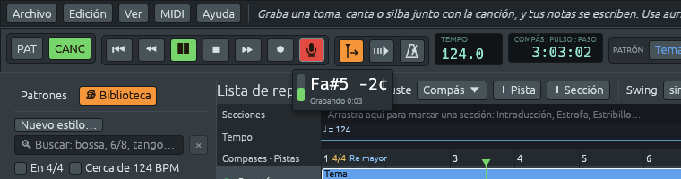

# Tomas: cantar o silbar una parte

Canta o silba mientras suena la canción, y Ferrous Lineup puede escribir
en ella la melodía, la línea de bajo, la batería y los acordes que oye.
Elige cualquier combinación en **Tu toma**. La melodía está seleccionada
de forma predeterminada; las demás opciones no y se recuerdan. Lo que
cantaste o tocaste también se conserva como una **toma** en una pista
propia, para que puedas oírlo junto a la canción.

Una grabación hecha antes, de una voz o de una banda, funciona igual:
ver [Añadir una grabación hecha antes](#añadir-una-grabación-hecha-antes).

## Qué necesitas

- **Un micrófono.** Ferrous Lineup graba desde la entrada
  predeterminada del sistema: la que está elegida en los ajustes de
  sonido del sistema. El micrófono de una computadora portátil sirve.
- **Auriculares**, para que el micrófono te oiga solo a ti y no a la
  canción. Con altavoces, la banda también se oiría como notas.
- En **macOS**, la primera toma pide permiso para usar el micrófono.
  Di que sí; si dijiste que no, actívalo en Ajustes del Sistema >
  Privacidad y seguridad > Micrófono.

## Grabar una toma

1. Pon el cursor de reproducción un compás o dos antes de donde
   quieres cantar, en modo canción. (En modo patrón, la toma se canta
   sobre el patrón mientras se repite.)
2. Haz clic en el botón del **micrófono**, junto a ● en la barra de
   herramientas. La canción empieza a sonar, si no estaba sonando.
3. Canta o silba. Debajo del botón, un pequeño panel muestra con qué
   fuerza te oye el micrófono (verde, rojo si es demasiado fuerte), la
   nota que oye con cuánto te alejas de ella en cents (la centésima
   parte de un semitono), y cuánto dura la toma.
4. Haz clic otra vez en el botón del micrófono para detenerla. La
   canción sigue sonando.

Puedes cantar un pasaje más de una vez mientras grabas, con un bucle o
una sección que se repite: **cuenta la última vez**. Cántalo otra vez
hasta que salga bien.

## Adónde van las notas: Tu toma

Cuando la toma se detiene, la aplicación la escucha un momento, y
luego la ventana **Tu toma** muestra lo que oyó: cuántas notas, en qué
compases, y las primeras por su nombre. Si cantaste un poco alto o
bajo todo el tiempo, lo dice; las notas se escriben como las quisiste
cantar.

La cuadrícula, el destino y las opciones de altura de abajo se aplican a
**Melodía**. Las demás capas van a los canales de batería, a un canal de
bajo y a la hoja de acordes.

| Opción | Qué hace |
|---|---|
| **Las notas van a** | Primero se elige el canal que toca la melodía, la **Melodía**. Las notas reemplazan lo que ese canal tocaba donde cantaste, y solo ahí. También puedes elegir cualquier otro canal, **Un canal nuevo** (llamado «Notas cantadas», tocado por una flauta), o **A ninguna parte: conservar solo la grabación**. |
| **En la cuadrícula de** | Adónde se ajustan los comienzos y los finales de las notas: **semicorcheas**, **corcheas** o **negras**. Una cuadrícula más gruesa ordena un ritmo suelto. |
| **Alturas** | Como qué notas se escriben las alturas que cantaste. **Como se cantó**: el semitono más cercano. **En la tonalidad**: la nota de la tonalidad más cercana, para que una nota desafinada no salga como una nota equivocada. **Tonalidad y acordes**: la nota de la tonalidad más cercana tal como la colorea el acorde de la hoja de acordes en ese lugar; sobre D7 en do mayor se escribe fa♯ en lugar de fa. Los compases sin acorde se quedan en la tonalidad. Las notas de arriba cambian a medida que eliges. |
| **La grabación** | **Conservarla** guarda lo que cantaste, en una pista: **Una pista nueva** abajo, o una que elijas. Desmárcalo para quedarte solo con las notas. |

En **Extraer**, elige **Melodía**, **Batería**, **Línea de bajo** y/o
**Acordes**. La batería reconoce bombo, caja y platillos hi-hat; la
extracción del bajo sigue una sola línea grave y, en una mezcla densa,
puede confundir otro instrumento grave con el bajo. Los acordes solo
están disponibles en modo canción. Estos extractores analizan la
grabación como una mezcla; no separan los instrumentos en pistas
aisladas.

**Escribirla** lo hace, como un solo paso: **Ctrl+Z** quita toda la
toma otra vez. **Descartarla**, o cerrar la ventana, no conserva nada.

La barra de estado dice qué cambió, como en *Se escribieron 19 notas en
Melodía. La grabación suena como Toma 1.* Cuando el patrón sobre el que
cantaste suena más de una vez en la canción, también lo dice: tus notas
suenan cada vez que suena el patrón, así que una melodía corregida una
vez queda corregida en todos los lugares donde se repite.

## Cómo se oye la melodía

- **Altura**: cada nota se redondea al semitono más cercano, después de
  quitar cuánto más alta o más baja se cantó toda la toma. Una nota
  cantada justo entre dos va a la que está en la tonalidad. **Alturas**,
  en la ventana Tu toma, puede llevar las notas a la tonalidad, o a la
  tonalidad y los acordes.
- **Ritmo**: dónde empieza y dónde termina cada nota, en la cuadrícula
  que elegiste. Una respiración o una consonante entre dos notas no se
  escribe como un silencio.
- **Intensidad**: con qué fuerza se toca cada nota. Una nota tan fuerte
  como la mayor parte de la toma suena como siempre; las notas más
  fuertes se tocan con más fuerza, las más suaves con menos.
- **Una nota a la vez**: la extracción de melodía sigue una sola voz.
  Un acorde o una voz sobre un acompañamiento fuerte puede confundirla.

Algunos consejos:

- Canta con una sílaba clara, como «da» o «la», y empieza cada nota con
  ella. Dos notas en la misma altura cantadas ligadas, sin una sílaba
  nueva, salen como una sola nota larga.
- Silbar funciona bien: su altura es muy clara.
- Canta en la octava que quieres. Las notas se escriben donde las
  cantaste; muévelas una octava en el [piano roll](piano-roll.md) si
  hace falta.

## La toma en su pista

La grabación conservada se dibuja en su pista como su forma de onda:
alta donde cantaste fuerte, plana donde hubo silencio. Suena con la
canción, desde donde empieces la reproducción, como cualquier parte: la
**luz** a la izquierda de su pista la silencia, y **S** la deja sonar
sola, para oír solo lo que cantaste (ver [Las
pistas](patterns-and-playlist.md#las-pistas)).

La grabación suena solo bajo los clips de su pista, como se dibuja su
forma de onda. Su clip se recorta como cualquier otro (ver [Colocar y
mover clips](patterns-and-playlist.md#colocar-y-mover-clips)): arrastra
hacia adentro su borde izquierdo para que la grabación empiece más
tarde, desde la mitad, o su borde derecho para que termine antes, y
arrastra el borde de nuevo hacia afuera para volver a oír esa parte. La
forma de onda queda donde estaba, así que el clip muestra la parte de
la grabación que sigue tocando. Una toma larga se corta en varios clips
seguidos; donde su pista no tiene clip, en un hueco que quede entre
ellos, la grabación calla, y sigue de nuevo bajo el siguiente.
**Transcribir otra vez…** sigue escuchando toda la grabación, también
las partes que sus clips ocultan.

Las notas que van a **Un canal nuevo**, o a un canal que no tiene nada
que tocar ahí, van a una pista propia justo debajo de la grabación, con
su nombre, como *Notas de Toma 1*. Silencia una de las dos pistas para
oír la grabación sin sus notas, o las notas sin la grabación.

Su sonido se guarda como un archivo WAV en una
carpeta junto a la canción, con su nombre, como *mi canción takes*
(para una canción todavía sin guardar, en la carpeta propia de Ferrous
Lineup). Deja esa carpeta junto a la canción: si las mueves o las
copias juntas, a otra carpeta o a otra computadora, la canción vuelve a
encontrar sus tomas (ver [Compartir una
canción](saving.md#compartir-una-canción)).

Una canción con una toma necesita esta versión de Ferrous Lineup, o
una más nueva, para abrirse.

## Transcribir otra vez una toma

Para escribir otra vez las notas de una toma con otras opciones, como
otra cuadrícula o **En la tonalidad**, haz clic derecho en su grabación
en la lista de reproducción y elige **Transcribir otra vez…**. La
aplicación la vuelve a escuchar, y **Tu toma** se abre con las notas
yendo adonde fueron antes. La fila **La grabación** dice que la
grabación se queda en su pista tal como está: no se guarda ni se añade
una segunda vez. **Escribirla** pone las notas nuevas en lugar de las
escritas antes, como un solo paso: **Ctrl+Z** devuelve las anteriores.

## Añadir una grabación hecha antes

Un archivo MP3, WAV, FLAC u Ogg puede ir sobre la canción como una
toma, y sus notas se oyen como en una que cantaste. Hay tres maneras:

- **➕ Grabación**, en la barra de la lista de reproducción, lo pone
  sobre la canción desde el cursor de reproducción (desde el compás 1
  en modo patrón, que pasa a modo canción).
- **Añadir una grabación…**, en el menú que aparece con un clic derecho
  en el nombre de una pista, lo pone en esa pista, desde el cursor de
  reproducción.
- **Suelta el archivo sobre una pista**: mientras lo arrastras sobre la
  lista de reproducción, se ilumina el lugar donde va a empezar, en el
  compás, el pulso o el paso que dice **Ajuste**, y empieza ahí, en esa
  pista. Soltado en la fila más tenue debajo de la última pista, va a
  una pista sin nada; soltado en cualquier otro lugar de la ventana,
  empieza en el cursor de reproducción.

La misma ventana **Tu toma** pregunta adónde van las notas.

- La grabación sigue de largo al tempo de la canción, así que coincide
  cuando se grabó a ese tempo, por ejemplo junto con la canción.
- Funciona mejor con una sola voz o un solo instrumento que toca una
  nota a la vez. En una banda entera, solo se oye la nota más fuerte de
  cada momento.
- Un WAV de diez segundos o menos soltado sobre la ventana es, en
  cambio, un sonido para un canal (ver [El rack de
  canales](channel-rack.md#tus-propios-sonidos)).
- Abrir un archivo de sonido con Ferrous Lineup, desde tu gestor de
  archivos o en la línea de comandos, empieza una canción nueva y
  vacía con la grabación desde su comienzo.

## Si las notas caen tarde o temprano

Tu tarjeta de sonido tiene retardos, en el camino de salida hacia tus
auriculares y en el de entrada desde el micrófono, que Ferrous Lineup
descuenta. Si tus notas igual caen un poco tarde o temprano en la
cuadrícula, ajusta **Ajustes > Audio > Micrófono > Retrasar las tomas
en**, en milisegundos: un número positivo mueve las tomas más tarde, uno
negativo más temprano. Para encontrar la cantidad justa, enciende el
metrónomo, canta «da» en cada pulso, y mira dónde caen las notas.
