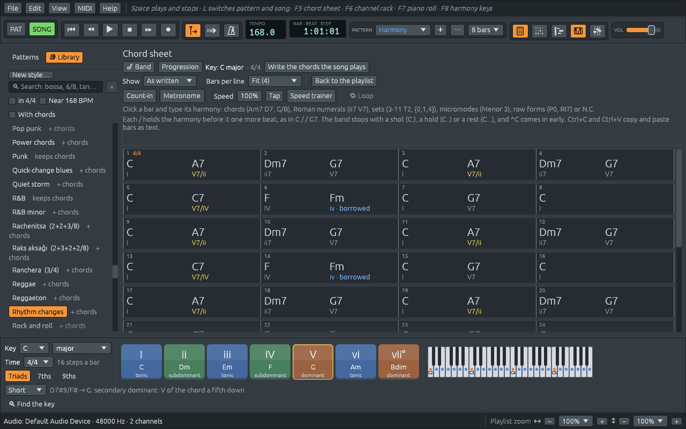

# The chord sheet

The chord sheet is the song's harmony, bar by bar, written the way a
lead sheet writes it. It is where you type a song for the band, and
where you read the chords of any song the app plays. Open it with
**F5**, the first of the window buttons in the toolbar (a page of chord
names), or **View > Chord sheet**. A song from **File > Demos** and a
new song from **File > New** open with the sheet in front.



## Reading the sheet

- Each bar shows its number in the corner, and the time signature
  where it changes.
- **Each section starts a new line**, under its name: "Verse",
  "Chorus". A section played three times is headed "Verse ×3". A double
  bar line marks where a section starts, and the final bar line, thin
  then thick, where the song ends.
- **Each chord sits where its beat falls.** "C A7" in a bar of four
  beats puts C at the start of the bar and A7 halfway along, on beat 3.
- **Under each chord is its Roman numeral** in the key: in C major, Fm
  is iv, and A7, which leads to Dm, is V7/ii. A chord with another note
  in the bass gets the figures musicians use for inversions: G7/B is
  V⁶₅, C/E is I⁶. Under a set or a micromode, its notes; when the key
  is a set or a micromode, its degree and how many notes it keeps of
  the bar before ("T1I · 2 common").
  [What chords do](chord-functions.md) explains what the numerals mean.
- **A bar with nothing in it goes on with the chord before**, written
  faintly so the bar does not look empty.
- **A key change** is written at the top right of the bar where it
  happens, such as "→ G major".

Point at a chord to have it explained: "A7: A dominant seventh, V7/ii
in C major. A secondary dominant: A7 is the dominant of Dm, the ii of C
major, as if Dm were a tonic. … Its notes: A C# E G." Hold the mouse button down on it to hear it, with its bass note
under it.

While the song plays, the bar playing is framed in white and the chord
sounding is the brightest name on the sheet. The sheet scrolls along
with the song while **Follow playhead** is on (the button with the
arrow in the toolbar).

## Typing chords

Click a bar to select it (it gets an orange frame), and type. The first
key opens a field over the bar.

| Key | What it does |
|---|---|
| **Enter** | takes what you typed and selects the next bar |
| **Tab** | takes it and goes straight on typing in the next bar |
| **Shift+Tab** | goes back a bar |
| **Escape** | leaves the bar as it was |
| **Enter**, **F2** or a double-click on a selected bar | opens it with what it holds, to change it |
| **Delete** | clears the selected bar |
| arrow keys | move from bar to bar, and up and down by lines |

So typing a song is: click bar 1, then `C`, Tab, `Am7`, Tab, `Dm7 G7`,
Tab, `C`, Enter.

If the computer keyboard is playing notes (**MIDI > Typing keyboard to
piano** is on), the letter keys play instead of typing: double-click
the bar or press Enter first.

### What a bar can hold

Several harmonies go in one bar, separated by spaces:

| Type | What it is | Examples |
|---|---|---|
| A chord | any chord symbol, with a bass note after a slash | `Am7`, `G/B`, `F#m7b5`, `C6/9` |
| Two chords at once | a polychord: the upper chord first, then `\|` | `Eb7\|Fb` |
| A Roman numeral | a chord of the key | `ii7 V7` in C major becomes Dm7 G7 |
| A pitch-class set | by its name, or its notes in braces | `3-11 T2`, `{D F A}`, `{0,1,4}` |
| A micromode | one of Kröpfl's twelve | `Menor 3`, `Menor 3 T4I` |
| A form of the key, by its degree | when the key is a set or a micromode | `T2`, `T5I` |
| A row form | a form of the song's twelve-tone row | `P0`, `I5`, `R3`, `RI7` |
| No chord | the band plays no harmony | `N.C.` |
| A held beat | the harmony before goes on one more beat | `/` |
| Nothing | the bar goes on with what was playing | an empty bar |
| The bar before again | plays the bar before once more: after `C G`, C G again | `%` |

[Chords and their names](chords.md) lists the ways a chord can be
written: `Cmaj7`, `CM7` and `CΔ` are all read, `Cm7` and `C-7` too. What
you type is written back in one way: a numeral becomes its chord ("V7"
in B♭ major is written F7), and "CM7" becomes Cmaj7. Sets, micromodes
and rows are explained in [Beyond keys](sets-rows-micromodes.md).

If something in a bar cannot be read, the field stays open and the
reason is written above the sheet in red, for example: *Bar 3: "Hm7" is
not a chord (Am7, G/B), a set (3-11 T2, {0,4,7}), a micromode (Menor 3),
a row form (P0, RI7) or N.C.* Nothing changes in the song until the
whole bar reads.

### Where the chords fall in a bar

The sheet follows the convention of lead sheets for several chords in
one bar:

| Typed in 4/4 | Played |
|---|---|
| `Am7` | Am7 for the whole bar |
| `Am7 D7` | Am7 on beat 1, D7 on beat 3: two beats each |
| `C F G` | C on 1, F on 3, G on 4 |
| `C Am Dm G7` | one on each beat |
| `C / / G7` | C on 1, held two more beats, G7 on 4 |
| `/ G7` | the chord before goes on for a beat, G7 on 2 |

In 3/4, two chords take two beats and one: "C G7" puts G7 on beat 3.
With a `/` anywhere in the bar, every word is one beat, so you can put
a chord on any beat you like.

## Writing what the song plays

A song opens with its chords on the sheet already. A demo writes the
chart it was made from; any other song, such as a MIDI file you opened
or a recording you imported, gets the chords the app hears in it.

**Write the chords the song plays**, at the top of the sheet, writes
them again from what the song plays now, in place of what the sheet
says. Use it after you change the notes in the piano roll. It writes
the bass player's note after the slash when that note is in the chord,
writes each section's first chord again at its start, as charts do, and
in a song whose key is a set or a row it writes sets or micromodes. One
Undo takes it all back. While a band plays from the sheet the button is
hidden, since the band's notes come from the sheet.

## Changing the bars

Right-click a bar for its menu:

- **Type in this bar**, **Clear this bar**, **Move the playhead here**;
- **Insert a bar before** and **Insert a bar after** add an empty bar,
  and everything after it moves along: notes, chords, sections, key,
  tempo and time markers. The new bar is empty, so the chord before
  goes on through it, as in a printed chart.
- **Delete this bar** takes the bar out, with its notes and chords, and
  everything after it moves back. The key, tempo and chord that were
  going on at the end of the deleted bar go on after it.
- **End the song here**: the band stops after this bar.
- **Band on …**: a break for the band on that chord (see [Shots, holds,
  rests and pushes](stops.md)).
- **Variation a**, **Variation b** and **Style** for the band, from that
  bar on (see [Song form and sections](song-form.md)).

To work on several bars at once, click one and **Shift+click** another,
or use **Shift** with the arrow keys; **Ctrl+A** selects every bar.
Clicking a section's name selects all of its bars. The bar numbers on
the playlist's ruler have the same insert and delete items.

## How it looks

At the top of the sheet:

- **Show** names the same harmony in other ways, without changing a
  note: **As the key**, which every song opens with (chords in a major
  or minor key or a mode, sets in a set or a row, micromodes in a
  micromode), **As written**, as **Chords**, as **Pitch-class sets** or
  as **Micromodes**. Another choice holds until you open another song.
  [Beyond keys](sets-rows-micromodes.md#one-harmony-four-names) tells
  what each says.
- **Bars per line**: **Fit the names** puts as many bars on a line as
  show every name, and the numeral under it, at its full size: 1, 2, 4,
  8, 12 or 16, so that lines start where four-bar phrases do. A name may
  sit just after its beat when the one before needs the room, and words
  after the numeral, such as "borrowed", are written where they fit
  (the numeral's colour and the name's hint say the same). The menu
  shows how many fit now, as **Fit (4)**. With the sheet in the main
  window, the zoom keys over it change the size of everything, so
  zooming out fits more bars. Or pick a number, and names that don't fit
  get smaller.
- **⛶ Fill the window** puts the sheet in the playlist's place in the
  main window, where a line holds more bars. **Back to the playlist**
  puts it back in its own window. The same switch is **View > Chord
  sheet in the main window**.

These choices are remembered for next time.

## Chord sheets as text

Charts are often passed around as text, in a message or a forum post.
Ferrous Lineup reads and writes them:

```text
Title: Autumn Song
Key: C major
Tempo: 120
Style: Bossa nova

[Verse ×2]
| C  | Am7 | Dm7 G7 | C |
| F  | %   | G7     | C |
```

- **File > Import chord sheet…** opens a `.txt` file like this one (or
  drop it on the window) as a new song, with the band playing it and
  the chord sheet open. If a line cannot be read, nothing is imported
  and the status bar says which line and why.
- **File > Export chord sheet…** writes the song's sheet the same way,
  with the bars lined up in columns.
- On the sheet, **Ctrl+C** copies the selected bars as text, and
  **Ctrl+V** pastes text from the selected bar on. Pasting brings only
  the chords; the song keeps its own key, tempo and style. A single line
  with no `|`, such as "Dm7 G7", goes into one bar.

Everything but the bars is optional:

| Line | Means |
|---|---|
| `Title: Autumn Song` | The song's name. A first line with nothing else on it is the title too. |
| `Key: G major` | The key: `G`, `Em`, `E minor`, `A Dorian`, `C harmonic minor`… |
| `Time: 3/4` | The time signature: `6/8`, `5/4`, `2+2+3/8`… |
| `Tempo: 132` | Beats per minute. |
| `Style: Bossa nova` | The band's style, by its name in the Library. |
| `[Verse]` | A section starts with the next bar; `[Chorus ×2]` plays it twice. |
| `\| C \| Am7 \| Dm7 G7 \|` | Bars, as many on a line as you like. |
| `# a note` | A note for people, skipped. |

In a bar goes exactly what you would type in a bar of the sheet: `%`
plays the bar before again, and an empty bar `| |` goes on with the
chord that was playing; `||`, `|:` and `:|` are read as plain bar
lines. A `Key:` or `Time:` line between bars changes
the key or the time from the next bar on.

Roman numerals are read in the chart's key, so this chart:

```text
Key: F major
| I | vi | ii7 V7 | I |
```

is F, Dm, Gm7 C7, F, and the same text with `Key: D major` is D, Bm,
Em7 A7, D: one progression in any key.
