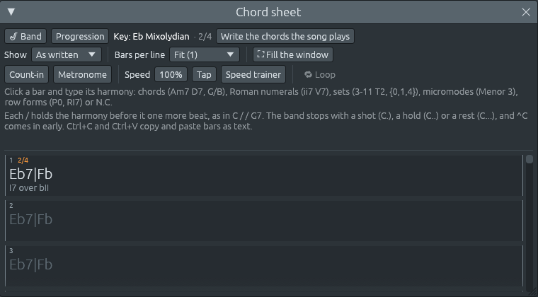

# Chords and their names

A **chord** is three or more notes sounding together. Most chords in
the music you know are built the same way: start on a note, the
**root**, and stack **thirds** on it, skipping every other note of the
scale. C, skip D, E, skip F, G: the chord of C.

This chapter goes through the chords, how their names are written, and
how Ferrous Lineup names what it hears.

## Triads

Three notes stacked in thirds make a **triad**: the root, the **third**
above it and the **fifth** above that. A third is either major (four
semitones) or minor (three), so there are four ways to stack two of
them:

| Triad | Thirds, from the bottom | On C | Written | Sounds |
|---|---|---|---|---|
| **Major** | major, then minor | C E G | C | bright, settled |
| **Minor** | minor, then major | C E♭ G | Cm | darker, still settled |
| **Diminished** | minor, then minor | C E♭ G♭ | Cdim, C° | tense, wants to move |
| **Augmented** | major, then major | C E G♯ | Caug, C+ | unsettled, floating |

Major and minor triads have a **perfect fifth** between root and fifth
(seven semitones). The diminished triad squeezes it to six, a tritone;
the augmented one stretches it to eight.

A key gives each of its notes a triad from its own notes. In a major
key they come out major on the 1st, 4th and 5th notes, minor on the
2nd, 3rd and 6th, and diminished on the 7th: C, Dm, Em, F, G, Am, Bdim
in C major. In harmonic minor, the raised seventh gives an augmented
triad on the 3rd note too:

To hear them, open the piano roll, pick **Draw > Chord in key
(triad)**, and click a note: it draws the triad the key gives that
note. The chord buttons above the grid play each one.

### Suspended chords

A **sus** chord leaves the third out and puts the note next to it in
its place: **Csus4** is C F G, **Csus2** is C D G. With no third it is
neither major nor minor, and the fourth of a sus4 pulls down to the
third: Csus4 to C is one of the oldest sounds of a cadence.

## Seventh chords

Stack one more third, and the chord gets a **seventh** above the root.
Jazz and most popular music use sevenths all the time:

| Chord | Notes on C | Written | Where it lives |
|---|---|---|---|
| **Major seventh** | C E G B | Cmaj7, CM7, CΔ | on the 1st and 4th notes of a major key: soft, dreamy |
| **Dominant seventh** | C E G B♭ | C7 | on the 5th note of a key (G7 in C): pulls home |
| **Minor seventh** | C E♭ G B♭ | Cm7, C-7 | on the 2nd, 3rd and 6th notes of a major key |
| **Half-diminished** | C E♭ G♭ B♭ | Cm7♭5, Cø | on the 7th note of a major key, the 2nd of a minor one |
| **Diminished seventh** | C E♭ G♭ B♭♭ (A) | Cdim7, C°7 | on the raised 7th note of a minor key |
| **Minor-major seventh** | C E♭ G B | Cm(maj7) | on the 1st note of harmonic minor |

The **dominant seventh** is called that because it is the chord on the
**dominant**, the fifth note of the key. Its third and seventh (B and F
in G7) are a tritone apart and want to move by a semitone each, to C
and E: that pull is why G7 leads to C. [What chords do](chord-functions.md)
explains it.

Two **sixth** chords add a sixth instead of a seventh: **C6** (C E G
A) and **Cm6** (C E♭ G A).

## Ninths, elevenths and thirteenths

Stacking further thirds gives the **ninth** (the second, an octave up),
the **eleventh** (the fourth) and the **thirteenth** (the sixth):

| Written | Notes on C | |
|---|---|---|
| **C9** | C E G B♭ D | a dominant seventh with a ninth |
| **Cmaj9**, **Cm9** | C E G B D, C E♭ G B♭ D | the major and minor sevenths with a ninth |
| **Cadd9** | C E G D | a triad with a ninth, but no seventh |
| **C6/9** | C E G A D | a sixth with a ninth: a bright ending in jazz |
| **C7♭9**, **C7♯9** | C E G B♭ D♭, C E G B♭ D♯ | altered dominants, sharper still |
| **C11**, **Cm11** | C E G B♭ D F, C E♭ G B♭ D F | with an eleventh |
| **C13**, **Cmaj13** | C E G B♭ D A, C E G B D A | with a thirteenth |

Players rarely play all of these notes: they leave out the fifth, and
in a thirteenth chord the eleventh, which clashes with the third (the
app's C13 has no eleventh either).

## Writing chord names

A chord name is the root and a few letters for its kind. Musicians
write the same chord in several ways, and Ferrous Lineup reads them
all; it writes each back in one way:

| Kind | Ferrous Lineup writes | Also reads |
|---|---|---|
| major | C | Cmaj, CM |
| minor | Cm | Cmin, Cmi, C- |
| diminished | Cdim | C°, Co |
| augmented | Caug | C+ |
| suspended | Csus4, Csus2 | Csus |
| major seventh | Cmaj7 | CM7, Cma7, CΔ, CΔ7 |
| minor seventh | Cm7 | Cmin7, Cmi7, C-7 |
| half-diminished | Cm7b5 | Cø, Cø7, C-7b5 |
| diminished seventh | Cdim7 | C°7, Co7 |
| minor-major seventh | Cm(maj7) | CmM7, C-maj7, CmΔ7 |
| augmented seventh | C7#5 | C7+5, C+7, Caug7 |
| six-nine | C6/9 | C69 |

Sharps and flats in a name are typed with `#` and `b`: F#m7, Bb13. A
name is case-sensitive where it matters: **CM7** is a major seventh,
**Cm7** a minor seventh.

## Slash chords and inversions

A chord's notes can be stacked in any order. The note at the bottom,
the **bass**, changes how it sounds:

- with the root at the bottom, the chord is in **root position**: C E G;
- with the third at the bottom, it is in **first inversion**: E G C;
- with the fifth at the bottom, **second inversion**: G C E;
- a seventh chord has a **third inversion**, with the seventh at the
  bottom.

A chord name shows the bass after a slash: **C/E** is C major with E in
the bass, and **G7/F** is G7 in third inversion. When the note after
the slash is not in the chord, as in **F/G**, it is a chord over a bass
note, a sound of its own (F/G is a softer way to play G11).

The Roman numerals under the chords show inversions as classical
harmony does, with the numbers of figured bass: **I⁶** for a first
inversion, **I⁶₄** for a second, and **V⁶₅**, **V⁴₃** and **V⁴₂** for
the inversions of a seventh chord.

In the piano roll, the list next to **Draw** picks the inversion of the
chords you draw (**Root position**, **1st inversion** and so on), and
**Tools > Invert chords up** or **down** turns the chords you already
have. Inversions make a smoother **bass line**: C, G/B, Am, G steps down
the scale instead of jumping.

## Two chords at once

An orchestra can play two chords at once, one over the other: a
**polychord**. Ferrous Lineup writes it with the upper chord first and
a bar between them. The chord that opens Stravinsky's *Augurs of
Spring*, which the strings hammer for pages, is **E♭7|F♭**: E♭7 above,
F♭ major below.

Type a polychord on the chord sheet the same way: `Eb7|Fb`.

## How the app hears chords

The piano roll names chords in two rows over the grid: the chord the
channel plays, and under it, on **All**, the chord all the channels
make together. The chord sheet, the harmony keys and **Write the chords
the song plays** name them the same way.

The app listens as a musician does, over a stretch of music rather than
note by note:

- an **arpeggio**, a chord played one note at a time, is heard as its
  chord;
- a **tune** counts for less than the chords under it, so a melody note
  passing over C doesn't turn it into Cadd9;
- a **bass** note between two chords counts as a passing note, so a
  walking bass doesn't change the chord on every beat;
- where no chord name fits, as in much music of the 20th century, the
  notes are named as a **pitch-class set** instead (see [Beyond keys:
  sets, rows and micromodes](sets-rows-micromodes.md)).

Pointing at a step tells you more, as in "Am: A minor, chord vi of C
major": the chord, its full name, and what it does in the key.
