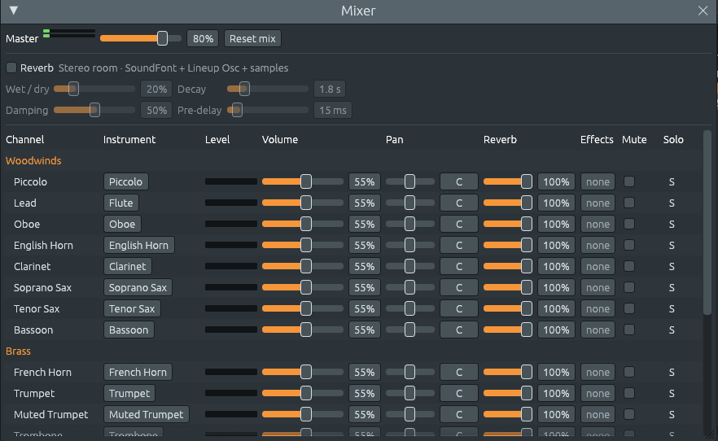

# The concert hall

**Songs > Classical and film** holds music from Bach to Stravinsky.
Some demos are a whole piece or a whole movement, others its opening or
its best-known tune. In the orchestral demos each instrument of the
score plays on its own channel, with its own sound, so you can follow
one part, mute it, or open it in the piano roll. The notes about each
demo say what was left out, or moved to another octave, when a piece
had to be shortened.

## Baroque

- *Canon in D*, by Johann Pachelbel: three violins play the same line,
  each two bars behind the last, over a bass of eight notes that repeats
  from start to end, a **ground bass**.
- *Air on the G String*, by Bach: long held notes in the first violin,
  each breaking into quick figures, over a bass in steady octave leaps
  that walks down the D major scale.
- *Prelude in C*, by Bach, from *The Well-Tempered Clavier*, played as
  a hip hop beat in **Hip hop and lo-fi**: no tune at all, one chord to
  a bar, broken into the same rising figure, and each chord changing as
  few notes as it can. From bar 5 the chords lead to
  G major, the dominant, which bar 11 reaches with D7 to G: a
  **modulation**.
- *Hallelujah Chorus*, from Handel's *Messiah*.

## The piano

- *Für Elise*, by Beethoven, the whole rondo: the theme rocks between E
  and D♯, the leading tone of A minor; the stormy second episode reaches
  B♭ major, the **Neapolitan** chord of A minor (see [Chords from
  outside the key](outside-the-key.md#the-neapolitan-sixth)).
- *Moonlight Sonata*, the opening of the Adagio, in C♯ minor: D major,
  the Neapolitan chord again, comes in the third bar.
- *Funeral March*, from Chopin's second sonata: one note, again and
  again, over a bass rocking between two bare fifths, with no third.

## The orchestra

| Demo | Listen for |
|---|---|
| *The Blue Danube*, Johann Strauss II | the waltz climbs the D major chord, then the same shape over the A7 chord, the dominant |
| *In the Hall of the Mountain King*, Grieg | the trolls creeping up the B minor scale over a bass on B, faster and faster: watch the tempo strip of the playlist |
| *Danse macabre*, Saint-Saëns | Death tuning his fiddle to a tritone, A against E♭ |
| *New World Largo*, Dvořák | the cor anglais tune, all major pentatonic, like a spiritual |
| *Dies irae*, from Mozart's *Requiem* | D minor in bare octaves; then new keys, each reached through a diminished seventh chord |
| *Jupiter Hymn*, Holst | every line starts on IV, not I |
| *Himno Nacional Argentino* | a verse that turns to B♭ minor and reaches F through diminished sevenths and a German sixth |

## Ravel's Boléro

*Boléro* (1928) is one long crescendo, a quarter of an hour of it. The
snare drum plays the same two bars from the first bar to the last,
while two tunes pass from instrument to instrument, each time a little
louder and fuller. The demo plays the whole piece with the instruments
of Ravel's score, which the mixer sets out in sections, as a score
does:

- The first tune stays in C major. The second is in C **Mixolydian**,
  C major with a B♭, and borrows D♭, A♭ and E♭ from the Phrygian mode
  on C.
- Listen for Ravel's mixed colours: a horn plays the tune with the
  celesta and two piccolos above it, on the notes of the horn's own
  overtones, so that they blend like the stops of an organ.
- In the last statement the music leaves C for the first time: eight
  bars in E major, a jolt, then back to C and the final crash.

## Debussy and Stravinsky

Early in the 20th century, composers left the major and minor keys
behind, and the chord sheet's other views come into their own (see
[Beyond keys](sets-rows-micromodes.md#one-harmony-four-names)).

- *La Mer*, by Debussy, the opening of *From Dawn to Noon on the Sea*:
  no chords in the usual sense, only a held B in the bass and, above it,
  notes of a pentatonic scale, B, C♯, F♯ and G♯. The chord sheet hears
  G♯m7 over B in B, F♯ and G♯, and its **Pitch-class sets** view calls
  them 3-7.
- *The Rite of Spring*, by Stravinsky. In *The Augurs of Spring* the
  strings hammer a **polychord**, E♭7 over F♭ major, written **Eb7|Fb**
  (see [Chords and their names](chords.md#two-chords-at-once)), while
  eight horns accent it where no beat leads the ear to expect it. In
  the *Ritual of Abduction* the meter changes all the time, 9/8, 6/8,
  7/8, 3/4, 2/4, and most notes come from the **octatonic scale**, half
  step and whole step in turn.
- *Petrushka*, by Stravinsky, in five demos from the four tableaux of
  the ballet: Russian folk tunes in the modes over drones, and Petrushka's
  own chord, C major and F♯ major at once, two triads a tritone apart
  that share no note.

Mussorgsky's *Promenade*, from *Pictures at an Exhibition*, and the
second movement of Tchaikovsky's *Pathétique Symphony*, a waltz in
five, are in [Odd meters and the Balkans](odd-meters-and-balkans.md).
