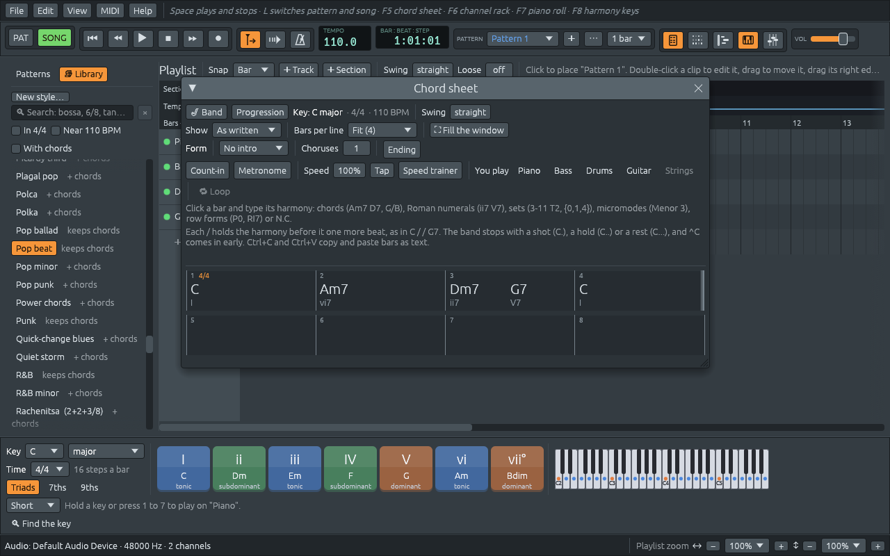

# Your first song

This chapter goes from an empty window to a song with a band playing it,
in a few minutes. Each step has a chapter of its own later on; this is
the short way through.

## 1. A new chord sheet

Choose **File > New** (**Ctrl+N**). The chord sheet opens on an empty
song in C major, 4/4, at 110 beats per minute, and a band is ready to
play it: a piano, a bass, drums and a guitar, in the **Pop beat** style,
which the Library on the left shows lit.

## 2. Type the chords

Click bar 1 and type, pressing **Tab** after each bar:

```text
C   Tab   Am7   Tab   Dm7 G7   Tab   C   Enter
```

Each chord appears where it falls, with its Roman numeral under it: C is
I, Am7 is vi7, Dm7 and G7 share bar 3 as ii7 and V7. As soon as a bar
holds a chord, the band writes its parts on the playlist, one track for
each player.



[The chord sheet](chord-sheet.md) has everything a bar can hold: any
chord symbol, Roman numerals, pitch-class sets, and the marks that make
the band stop or push.

## 3. Play

Press **Space**, or ▶ in the toolbar. The band plays the four bars, and
starts again from the top until you press **Space** once more. The bar
playing is framed in white on the sheet, and the harmony keys along the
bottom light the chord sounding.

If you have not answered it yet, Ferrous Lineup offers to download a
SoundFont, the recordings of real instruments that make the band sound
like one. Say **Download** (about 30 MB, once); [Sounds](sounds.md)
tells the whole story.

To go round only some of the bars, click one, **Shift+click** another,
and press **Loop** in the sheet's practice row.

## 4. Pick a style

The band's style is how it plays: the rhythm of the drums, what the
piano and the bass do with each chord. To try another one:

1. Click in the **Search** box at the top of the Library and type
   `bossa`.
2. Click **Bossa nova**. A small window asks what to take from it: its
   **playing patterns**, its **instruments**, its **time signature**,
   its **swing**, and, for a style marked **+ chords**, its chord
   progression. What is ticked when it opens keeps your chords and your
   tempo, so press **Apply**.
3. Press **Space**. The same four chords, now as a bossa nova.

Pick styles while the song plays, and the band carries on in each new
one.
**Ctrl+Z** goes back to the style before. [Styles and the
Library](styles.md) describes the Library and every option of that
window.

## 5. The tempo and the key

- **Tempo**: drag the **TEMPO** number in the toolbar up or down, or
  double-click it and type `140`.
- **Key**: pick another key in the **Key** menu at the bottom left, such
  as **D**. The whole song moves up a tone, chords and band together,
  and the chord sheet now reads D, Bm7, Em7 A7, D. Pick **C** again to
  come back.

## 6. Give it a form

A band rarely plays a tune just once. The **Form** row of the sheet
says how:

- **Intro**: 2, 4 or 8 bars the band plays before your first chord,
  with chords that lead into it. They are written on the sheet, so you
  can change them.
- **Choruses**: how many times the band plays the chords you wrote. Set
  it to 3.
- **Ending**: two more bars, where the band goes home to the tonic and
  holds it, with a crash of the cymbal.

Press **Home** to go back to the start and play it all: intro, three
times through, ending. [Song form and sections](song-form.md) adds
verses, choruses and variations.

## 7. Save it

Press **Ctrl+S** and give the song a name. Songs are saved as `.lineup`
files, which hold the chords, the band, every note and every setting;
**File > Open…** or **File > Open recent** brings them back. To share
the music with someone who doesn't have Ferrous Lineup, **File > Export
WAV…** writes it as a sound file; see [Exporting](exporting.md).

## Where to go from here

- To play along: [Practising with the band](practising.md) shows how
  to leave a player out and play the part yourself, slow the band down,
  or let it speed up a little every time round.
- To learn what the chords do: [Notes, intervals and
  scales](notes-and-scales.md) starts the short course in harmony.
- To hear something finished: **File > Demos** has more than five hundred songs
  and pieces, from folk songs to Stravinsky; see [Finding a
  demo](finding-a-demo.md).
