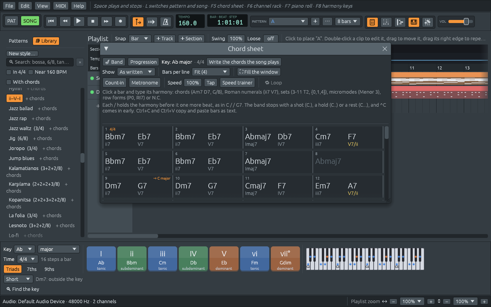

# What Ferrous Lineup does

Ferrous Lineup is a **backing band you can learn harmony with**. You
write the chords of a song bar by bar, pick a style, and a band plays
them: a piano, a bass and drums, and in many styles a guitar, strings,
an organ or a horn section too. Change the style, the key or the tempo,
and the band plays the song again the new way. While it plays, the app
names every chord you hear and says what it does in the key.

Ferrous Lineup is free software: you can use it, share it and change it
under the GNU General Public License, version 3 or later. It runs on
Linux, macOS and Windows.

## What you can do with it

- **Play a song with a band.** Type the chords on the
  [chord sheet](chord-sheet.md), choose one of the styles in the
  [Library](styles.md), and press Space. Give the song an intro and an
  ending, play the chorus twice, let the band dig in on the bridge, or
  stop on a [shot](stops.md) with the band.
- **Practise with it.** Leave a player out and [play the part
  yourself](locks.md), loop the bars you are learning, start slow and
  let the [speed trainer](practising.md) bring you up to tempo, and
  print a [lead sheet](lead-sheets.md) for a B♭, E♭ or F instrument.
- **Learn harmony.** The [harmony keys](harmony-keys.md) show the seven
  chords of the key, coloured by what they do. Every chord on the chord
  sheet has its Roman numeral under it, and chords from outside the key
  say where they come from. [Part 5](notes-and-scales.md) of this manual
  is a short course in harmony with the app as your instrument.
- **Edit every note.** What the band plays lands on tracks of its own,
  as ordinary [patterns](patterns-and-playlist.md). Open one in the
  [piano roll](piano-roll.md) to see how a bossa nova pianist spreads a
  chord, change it, or write your own parts from scratch. Or sing or
  whistle a part along with the song, and the app writes its notes
  for you, in a [take](takes.md).
- **Listen and study.** Hundreds of [demo songs](finding-a-demo.md),
  from folk songs and tangos to jazz standards and *Boléro*, open with
  their chords written out, and the [listening guide](finding-a-demo.md)
  says what to listen for.
- **Go beyond keys.** Write with [pitch-class sets, twelve-tone rows and
  Kröpfl's micromodes](sets-rows-micromodes.md), and see the same music
  named in each of them.
- **Share it.** [Export](exporting.md) the song as a WAV or MIDI file,
  as a video with the views playing along, or as a printable lead sheet.
  Connect a [MIDI keyboard](midi.md) to play along, or an external
  synth to play the band.

## How this manual is organized

1. **Getting started**: installing the app, the main window, your first
   song, and the instrument sounds.
2. **Songs with the band**: the chord sheet, the styles, song form,
   breaks, swing, the bigger band, the soloist and your own styles.
3. **Editing notes**: patterns and the playlist, the channel rack, the
   piano roll, the harmony keys, tempo and key changes, and the
   settings.
4. **Sound, MIDI and files**: the mixer, MIDI keyboards and synths,
   takes sung or whistled into the song, saving and opening, and
   exporting.
5. **Learning harmony**: notes and scales, keys and modes, chords and
   what they do, voice leading, rhythm and meter, sets and rows, and
   practising.
6. **The demos**: how to find them, and a guide to listening to them.

At the end are the keyboard shortcuts, troubleshooting, a music
glossary and an index.

## How the manual writes things

- Words in **bold** are written as the app shows them: a button, a menu
  item, a window.
- A path through the menus is written with `>`: **File > Demos >
  Songs** means the **File** menu, then **Demos**, then **Songs**.
- **Ctrl** is the Control key on Linux and Windows. On a Mac, use ⌘
  (Command) wherever this manual says Ctrl.
- Notes are named with letters (C, D, E, F♯). The app can name them in
  solfège instead (Do, Re, Mi, Fa♯): see [Settings](settings.md).

The app is also in Spanish, and so is this manual: the
[manual de usuario](https://naelolaiz.github.io/ferrous-lineup/es/manual/).
How the program is built, and why, is in a separate book, [Inside
Ferrous Lineup](https://naelolaiz.github.io/ferrous-lineup/), written
for people who want to read or change its code.
