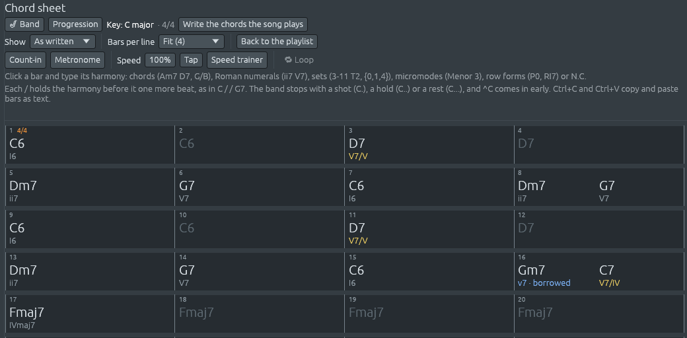

# Jazz, blues, gospel and pop

Jazz, the blues, gospel and the popular music that grew from them fill
several submenus of **File > Demos > Songs**: **Jazz**, **Blues**,
**Soul, funk and R&B**, **Pop**, **Rock** and more. This chapter
follows the harmony from ragtime to the big bands, and then looks at
the songs everyone knows.

## Ragtime

**Ragtime** is the piano music jazz grew out of, around 1900. The left
hand keeps a steady oom-pah, bass then chord, while the right hand
pushes against it, landing between the beats and holding on across
them: that is **syncopation** (see [Rhythm and
meter](rhythm-and-meter.md#strong-beats-weak-beats-and-syncopation)).
Rags come in strains, like marches, often A A B B A C C D D, with the
third strain, the **trio**, in the key of IV.

- *The Entertainer* and *Maple Leaf Rag*, by Scott Joplin. In the
  *Maple Leaf Rag*, listen for the F♭ chord, ♭VI, that darkens the
  third bar.
- *Golliwogg's Cakewalk*, by Claude Debussy (1908): a cakewalk with a
  blue note, a C♭ that keeps falling onto B♭. In the middle it quotes
  the opening of Wagner's *Tristan und Isolde*, marked "with great
  emotion", and the cakewalk's chords answer it each time.

To play your own chords this way, pick **Ragtime** in the Library's Jazz
group: the pianist's left hand alone, a bass note on each beat and the
chord after it. **Ragtime band** adds drums, a banjo and a tuba, and
**Stride piano** is the faster Harlem piano that grew out of ragtime.

## New Orleans and the twenties

- *When the Saints Go Marching In*: the brass band classic, the tuba on
  two beats to the bar.
- *Tiger Rag* (1917): four strains, and the key drops a fifth twice, B♭,
  E♭, A♭, each new key reached through a dominant seventh on the old
  tonic. The second strain stops dead for two-bar **breaks**, left for a
  soloist.
- *Charleston* (1923): a chain of dominants, D7, G7, C7, F7 (III7, VI7,
  II7, V7), each the V of the next, under a rhythm that gave its name
  to a comping pattern: a note on beat one and another just before beat
  three, held over.

## The standards and the big bands

Most standards are built on one move, **ii, V, I**: Dm7, G7, Cmaj7 in C
(see [What chords do](chord-functions.md#roots-that-fall-a-fifth)).
*Two-Five Walk*, written for Ferrous Lineup, spells it out in sixteen
bars. Then hear how the songwriters played with it:

- *Take the "A" Train*, by Billy Strayhorn (1939): the second chord is
  D7, the dominant of the dominant, where C major's own ii would be D
  minor, under a long G♯ in the tune, its raised eleventh. It settles to
  Dm7 and G7, a ii-V back to C. For the bridge, Gm7 and C7, a ii-V in F,
  lead to F major 7.
- *Tea for Two*, by Vincent Youmans (1924): one little figure,
  long-short, turned over a ii-V twice; then the same game a major third
  higher.
- *I Got Rhythm*, by George Gershwin (1930): its chords became **rhythm
  changes**, the progression jazz musicians wrote most new tunes on,
  after the blues. The A section turns I-vi-ii-V twice; the bridge is a
  chain of dominants falling by fifths.
- *In the Mood* (1939): a riff, a B♭ arpeggio, over a twelve-bar blues.
- *Sing, Sing, Sing* (1936): a minor-key riff tune on i and V7, E minor
  and B7.

The big-band demos have a horn section behind the saxophone's tune, a
brass section punching the chords in the Charleston rhythm (see [A
bigger band and the horns](bigger-band.md#the-horn-section)). For your
own chords, the Library's **Big band** style brings the whole band: a
walking bass, the guitar four to the bar, and the horns riffing together
over a jazz blues. **Big band ballad** holds the chords on the
saxophones.

## The blues

The **twelve-bar blues** is three lines of four bars: the first on I,
the second starting on IV and the third on V, each of those two coming
home to I. A singer sings a line, the same line again over the IV
chord, and an answer. The **blue notes**, such as the flat third and the
flat seventh, clash with the major chords under them, and the clash is
the sound of the blues.

- *Midnight Shuffle*, written for Ferrous Lineup: the twelve-bar blues
  as a shuffle, the A blues scale over major chords.
- *Trouble in Mind* (1924): an eight-bar blues in 12/8; the tune falls
  onto B♭, the blue third, over G7.
- *St. Louis Blues*, by W. C. Handy (1914): a blues in strains, like a
  rag, with a tango introduction and a strain in the habanera rhythm.
- *Hit the Road Jack* (1960): four chords walking down, C minor, B♭,
  A♭, G7, under a rhythm-and-blues shuffle.

## Spirituals and gospel

The African-American spirituals of the 19th century are under **Soul,
funk and R&B**, dressed in styles from gospel to funk. Many use the
**major pentatonic scale**, five notes with no semitones: *Swing Low,
Sweet Chariot* is all G A B D E, and so is the hymn *Amazing Grace*.
*Wade in the Water* sits on its minor home chord and rocks to iv; the
leading tone comes only at the cadences.

Two short demos written for Ferrous Lineup show the harmony of soul and
funk: *Sunday Seventh*, seventh chords with two secondary dominants, E7
to A minor and C7 to F; and *Dorian Strut*, two chords in E Dorian,
whose IV chord, A7, is major.

## Songs everyone knows

The **Pop**, **Rock**, **Electronic**, **Hip hop and lo-fi**, **Reggae
and ska** and **Country and folk** submenus hold folk songs, carols,
nursery rhymes and famous classical tunes, often dressed in a modern
style. They are short and well known, so they are good for hearing one
idea at a time:

| Demo | Listen for |
|---|---|
| *Frère Jacques* | a round: four voices sing the same tune two bars apart, and it works because every two bars fit the same chord |
| *Greensleeves* | a minor key that borrows a major V, E major, to lead home |
| *Scarborough Fair*, *Drunken Sailor* | the Dorian mode: minor, with a raised sixth (see [Keys and modes](keys-and-modes.md#the-modes)) |
| *Old Joe Clark* | the Mixolydian mode: major, with a flat seventh |
| *Mo Li Hua* | the major pentatonic, with no C and no F♯ anywhere, ending on the fifth |
| *Hava Nagila* | the Jewish *freygish* mode: the notes of A harmonic minor with E as home |
| *Beethoven's Fifth* | four notes, short-short-short-long, as a hard-rock riff |
| *Prelude in C*, by Bach | one chord a bar, each changing as few notes as it can, as a hip hop beat |
| *Toccata in D minor* | a diminished seventh chord, then a Picardy third, as techno |
| *The Big Bang Theory theme* | IVadd9, V, I, vi7 going round, and a jump in tempo after four bars |
| *Desarma y sangra*, by Charly García | a ballad in E♭ that borrows D♭, ♭VII, from E♭ minor |

The jazz demos in odd meters, *Take Five* and the *Mission: Impossible*
theme, are in [Odd meters and the Balkans](odd-meters-and-balkans.md).
