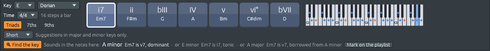

# Keys and modes

A **key** is a home note and the scale around it. C major is the major
scale on C: its notes are C D E F G A B, and C is home, the note the
music comes back to and rests on. Most songs stay in one key, or move
to another for a while and come back.

## The key of a song

A song in Ferrous Lineup has a key, shown at the left of the harmony
keys along the bottom of the window and at the top of the piano roll.
The key is what the harmony keys, the Roman numerals on the chord
sheet, the hints and the band all read the music in.

Picking another key in the **Key** menus **moves the song**, the way a
band plays the same song in another key when you ask it to:

- **A new tonic moves every note by the same distance.** From C major
  to D major, the chords, the bass and the tune all go up a tone. The
  song moves the shorter way: C to G is five semitones down, not seven
  up, so it stays about where it was on the keyboard.
- **A new kind of scale moves each note to the same step of the new
  scale.** From C major to C minor, the third, sixth and seventh notes
  go down a semitone (E, A and B become E♭, A♭ and B♭), and C, D, F and
  G stay.
- **The drums stay as they are**, and **Ctrl+Z** puts everything back
  in one step.

Try it: open **File > Demos > Songs**, find *Frère Jacques*, play it,
and pick **D** in the key menu, then **minor**.

## Major and minor keys

Every major key has a **relative minor**, the minor key that uses the
same notes and starts on the sixth note: A minor has the notes of C
major, E minor those of G major. They share their **key signature**, the
sharps or flats written at the start of each line of a score. You tell
them apart by where the music comes home: on C or on A.

Every major key also has a **parallel minor** on the same tonic: C
major and C minor. Songs often borrow chords from the parallel key; see
[Chords from outside the key](outside-the-key.md).

A minor key has three forms, and Ferrous Lineup counts all three as one
key (see [What chords do](chord-functions.md)):

- **natural minor**: A B C D E F G, the notes of the relative major;
- **harmonic minor**: the seventh note raised (G♯ in A minor), so it
  leads up to the tonic. It makes the dominant chord major (E, or E7),
  which pulls home much harder than Em;
- **melodic minor**: the sixth and seventh raised going up (F♯ and G♯),
  for a smooth line.

## Keys with two names

On the piano, F♯ and G♭ are the same black key. So **F♯ major**, six
sharps, and **G♭ major**, six flats, are the same seven keys of the
piano written two ways. A composer picks the name that fits the music
around it: Debussy writes the middle of *Golliwogg's Cakewalk*, a piece
in E♭ major, in G♭ major, to stay in flats.

Three keys of the piano have two names in major, and three in minor:

| Usual name | Other name |
|---|---|
| B major (5 sharps) | C♭ major (7 flats) |
| F♯ major (6 sharps) | G♭ major (6 flats) |
| D♭ major (5 flats) | C♯ major (7 sharps) |
| G♯ minor (5 sharps) | A♭ minor (7 flats) |
| D♯ minor (6 sharps) | E♭ minor (6 flats) |
| B♭ minor (5 flats) | A♯ minor (7 sharps) |

The key menus list both names, fifteen keys in all for major. Picking
the other name of the same key **renames it and moves no note**: the
chord sheet is written again, so F♯, D♯m7, B and C♯7 in F♯ major become
G♭, E♭m7, C♭ and D♭7 in G♭ major.

## The modes

The **modes** are the major scale started on another of its notes. The
white keys from D are D Dorian, from E E Phrygian, and so on. Each has
its own colour, because the half steps fall in other places:

| Mode | White keys from | Compared with major or minor | Heard in |
|---|---|---|---|
| Ionian | C | the major scale itself | |
| Dorian | D | minor with a raised sixth | *Scarborough Fair*, funk, modal jazz |
| Phrygian | E | minor with a lowered second | flamenco, metal |
| Lydian | F | major with a raised fourth | film music, dreamy pop |
| Mixolydian | G | major with a lowered seventh | rock, blues, folk |
| Aeolian | A | the natural minor | |
| Locrian | B | minor with a lowered second and fifth | rare; its home chord is diminished |

The key menus offer the five modes besides major and minor. In a mode,
the chord sheet and the harmony keys give Roman numerals, but they do
not colour chords by function, since tonic, subdominant and dominant
belong to major and minor keys.

## Key changes in a song

A song can change key partway through: Mozart's *Turkish March* goes
from A minor to A major and to F♯ minor and back. Each change is a
**key marker** on the playlist:

- The bar numbers at the top of the playlist write the key at bar 1 and
  wherever it changes, in blue.
- Right-click a bar number and choose **Key from bar N** to change key
  there, picking a tonic and a scale, or **Remove this key change**.
  Bar 1 is the song's own key, which the Key menus change.
- While the song plays, the harmony keys follow the key at the playhead.
  When it is not the key the song starts in, *Now in A major* appears
  under the Key menus, and the seven chord keys are that key's chords.
- The chord sheet writes "→ G major" in the bar where the key changes.

Musicians call a real change of key, one the music settles in, a
**modulation**. A few bars that only lean on another key, such as a
chord with its own dominant before it, are a **tonicization**, and the
song stays in its key; see [Chords from outside the
key](outside-the-key.md).

## Finding the key (experimental)

**🔍 Find the key**, under the harmony keys, listens to the notes and
says which key they fit, bar by bar. It compares how often each note
sounds with how often it sounds in each key: in C major, C, E and G
sound most, then the other white keys, and the black keys hardly ever.

When the answer is clear, it shows one key. When it is not, the best key
is shown brightest and up to two others fainter after it. C major and A
minor have the same notes, so a tune that stays on the white keys may
fit both; modes are the hardest case, because they share their notes
with a major and a minor key. Each key shown says what the chord
playing is in that key: G7 is V7 in C major, ♭VII7 in A minor and I7 in
G major.

It also works while you play on a MIDI keyboard or the computer
keyboard, from the bars you have played so far. In song mode, **Mark on
the playlist** writes the key changes it heard as key markers, which is
how you give an imported MIDI file or recording the key changes it
really has. No note moves, and Undo takes them back.

It is right on most bars of the demo songs, but it often misses short
visits to another key, and it can mistake a key for its relative major
or minor.
