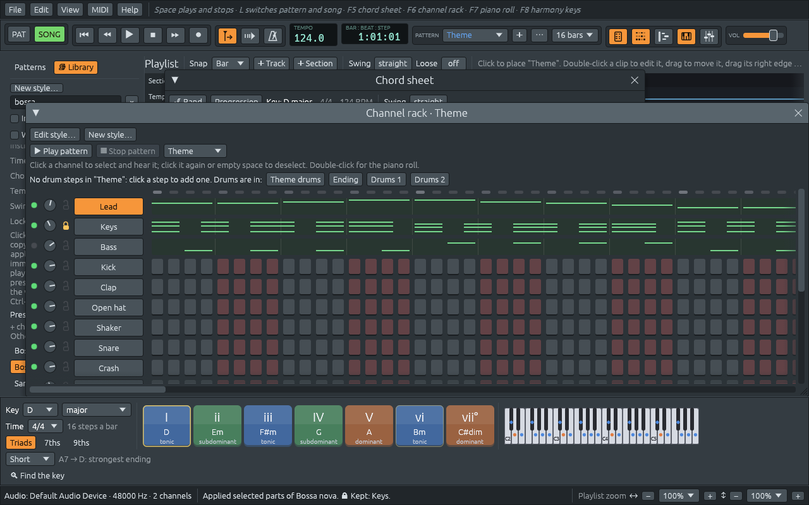

# Locking a track, and playing your part

The band writes its parts from the chord sheet, and writes them again
whenever the chords, the key, the bars or the style change. This chapter
is about the parts that should stay as they are: a part you played or
edited yourself, a track you want to keep while you try styles around
it, and a part you want to play live, with the band leaving it out.

## Locking a track

Say you played a piano part yourself, or picked a nylon-string guitar
for the chords, and now want to hear the song as a bossa nova. Lock the
track first. A locked track keeps its notes and its instrument, and
styles play the rest of the song around it.

1. Open a demo, such as *Ode to Joy*, and show the channel rack with
   **F6**.
2. Click the small **padlock** between **Keys**'s knob and its name. It
   closes and turns orange. Right-clicking a channel's name has **Lock**
   and **Unlock** too, and **Ctrl+Z** undoes either.
3. In the Library, apply another style, such as **Bossa nova**. The
   drums and the bass change; the Keys part is the one you had. The
   status bar ends with **🔒 Kept: Keys.**, and the Library's list of
   where each part came from has a **Locked** line.
4. Unlock Keys again. If the band was playing the piano, it takes the
   part back, and your Keys is muted so the two don't play over each
   other.

What a lock keeps:

- **A locked Keys** keeps the song's chords, and the new bass follows
  them.
- **A locked drum** keeps its notes while the other drums take the new
  rhythm.
- **When the band comes into a song whose own Keys or Bass is locked**,
  it leaves that part to it, and the chord sheet says so: "🔒 Keys is
  locked: the band leaves the piano to it."
- **A locked band player** keeps its notes and doesn't take new chords:
  "🔒 The bass is locked: it keeps its notes, not new chords."

What moves the whole song still moves a locked track with it: a new time
signature puts its notes in the new bars, and a key change moves them to
the new key. A lock protects a part from styles, not from the song
changing shape, and you can always edit a locked track by hand.

## A part you edit stays yours

Open a band part in the piano roll (double-click its clip in the
playlist) and change a note: from then on the band leaves that part as
you left it, even when the chords change. The chord sheet says "✎ You
edited the bass: the band keeps it as you left it.", with a **Play it
again** button that hands the part back to the band, written from the
sheet as it is now.

## You play

The chord sheet's practice row has **You play**, with a button for each
player the band has: **Piano**, **Bass**, **Drums**, **Guitar** and so
on. Click one, and the band leaves that part out so you can play it
yourself. For every player but the drums, your keyboard switches to that
player's sound, a MIDI keyboard or the computer's keyboard (**MIDI >
Typing keyboard to piano**): you take over the bass *with* the bass's
sound. Click the button again to have the band play it.

The band goes on writing the part while you play it, so when you hand it
back it plays what the sheet says now. A player the style has but that
doesn't play yet (strings that only come in for variation b, or any
player before there are chords) is greyed out.

[Practising](practising.md) has the rest of the practice row: the
count-in, the metronome, a slower speed, tap tempo and looping bars.
