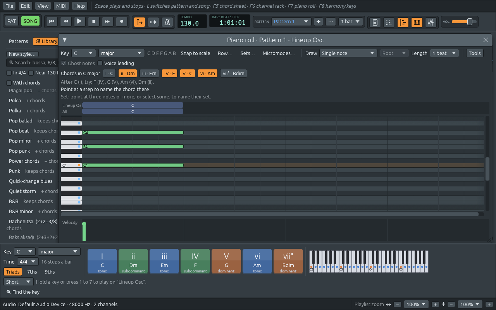

# Notes, intervals and scales

This part of the manual is a short course in harmony, with Ferrous
Lineup as the instrument. Each chapter explains an idea, then shows
where the app shows it or lets you hear it. Nothing here needs more
than the piano roll and the harmony keys; the [music
glossary](music-glossary.md) has every word in one place.

## Twelve notes

A piano has 88 keys, but only twelve different notes, which repeat in
every octave:

```text
 C  C♯ D  D♯ E  F  F♯ G  G♯ A  A♯ B  C
 0  1  2  3  4  5  6  7  8  9  10 11 12
```

The distance from one key to the next, white or black, is a
**semitone**. Twelve semitones make an **octave**: the same note again,
higher. A note's name without its octave (C, rather than "the C in the
middle of the piano") is its **pitch class**. Harmony mostly works with
pitch classes: a C major chord is C, E and G, in any octave and in any
order.

The piano roll writes the octave after the name: **C4** is middle C,
**C5** the C an octave above it, **A4** the A an orchestra tunes to.



## Sharps, flats and spelling

Each black key has two names. The key between C and D is **C♯** ("C
sharp", a semitone above C) and also **D♭** ("D flat", a semitone below
D). Which name is right depends on the music around it, and the rule is
simple: **a scale uses each of the seven letters once**.

- F major is F G A **B♭** C D E: it already has an A, so the fourth note
  is B♭, not A♯.
- F♯ major is F♯ G♯ A♯ B C♯ D♯ **E♯**: it already has an F (F♯), so the
  seventh note is E♯, which sounds like F but is written as a kind of E.
- D harmonic minor raises its seventh note, C, to **C♯**, even though
  its key signature has a flat.
- Some notes need two sharps or two flats: the seventh of G♯ harmonic
  minor is **F𝄪** (F double sharp, which sounds as G), and the seventh of
  a C diminished seventh chord is **B𝄫** (B double flat, which sounds as
  A).

Ferrous Lineup spells every note this way, in the piano roll, on the
chord sheet, on the harmony keys and in the lead sheet. A note from
outside the key is written the way musicians most often meet it,
counted from the key's first note: a flat second, third, sixth or
seventh, and a sharp fourth.

### Letters or solfège

English-speaking musicians name notes with letters, C D E F G A B.
Spanish, Italian and French musicians use **solfège**: Do Re Mi Fa Sol
La Si. Ferrous Lineup can show either: **Edit > Settings… > Harmony >
Note naming**. Chord symbols follow the same setting, so Am7 is written
Lam7 in solfège. Until you choose, the app follows its language:
letters in English, solfège in Spanish.

## Intervals

An **interval** is the distance between two notes. Musicians name it
with two words: a **number**, counted in letters, and a **quality**,
counted in semitones.

The number counts the letters from the lower note to the upper one,
both included: C up to E is a **third** (C, D, E), C up to G a
**fifth**. So C up to D♯ is a second (C, D), even though D♯ sounds
the same as E♭, and C up to E♭ is a third.

The quality says which kind of that number it is:

| Interval | Semitones | Example from C | Sound |
|---|---|---|---|
| minor second | 1 | C–D♭ | the tightest rub |
| major second | 2 | C–D | a step of a scale |
| minor third | 3 | C–E♭ | the third of a minor chord |
| major third | 4 | C–E | the third of a major chord |
| perfect fourth | 5 | C–F | open, like a bugle call |
| augmented fourth / diminished fifth | 6 | C–F♯ / C–G♭ | the **tritone**: restless, it wants to move |
| perfect fifth | 7 | C–G | the most open sound after the octave |
| minor sixth | 8 | C–A♭ | |
| major sixth | 9 | C–A | |
| minor seventh | 10 | C–B♭ | the seventh of G7 and Am7 |
| major seventh | 11 | C–B | the seventh of Cmaj7 |
| octave | 12 | C–C | the same note again |

The **ear training** window asks you to name intervals by ear, and
explains each answer with its notes (see [Practising](practising.md)).

## Scales

A **scale** is a choice of some of the twelve notes, starting from a
first note called the **tonic**. The major scale is the white keys from
C: C D E F G A B. In semitones above the tonic, that is 0 2 4 5 7 9 11:
steps of two semitones, except between the third and fourth notes and
between the seventh and the octave. The same pattern started on another
note gives the major scale of that key: from D, it is D E F♯ G A B C♯.

The scales the app knows:

| Scale | From C | What it sounds like |
|---|---|---|
| major | C D E F G A B | bright, settled: most songs you know |
| natural minor | C D E♭ F G A♭ B♭ | darker |
| harmonic minor | C D E♭ F G A♭ B | minor with a raised seventh, which pulls up to the tonic; the scale of tangos and flamenco |
| melodic minor | C D E♭ F G A B | minor with a raised sixth and seventh, smooth going up; jazz uses it both ways |
| major pentatonic | C D E G A | five notes, no half steps: folk songs all over the world |
| minor pentatonic | C E♭ F G B♭ | the rock and blues guitar scale |
| blues | C E♭ F F♯ G B♭ | the minor pentatonic with the "blue note" between the fourth and fifth |
| chromatic | all twelve | no key at all |

The **modes**, Dorian, Phrygian, Lydian, Mixolydian and Locrian, are
the major scale started on another of its notes. [Keys and
modes](keys-and-modes.md) explains them, and how a scale becomes a key.

## Seeing and hearing it in the app

- The **piano roll** has **Key** menus above its grid. Pick a key, and
  its notes get a dot on the keyboard at the left of the grid and are
  written next to the menus: C D E F G A B for C major. **Snap to scale** makes the notes you draw, move or play land on
  the key's notes. See [The piano roll](piano-roll.md).
- The **harmony keys** at the bottom of the window show the key's
  chords; [What chords do](chord-functions.md) explains them.
- Any note you click in the piano roll's keyboard plays, so you can play
  a scale with the mouse, or with the computer's keys (**MIDI > Typing
  keyboard to piano**: Z X C V B N M are C D E F G A B).
