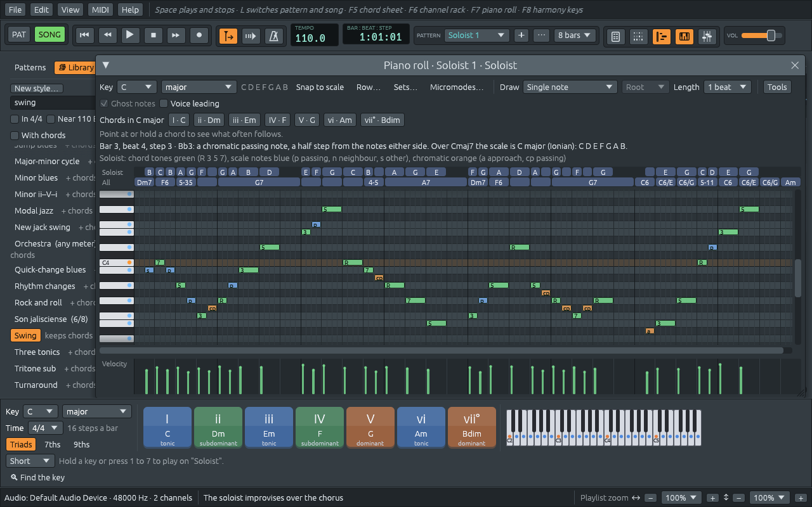

# The soloist (experimental)

The band accompanies: it plays the chords so that someone else can sing
the tune or improvise over them. The **soloist** is that someone else,
improvising a line over the chord sheet. It is experimental and off
until you switch it on, because a solo made by rules is a study, not a
performance. But it is a useful study: every note it plays has a reason,
and the piano roll shows the reason, so you can see how an improvised
line is built and try the same rules on your own instrument.

## Trying it

1. Press **Ctrl+N** and type these bars, one chord a bar:

   ```text
   Dm7   G7   Cmaj7   A7   Dm7   G7   C6   C6
   ```

2. In the Library, apply **Swing**.
3. Open **🎷 Band** and point at **Soloist (experimental)**: the hint
   says who the soloist is in this style, a tenor sax. Tick it. A
   **Soloist** track comes into the playlist, and a Soloist channel into
   the channel rack.
4. Press **Space**. Over the band, the sax plays two-bar phrases in
   swung eighth notes, with a breath between them.

**Another solo**, in the same menu, plays a different one; **Ctrl+Z**
brings the last one back. Untick the soloist and its track and channel
go away. Like every band part, the solo is played again when the sheet
changes, and if you edit its notes it stays as you left it until you
click **Play it again** or **Another solo**.

## Reading the solo

Double-click the soloist's clip to open its part in the piano roll. Its
notes are coloured by what they are:

- **green** for chord tones, marked with which one: **R** for the root,
  **3**, **5**, **7**, and **6** or **9** when the chord has them;
- **blue** for the other notes of the chord's scale: **p** a passing
  note, **n** a neighbour note, **s** any other;
- **orange** for chromatic notes, from outside the scale: **a** an
  approach, **cp** a chromatic passing note.

Point at a note, or play the song, and the line above the grid says
what it is, in a sentence, and which scale the chord plays.

In this solo, bar 3 ends with B3, the 7th of Cmaj7, on beat 4, then B♭3
on the "and", then A3 on beat 1 of bar 4, the root of A7: three notes a
half step apart, walking down into the next chord. The B♭ belongs to
neither chord, and that is fine: it falls on the weak half of the beat,
and it leads somewhere.



## How an improvised line is built

### Chord tones on the beat

Ask a jazz teacher how to start improvising over chords, and the first
rule is nearly always the same: **play chord tones on the strong beats,
and anything that connects them in between**. On the beat the ear checks
the melody against the harmony; between the beats it is moving and
forgives more. A line that lands on a chord tone on each beat "makes the
changes": you can hear the chords in it even without the band.

The most telling chord tones are the **3rd** and the **7th**, the
**guide tones**. They say whether a chord is major or minor and what
kind of seventh it has, and in a ii–V–I they move by half steps: the 7th
of Dm7 (C) falls to the 3rd of G7 (B), and the 7th of G7 (F) falls to
the 3rd of Cmaj7 (E).

The soloist picks, for each beat, the chord tone nearest to where it is
going. The line keeps its direction until it turns at the edge of the
instrument's range, or now and then on its own, and once in a while it
leaps past a chord tone to the next. So it moves mostly by small steps,
as tunes do, with a leap here and there.

### Chord scales

Between the chord tones go other notes, and which ones depends on the
chord: over Dm7, is the note between A and C a B or a B♭? Jazz teaching
answers with **chord scales**: each chord gets a seven-note scale that
holds it, and the notes between come from that scale. The scale comes
from the chord **in its key**. Over Dm7 in C major the B is natural,
because the music is in C: the scale is C major from D, called **D
Dorian**. The modes of the key are what its chords play:

| Chord in C major | Its scale | Notes |
|---|---|---|
| Cmaj7 (I) | C Ionian | C D E F G A B |
| Dm7 (ii) | D Dorian | D E F G A B C |
| Em7 (iii) | E Phrygian | E F G A B C D |
| Fmaj7 (IV) | F Lydian | F G A B C D E |
| G7 (V) | G Mixolydian | G A B C D E F |
| Am7 (vi) | A Aeolian | A B C D E F G |
| Bm7♭5 (vii) | B Locrian | B C D E F G A |

Seven names for the same seven notes. The names matter because they say
which note is the root and where the half steps fall from it: that is
what gives each chord its colour in the key (see [Keys and
modes](keys-and-modes.md)).

Other chords get their scale the way a player thinking in the key would
choose it:

1. **A chord of the key** plays the key's scale from its root, as in the
   table. In a minor key, a chord with the raised 7th (E7 in A minor,
   with G♯) plays the **harmonic minor** from its root: E F G♯ A B C D,
   called **E Phrygian dominant**.
2. **A chord borrowed from the minor key on the same note** plays that
   key's scale: Fm in C major comes from C minor, so it plays F Dorian.
3. **A secondary dominant** plays the scale of the chord it leads to: A7
   in C major is the V7 of Dm, so it plays D harmonic minor from A, A B♭
   C♯ D E F G. That is why a solo over A7 here has B♭ in it: it points to
   the D minor chord that follows.
4. **Anything else** plays the scale its kind usually gets: **Lydian**
   for a major chord from outside the key, **Lydian dominant** for a
   dominant seventh that leads nowhere, **half-whole diminished** for 7♭9
   and 7♯9, **whole-half diminished** for a diminished seventh, **whole
   tone** for an augmented chord, **Locrian** for a half-diminished one,
   **Dorian** for a minor chord.

And the chord's own notes always win: E9 in C major starts from A
harmonic minor, but its 9th is F♯, so F♯ replaces F in its scale.

[Chords from outside the key](outside-the-key.md) explains borrowed
chords and secondary dominants.

### Notes between the beats

Each kind of note between the chord tones has a name, and most are older
than jazz; harmony textbooks call them **non-chord tones**:

- a **passing note** fills the gap between two chord tones a third apart,
  by step, going the same way: C **D** E over C;
- a **neighbour note** steps away from a chord tone and comes back: E
  **F** E;
- a **chromatic passing note** fills a whole step with the half step in
  between: D **D♯** E;
- a **chromatic approach** comes into a chord tone from a half step
  below or above: **F♯** G. A phrase that starts just before the beat, a
  **pickup**, usually starts with one.

Chromatic passing notes on the "and" of the beat are part of the sound of
**bebop**, the jazz of Charlie Parker and Dizzy Gillespie: a half step
added between two scale notes keeps the chord tones on the beats when a
line runs in eighth notes.

### Phrases and breathing

Singers and horn players have to breathe, so lines come in **phrases**.
The soloist plays two-bar phrases, each starting on the beat, a beat
late or with a pickup, and leaves a beat or two empty at the end. The
rests are what make it sound like someone talking. Its eighth notes
swing as the band's do.

The soloist plays over the chorus, not the intro or the ending (see
[Song form and sections](song-form.md)), and keeps playing through shots
and rests (see [Shots, holds, rests and pushes](stops.md)): that is what
a band stops for. Over **N.C.** it is silent. Over a pitch-class set, a
micromode or a row form it plays the set's own notes on the beats, with
chromatic notes between them.

## Who plays

| Styles | Soloist | Range |
|---|---|---|
| Pop | alto sax | G3 to G5 |
| Rock | overdriven guitar | A3 to C6 |
| Blues | harmonica | C4 to C6 |
| Jazz | tenor sax | D3 to F5 |
| Soul, funk and R&B | alto sax | G3 to G5 |
| Hip hop and lo-fi | vibraphone | C4 to C6 |
| Electronic | saw lead | C4 to C6 |
| Latin | trumpet | B♭3 to A5 |
| Tango | tango accordion | G3 to C6 |
| Latin American folklore | pan flute | E4 to E6 |
| Flamenco | nylon-string guitar | E3 to A5 |
| Reggae and ska | trumpet | B♭3 to A5 |
| Country and folk | fiddle | G3 to E6 |
| Classical and film | flute | F4 to F6 |

The tango accordion is General MIDI's stand-in for the bandoneon. The
ranges are the comfortable middle of each instrument, where it sings.
Click the **Soloist** line in the Band menu to give it another sound.
