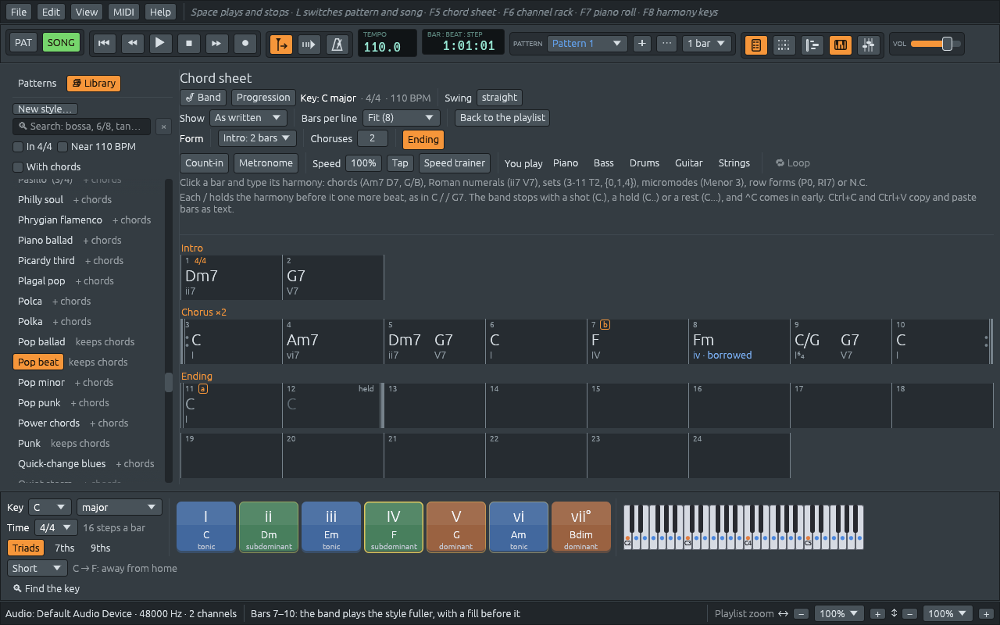

# Song form and sections

A band doesn't play a tune once and stop dead. It plays a few bars to
set the key and the groove (the **intro**), then the tune, then the tune
again, maybe several times, and then it **ends**: it lands on the home
chord and holds it. Along the way it plays some parts fuller than
others, and some songs change style halfway through. This chapter shows
how to give a song that shape.

## The Form row

The chord sheet's **Form** row shapes the whole performance:

- **Intro**: **No intro**, **2 bars**, **4 bars** or **8 bars**. The band
  puts that many bars in front of the song, with chords that lead into
  its first chord. They are written on the sheet under **Intro**, so you
  can read them, hear them and change them. Picking a length again
  writes them anew, and **No intro** takes them away. The rest of the
  song, melody and all, moves along to make room.
- **Choruses**: how many times the band plays the tune. The sheet shows
  it once, under **Chorus ×3**, between the repeat signs of printed
  music, and while it plays, the row shows which time round it is: "▶ 2
  of 3".
- **Ending**: two more bars after the last chorus. The band goes to the
  key's home chord, plays one bar of it in the style, then strikes it
  once and holds it through the last bar, with a crash of the cymbal.
  The two bars are shown in grey under **Ending**, the last one marked
  **held**.

### "Chorus" means once through

In a pop song, the chorus is the part that comes back after each
verse. Jazz musicians use the word another way: a **chorus** is once
through the whole tune, from the top of the chart to its last bar. A
soloist "takes two choruses"; the band plays the melody for one chorus,
then solos over several, then the melody again. The Form row uses the
word the jazz way: one chorus is every bar on the sheet after the intro.
The verses and choruses of a pop song are all inside it.

### The intro: a turnaround

A **turnaround** is the handful of chords at the end of a tune that
"turn it around" and lead back to the top. It makes the best intro,
because the tune's first chord then sounds like an arrival. Its engine
is the **dominant seventh**: in C major, G7 (G B D F) holds B, which
pulls up to C, and F, which pulls down to E. And D minor leads to G the
way G leads to C, because roots that fall by fifths (A, D, G, C) are the
strongest way chords move. See [What chords do](chord-functions.md).

| Intro | Into C major | Into A minor |
|---|---|---|
| 2 bars | Dm7, G7 (ii7 V7) | Bm7♭5, E7 (iiø7 V7) |
| 4 bars | C, Am7, Dm7, G7 (I vi7 ii7 V7) | Am, Fmaj7, Bm7♭5, E7 (i ♭VImaj7 iiø7 V7) |
| 8 bars | the same four chords, two bars each | the same, two bars each |

Into a minor chord, the ii is **half-diminished** (B D F A before Am),
the chord that really sits on the second note of A minor, and the V is
still a dominant seventh, E7, with G♯: the **leading tone**, a semitone
under A, which pulls to it much harder than the G of E minor would.

The numerals are counted from the chord the intro leads to. Most songs
start on their home chord, and then that is the same as the key. A song
in C that starts on F gets Gm7, C7: the ii and V of F, so the intro
still leads straight into the first chord. A song that starts on a
pitch-class set, a micromode or a diminished chord gets a **vamp**
instead: the band plays the first harmony from the first bar, setting up
the sound before the tune comes in.

### The ending: home, and held

The ending goes to the **tonic**, the chord the whole key leans towards.
If the song starts on its tonic, the ending plays that very chord: a
blues in C that starts on C7 ends on C7. Otherwise it plays the key's
plain chord, C in C major, Am in A minor. A song that changes key ends
in the key its last chorus ends in. Type a chord in an ending bar, and
it becomes part of the tune: the chorus grows to take it in, and the
ending moves on after it.

**End the song here**, in a bar's right-click menu, says where the band
stops: it ends with that bar, and the chords written after it are
cleared.

## Sections

Most songs have parts with names: an intro, verses, a chorus, a bridge.
Sections are marked on the **playlist**, in the strip above the bar
numbers:

- Drag along the **Sections** strip to mark one. It takes the first
  usual name not used yet (Intro, Verse, Chorus, Bridge, Outro…).
  **➕ Section** in the playlist's toolbar marks the next stretch of the
  song after the last one.
- Drag a section to move it, or its right edge to make it longer or
  shorter.
- Click a section for its menu: **Select clips in this section**, its
  **Name** (type one or click Intro, Verse, Chorus, Bridge, Outro,
  Pre-Chorus, Solo, Break or Drop), **Play it** a number of times (a
  section is drawn once and played that many times), **🔁 Loop this
  section**, **⧉ Duplicate** (a copy, with its clips, right after it),
  **⇶ Write out the repeats** (turns "×3" into three copies, so each time
  round can be changed on its own) and **🗑 Delete section** (the clips
  under it stay).

On the chord sheet, each section starts a new line under its name, as
"Verse ×2" when it plays twice. Click a section's name on the sheet to
select all its bars; right-click it for the menu below, for the whole
section.

### Parts the band hears

A song needs no sections for the band to follow its parts. When none
are marked, as in a MIDI file you open, the band listens for them in
the notes: where a run of bars comes back (a verse, a refrain), where
something new comes in, where the key or the time signature changes,
and where the tune rests at the end of a phrase. It counts the parts
from the tune's first full bar, in phrases of four and eight bars, as
most songs are built. A song that goes round one short loop all the way
through is one part.

The parts it hears show faint on the **Sections** strip, named by what
they sound like: **A**, **B** and so on, a part that comes back with the
same letter, and an **Intro** or a **Coda** at the ends. The first one
says **recognized**. Click any of them to keep them all as the song's
own sections, and then rename, move or resize them like any other
(**Ctrl+Z** takes it back). The band always plays by the sections you
mark, so where it heard a part in the wrong place, mark the right ones
yourself.

### How the band follows the parts

- Its patterns on the playlist start where each part starts.
- A chord held over the start of a part rings on, instead of being
  struck again.
- The drums end each part with a **fill**, and play a small one every
  eight bars inside parts of sixteen bars or more. The fill before the
  ending builds over two bars. The fills take turns, so a part that
  comes back doesn't end the same way as before.
- The part after a fill starts with a **crash** cymbal on its first
  beat, the drummer's signal that something new begins.
- A part of another kind than the one before, a B after an A or a
  refrain after a verse, moves the drummer from the hi-hat to the ride
  cymbal.
- A candombe **breaks** in the last bar before every new part: the
  band strikes the first beat and stops, and the repique plays the
  clave on the wood alone. A part that goes on into another of the same
  name, "Verse" into "Verse 2", plays on. When the tune leads into the
  new part from its first bar, a note tied over into the next bar as a
  sung pickup, the break lasts that bar too: everyone comes in together
  with the part's second bar.
- Folk rhythms fill on their own drums, such as the bombo's head and
  rim. The tango, orchestra and ranchera rhythms stand in for bands
  without a drummer, so they don't fill.

## Variations a and b

A band doesn't play every part of a song the same way. The verse is
lighter, so the words come through; in the chorus the drummer, the
bassist and the pianist all lift at once. Every style has two
**variations**: **a** is the style as it is, and **b** is the same style
played fuller.

Right-click a bar on the chord sheet and pick **Variation a** or
**Variation b**: the band plays that variation from that bar to the next
change, or to the end. To change only some bars, select them first
(click the first, **Shift+click** the last) and right-click one of them;
the bars after them keep what they played. A boxed letter marks each
change, on the sheet after the bar number and on the playlist's bar
numbers, like the rehearsal letters over the staff in band parts.

The drums announce each change: the bar before it gets a **fill**, and
the first beat of the new variation a **crash** cymbal, the signal real
drummers give.

What "fuller" means:

| Who | Variation a | Variation b |
|---|---|---|
| Drums | time on the closed **hi-hat** | time on the **ride** cymbal, unless the style already keeps time there |
| Drums in a pop or rock ballad | **cross-stick** on the snare's rim | the full snare |
| Bass in a jazz style played "in two" | root and fifth, a note every two beats | **walking**, a note on every beat |
| Bass in a blues shuffle | quarter notes | the **boogie** line, up and down the chord |
| Bass in pop, rock, soul or folk | the root held | the root on every beat |
| Piano in a pop or rock ballad | the chord, then its notes one by one | steady eighth notes |
| Strings in Pop beat and Motown, organ in Rock beat | out | in |
| Everyone | | a little louder |

The **hi-hat** is two cymbals that the drummer closes with a pedal: a
short, dry "tick". The **ride** is one large cymbal that rings, a
shimmering wash that fills more of the sound. A **cross-stick** is the
stick laid across the snare, its end clicking on the rim: soft and
woody. Moving from one to the other is the most common way a band lifts
a chorus. Where a style has no well-known busier way to play (a tango, a
bossa nova, a chorale), variation b only changes the drums and the
loudness.

## A style for some bars

Many songs change their feel partway through: a verse as a bossa nova
and a bridge in swing, a pop song that goes to half time for its bridge.
The same right-click menu has **Style: …**, which names the style
playing in that bar. Open it, then a genre, and pick a style: the band
plays it from that bar on, or only in the bars selected. The sheet
writes the style's name at the bar where it starts. **The song's style**,
at the top of the menu, goes back to the band's own.

A style for some bars changes **how** the band plays: the piano's
comping, the bass line, the drums, the guitar, strings and organ
patterns, and the swing. It keeps **who** plays: the same piano and the
same bass go from the bossa nova verse to the swing bridge, as in a real
band. The drums play the outgoing style's fill into the change and a
crash on its first beat.

The menu lists only the styles in the time signature of those bars. To
play a waltz in the middle of a song in 4/4, change the time signature
of those bars first (see [Tempo, time signatures and key
changes](tempo-meter-key.md)).
