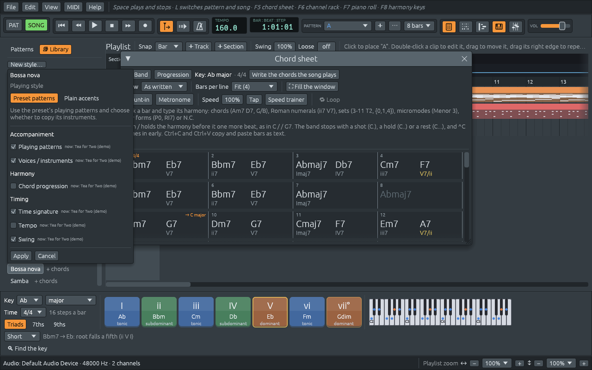

# Styles and the Library

A **style** is a way for the band to play: the drum groove, the rhythm
the piano strikes the chords in (musicians call that **comping**), what
the bass plays, and in many styles a guitar, strings or an organ. A
style also has a usual tempo and a swing, and many bring a well-known
chord progression of their kind of music.

The **Library**, the tab in front on the left of the main window, holds
about two hundred styles: pop, rock, blues, jazz, soul and funk, hip
hop, electronic, Latin, tango, Latin American folklore, flamenco,
reggae, country and folk, classical and film music, dances in odd
meters, and the styles you make yourself.

## Finding a style

- **Search**: type a name, a kind of music or a time signature, such as
  `bossa`, `tango` or `6/8`. **×** clears the search.
- **In 4/4** keeps only the styles in the song's time signature.
- **Near 110 BPM** keeps only the styles made for about the song's
  tempo, at most 1.15 times faster or slower.
- **With chords** keeps only the styles that bring a chord progression.

The tick boxes name the song's own time signature and tempo, and they
are remembered for next time. When nothing is left, the Library says
whether the search or the boxes did it.

Each style shows its time signature when it is not 4/4, as in **Waltz
(3/4)**, and either **+ chords**, when it brings a chord progression, or
**keeps chords**, when it only plays yours. Point at one to read what
it is: what to listen for, its progression in C as chords and as Roman
numerals, its time signature, tempo and length in bars, and its drums.

**Edit > Settings… > Library > Style list** shows the styles in
alphabetical order, as the app starts, or **grouped by genre**, with
your own styles in a group of their own.

Under the styles are three groups you can open:

- **Twelve-tone rows** and **Micromodes (Kröpfl)**: styles that play a
  twelve-tone row or a micromode instead of chords. The key becomes the
  row or the micromode, starting on the key note; see [Beyond keys:
  sets, rows and micromodes](sets-rows-micromodes.md).
- **Fills**: one bar of drums each: Snare roll, Tom fill, House build,
  Latin fill, Hip hop fill and Crash ending. While the song plays, a
  click puts the fill in the last bar of the song's drum patterns.

## Trying a style

Click a style. A small window asks what to take from it:

| Option | What it brings | Ticked at first |
|---|---|---|
| **Playing patterns** | the drums, and the way the piano, the bass and the other players play the chords | yes |
| **Voices / instruments** | the style's players and sounds: a nylon-string guitar for a bossa nova, strings for a tango | yes |
| **Chord progression** | the style's progression, in place of the song's chords; the melody stays | no |
| **Time signature** | the style's time signature: a waltz puts the song in 3/4 | yes |
| **Tempo** | the style's usual tempo | no |
| **Swing** | the style's swing (see [Swing and feel](swing.md)) | yes |

Next to each option, **now:** says what the song has and where it came
from, so you can see what the option would replace. Press **Apply**, or
**Cancel** to leave the song as it is. The window starts with the
choices you confirmed last, also the next time you start the app.

**Ctrl+click** a style (⌘-click on a Mac) applies it at once, with the
choices you made last. **Ctrl+Z** undoes a style, whichever way it was
applied.

What the first choices keep:

- **Your chords.** With **Chord progression** off, every style you try
  plays the chords already on the sheet. A style marked **keeps
  chords** has no progression, and its option is greyed out.
- **Your tempo.** With **Tempo** off, the song keeps its tempo. A style
  in another time signature changes the bars, and each bar lasts as
  long as before: a song at 112 beats per minute in 4/4 becomes 84 in
  3/4, the same pace counted in three, and goes back to 112 when a 4/4
  style comes back.

At the top of the window, **Playing style** has a second choice, **Plain
accents**: the style's drums, with the piano and the bass striking the
chords on the main beats of each bar, on your own instruments and over
your own chords. It is a plain way to hear a time signature without a
style's patterns.

## Where a style goes

- **With a band**, as in a song from **File > New**, a demo or an
  imported chord sheet, and whenever **SONG** is lit in the toolbar, the
  style becomes the band's way of playing **the whole song**. While the
  song plays, the band goes on in the new style from where it is, so you
  can click through styles and hear each one over your chords.
- **In pattern mode with no band** (**PAT** lit, as in a beat from
  **File > New beat**), a click writes the style into a pattern of its
  own, a **trial pattern**, and plays it there, leaving the song alone.
  The next style you click rewrites the same pattern, as long as you
  have not changed it.

Right-click a style for two more choices:

- **Play the whole song with this preset** applies it to the whole song,
  even in pattern mode.
- **Edit a copy in channel rack…** opens a copy in the style editor, to
  change it and save it as your own (see [Your own styles](style-editor.md)).

## Where each part came from

At the top of the Library, six lines say where each part of the song
comes from: **Patterns**, **Instruments**, **Time signature**,
**Chords**, **Tempo** and **Swing**. Each one names the demo or the
style it came from, says **edited, was …** once you change that part
yourself, or **yours** when nothing brought it in. A **Sections** line
lists the sections played in other styles (see [Song form and
sections](song-form.md)), and a **Locked** line the tracks that styles
leave alone (see [Locking a track, and playing your
part](locks.md)). Undo, redo and saving keep all of it.

## Progressions from the Library

The chord sheet's **Progression** button opens the same list, with the
same search and tick boxes, showing only the styles that bring a chord
progression. Pick one, and its chords are written on the sheet from the
selected bar on, in the song's key, without changing the band's style.
The selection moves past them, so the next progression you pick goes on
after it. It is a quick way to start a song: **Progression**, then
**Four chords**, gives you I V vi IV, the progression of a thousand pop
songs.

## The Library settings

**Edit > Settings… > Library** has:

- **Style list**: **Alphabetical list** or **Group by genre**.
- **Style application defaults**: the choices each style's window
  starts with, as buttons to switch on and off (**Patterns**,
  **Instruments**, **Chords**, **Meter**, **Tempo**, **Swing**), and
  **Preset patterns** or **Plain accents**. **Edit defaults…** opens
  them as a style's window does. Changing them changes the next style
  you apply, not the song.
- **Your styles**: **Styles folder…** chooses the folder your saved
  styles are read from (see [Your own styles](style-editor.md)).
