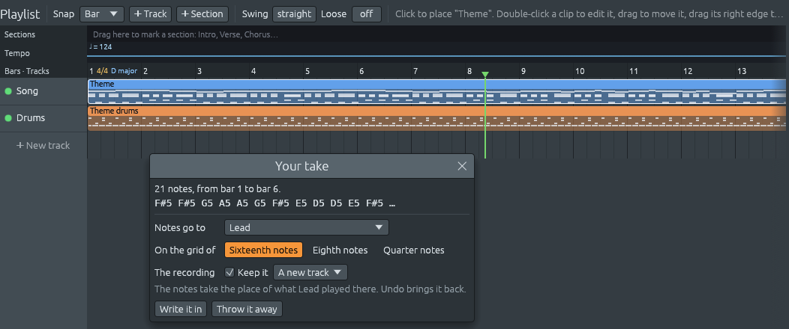

# Takes: singing or whistling a part

Sing or whistle while the song plays, and Ferrous Lineup can write the
melody, bass line, drums and chords it hears into the song. Choose any
combination in **Your take**. The melody is selected by default; the
other choices are off by default and remembered. What you sang or
played is kept too, as a **take** on a track of its own, so you can hear
it next to the song.

A recording made before, whether a voice or a band, works the same way:
see [Adding a recording made before](#adding-a-recording-made-before).

## What you need

- **A microphone.** Ferrous Lineup records from your system's default
  input: the one chosen in your system's sound settings. A laptop's
  own microphone works.
- **Headphones**, so the microphone hears only you and not the song.
  Through speakers, the band would be heard as notes too.
- On **macOS**, the first take asks for permission to use the
  microphone. Say yes; if you said no, turn it on in System Settings >
  Privacy & Security > Microphone.

## Recording a take

1. Put the playhead a bar or two before where you want to sing, in
   song mode. (In pattern mode the take is sung over the pattern as it
   loops.)
2. Click the **microphone** button, next to ● in the toolbar. The song
   starts playing, if it was not.
3. Sing or whistle. Under the button, a small panel shows how loud the
   microphone hears you (green, red when too loud), the note it hears
   with how far you are from it in cents (a hundredth of a semitone),
   and how long the take is.
4. Click the microphone button again to stop. The song goes on playing.

You can sing a passage more than once while recording, with a loop or a
section that repeats: the **last time counts**. Sing it again until it
is right.

## Where the notes go: Your take

When the take stops, the app listens to it for a moment, then the
**Your take** window shows what it heard: how many notes, in which
bars, and the first ones by name. If you sang a little sharp or flat
throughout, it says so; the notes are written as you meant them.

The grid, destination and pitch choices below apply to **Melody**. The
other layers go to the drum channels, a Bass channel and the chord sheet.

| Choice | What it does |
|---|---|
| **Notes go to** | The channel that plays the tune, the **Lead**, is chosen first. The notes take the place of what that channel played where you sang, and only there. You can also choose any other channel, **A new channel** (named "Sung notes", played by a flute), or **Nowhere: keep only the recording**. |
| **On the grid of** | Where the starts and ends of the notes snap to: **Sixteenth notes**, **Eighth notes** or **Quarter notes**. A coarser grid tidies a loose rhythm. |
| **Pitches** | Which notes the pitches you sang are written as. **As sung**: the nearest semitone. **In the key**: the nearest note of the key, so a note sung out of tune does not come out as a wrong note. **Key and chords**: the nearest note of the key as the chord on the chord sheet there colours it; over D7 in C major, F♯ is written instead of F. Bars with no chord keep to the key. The notes listed at the top change as you choose. |
| **The recording** | **Keep it** keeps what you sang, on a track: **A new track** at the bottom, or one you choose. Untick it to keep only the notes. |

In **Extract**, choose **Melody**, **Drums**, **Bass line** and/or
**Chords**. Drums recognizes kick, snare and hi-hat; bass extraction
follows one low-pitched line, and can mistake another low instrument
for bass in a dense mix. Chords are available in song mode. By default,
the extractors analyze the recording as a mix. Builds with optional
source-separation helpers can analyze separated stems instead.

**Write it in** does it, as one step: **Ctrl+Z** takes the whole take
away again. **Throw it away**, or closing the window, keeps nothing.

The status bar says what changed, as in *Wrote 18 notes on Lead. The
recording plays as Take 1.* When the pattern you sang over plays more
than once in the song, it says that too: your notes play each time the
pattern does, so a melody fixed once is fixed everywhere it repeats.

## Optional source separation

If enabled in your build, **Settings > Audio > Source separation**
selects a local helper before the app hears a recording. **Off** keeps
the usual behavior. With a helper, melody is heard from **vocals**, drums
and bass from their own stems, and chords from **other**. A vocal stem
is not an instrumental melody: leave this option off for whistling or a
solo instrument. The review identifies the separator used; **Keep it**
still keeps the original recording, not the separated audio.

Separation can take minutes and several gigabytes of memory. **Cancel
analysis** in the status bar stops the helper. If a microphone take
fails or is cancelled, the app keeps it in a failure window: **Retry
analysis**, **Analyze without separation**, or **Throw it away**. There
is no automatic fallback to the mix. Imported files are never changed.
Changing Settings and choosing **Transcribe again** lets you compare
backends on the same take.

## How the melody is heard

- **Pitch**: each note is rounded to the nearest semitone, after taking
  out how sharp or flat the whole take was. A note sung right between
  two goes to the one in the key. **Pitches** in the Your take window
  can keep the notes to the key, or to the key and the chords.
- **Timing**: where each note starts and ends, on the grid you chose. A
  breath or a consonant between two notes is not written as a rest.
- **Loudness**: how hard each note is played. A note as loud as most of
  the take plays as usual; louder notes are played harder, softer ones
  softer.
- **One note at a time**: melody extraction follows one voice. A chord
  or a voice over loud backing can confuse it.

Some tips:

- Sing on a clear syllable, such as "da" or "la", and start each note
  with it. Two notes on the same pitch sung smoothly, with no new
  syllable, come out as one long note.
- Whistling works well: its pitch is very clear.
- Sing in the octave you want. The notes are written where you sang
  them; move them by an octave in the [piano roll](piano-roll.md) if you
  need to.

## The take on its track

The kept recording is drawn on its track as its waveform: tall where
you sang loud, flat where you were silent. It plays with the song, from
wherever you start playback, like any part: the **light** at the left
of its track mutes it, and **S** plays it alone, to hear only what you
sang (see [Tracks](patterns-and-playlist.md#tracks)).

The recording is heard only under the clips of its track, as its
waveform is drawn. Its clip trims like any other (see [Placing and
moving clips](patterns-and-playlist.md#placing-and-moving-clips)):
drag its left edge in to start the recording later, partway through
it, or its right edge in to stop it sooner, and drag the edge back out
to hear that part again. The waveform stays where it was, so the clip
shows the part of the recording it still plays. A long take is cut
into several clips one after the other; where its track has no clip,
in a gap left between them, the recording is silent, and it goes on
again under the next one. **Transcribe again…** still listens to the
whole recording, the parts its clips hide too.

Notes that go to **A new channel**, or to a channel with nothing to
play there, go on a track of their own right under the recording,
named after it, as *Take 1 notes*. Mute either track to hear the
recording without its notes, or the notes without the recording.
Its sound is saved as a WAV file in a folder next to the song, named
after it, as *my song takes* (for a song not saved yet, in Ferrous
Lineup's own folder). Keep that folder next to the song: moved or
copied together, to another folder or another computer, the song finds
its takes again (see [Sharing a song](saving.md#sharing-a-song)).

A song with a take needs this version of Ferrous Lineup or a newer one
to open.

## Transcribing a take again

To write a take's notes again with other choices, such as another grid
or **In the key**, right-click its recording on the playlist and pick
**Transcribe again…**. The app listens to it again, and **Your take**
opens with the notes going where they went before. **The recording**
row says the recording stays on its track as it is: it is not saved or
added a second time. **Write it in** puts the new notes in place of the
ones written before, as one step: **Ctrl+Z** brings the old ones back.

## Adding a recording made before

An MP3, WAV, FLAC or Ogg file can go on the song as a take, and the
notes in it are heard as in one you sang. There are three ways:

- **➕ Recording**, in the playlist's toolbar, puts it on the song from
  the playhead (from bar 1 in pattern mode, which switches to song
  mode).
- **Add a recording…**, in the menu you get by right-clicking a track's
  name, puts it on that track, from the playhead.
- **Drop the file on a track**: while you drag it over the playlist,
  the place where it will start is lit, on the bar, beat or step that
  **Snap** says, and it starts there, on that track. Dropped on the
  fainter row under the last track, it goes on a track with nothing on
  it; dropped anywhere else on the window, it starts at the playhead.

The same **Your take** window asks where the notes go.

- The recording goes straight on at the song's tempo, so it lines up
  when it was recorded at that tempo, for instance along with the song.
- It works best for one voice or one instrument playing one note at a
  time. In a whole band, only the strongest note of each moment is
  heard.
- A WAV of ten seconds or less dropped on the window is a sound for a
  channel instead (see [The channel rack](channel-rack.md#your-own-sounds)).
- Opening a sound file with Ferrous Lineup, from your file manager or
  on the command line, starts a new, empty song with the recording from
  its start.

## If the notes land late or early

Your sound card has delays, on the way out to your headphones and on
the way in from the microphone, which Ferrous Lineup takes out. If
your notes still land a little late or early on the grid, set
**Settings > Audio > Microphone > Move takes later by**, in
milliseconds: a positive number moves takes later, a negative one
earlier. To find the right amount, turn on the metronome, sing "da" on
every beat, and see where the notes land.
