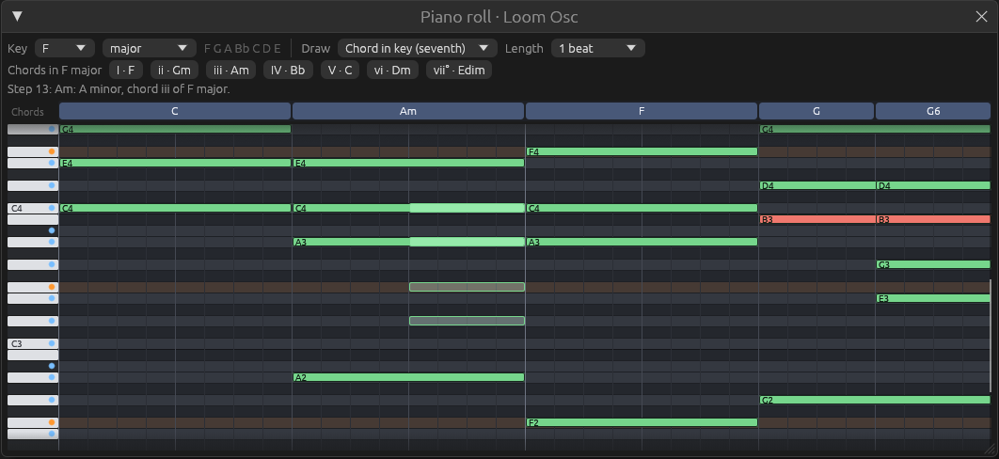

# The piano roll window

Files: [`crates/lineup-app/src/piano_roll.rs`](https://github.com/naelolaiz/ferrous-loom/blob/band-in-a-box/crates/lineup-app/src/piano_roll.rs),
[`crates/lineup-app/src/channel_rack.rs`](https://github.com/naelolaiz/ferrous-loom/blob/band-in-a-box/crates/lineup-app/src/channel_rack.rs),
[`crates/lineup-app/src/widgets.rs`](https://github.com/naelolaiz/ferrous-loom/blob/band-in-a-box/crates/lineup-app/src/widgets.rs)
and [`crates/lineup-app/src/app.rs`](https://github.com/naelolaiz/ferrous-loom/blob/band-in-a-box/crates/lineup-app/src/app.rs)



## A floating window

```rust
egui::Window::new(format!("Piano roll · {}", channel.name))
    .id(egui::Id::unique("piano-roll"))
    .open(&mut open)
    .default_pos([12.0, 246.0])
    .default_size([1060.0, 486.0])
    .show(ctx, |ui| self.contents(ui, project, playhead, &mut actions));
```

An `egui::Window` floats above the panels; you can move it, resize it,
fold it up with the triangle and close it with the ×. Pattern-based
studios work this way too: the channel rack and the piano roll are
windows inside the main window.

- The title changes with the channel, and egui normally identifies a
  window by its title. `.id(...)` gives it a fixed identity instead, so
  it keeps its position and size when you switch channels.
- `.open(&mut open)` adds the close button: egui sets `open` to `false`
  when it is clicked.

There is a small borrowing puzzle here. `open` is a copy of `self.open`:

```rust
let mut open = self.open;
egui::Window::new(/* ... */)
    .open(&mut open)
    .show(ctx, |ui| self.contents(ui, project, playhead, &mut actions));
self.open = open;
```

If the window borrowed `&mut self.open` while the closure borrowed
`&mut self` (to call `self.contents`), `self.open` would be borrowed
mutably twice at once, which Rust forbids. Copying the `bool` out and
back in avoids the overlap.

## State that lasts: a struct instead of a function

The channel rack is a function: everything it shows comes from the
project. The piano roll needs to remember things the project does not
know about, from one frame to the next:

```rust
pub struct PianoRoll {
    pub open: bool,
    channel: usize,
    stamp: ChordStamp,
    note_length: usize,
    drag: Option<Drag>,
    scroll_to_notes: bool,
    hovered_step: Option<usize>,
}
```

It still never changes the project itself. `show` returns a list of
actions, as the rack does, and `LineupApp::apply_roll` carries them out:

```rust
pub enum RollAction {
    AddNotes { channel: usize, notes: Vec<NoteEvent> },
    RemoveNote { channel: usize, index: usize },
    ReplaceNote { channel: usize, index: usize, note: NoteEvent },
    Preview { channel: usize, pitches: Vec<Note> },
    SetScale(Scale),
}
```

So the struct holds *UI* state (what is being dragged, which menu
choice is selected) and the project holds *document* state (the notes).
Step 4 will save the project to a file; nothing in `PianoRoll` needs to
be saved.

## Pixels and music: a small `Copy` struct

Most of the drawing code turns steps and pitches into screen positions,
or the pointer position back into a step and a pitch. That arithmetic
lives in one place:

```rust
#[derive(Debug, Clone, Copy)]
struct Grid {
    rect: Rect,
    step_width: f32,
    length: usize,
}

impl Grid {
    fn x(self, step: usize) -> f32 {
        self.rect.left() + step as f32 * self.step_width
    }

    fn row_top(self, midi: u8) -> f32 {
        self.rect.top() + (HIGHEST - midi) as f32 * ROW_HEIGHT
    }

    fn cell_at(self, pos: Pos2) -> (usize, Note) {
        let last_step = self.length.saturating_sub(1) as f32;
        let step = ((pos.x - self.rect.left()) / self.step_width)
            .floor()
            .clamp(0.0, last_step) as usize;
        let row = ((pos.y - self.rect.top()) / ROW_HEIGHT)
            .floor()
            .clamp(0.0, (HIGHEST - LOWEST) as f32) as u8;
        (step, Note::new(HIGHEST - row))
    }
}
```

High notes are at the top, so the row counts down from `HIGHEST`.
`cell_at` clamps, so a drag that leaves the grid still gets the nearest
cell, and returns a **tuple**, `(usize, Note)`, which the caller takes
apart with `let (step, pitch) = grid.cell_at(pos);`.

Because `Grid` is `Copy` and its methods take `self` by value, it can be
passed to every drawing function without any `&` or lifetimes. For a
struct of a few numbers, copying is as cheap as passing a reference.

The step width is computed every frame from the window's width, so the
whole pattern always fits across and the window can be resized freely.

## Mouse input as a small state machine

egui reports what the mouse is doing *this frame*. A drag lasts many
frames, so the piano roll remembers it in an enum:

```rust
enum Drag {
    /// Moving a note; `grab` is how many steps after its start the pointer took hold.
    Move { index: usize, grab: usize },
    /// Changing a note's length by dragging its right end.
    Resize { index: usize },
}
```

`handle_input` is long, but each part answers one question:

1. **Was the left button just pressed on the grid?** If it hit a note,
   start a `Move`, or a `Resize` if the press was within 6 pixels of the
   note's right end. If it hit an empty cell, add the stamp's notes; a
   single new note also starts a `Move`, so you can place and drag in
   one gesture.
2. **Is the right button down over a note?** Delete it. Checking every
   frame means you can sweep across several notes to delete them all.
3. **Is the left button up?** Then any drag is over: `self.drag = None`.
4. **Is a drag in progress?** Work out where the note would be now, and
   if that differs from where it is, send a `ReplaceNote`.

The fourth part uses a **let chain** with three conditions, and struct update
syntax to change one or two fields:

```rust
if let Some(drag) = self.drag
    && let Some(pos) = pointer
    && let Some(&note) = notes.get(drag.index())
{
    let (step, pitch) = grid.cell_at(pos);
    let changed = match drag {
        Drag::Move { grab, .. } => NoteEvent {
            pitch,
            start: step.saturating_sub(grab),
            ..note
        },
        Drag::Resize { .. } => {
            let length = (step + 1).saturating_sub(note.start).max(1);
            self.note_length = length;
            NoteEvent { length, ..note }
        }
    };
    if changed != note {
        actions.push(RollAction::ReplaceNote { channel, index: drag.index(), note: changed });
    }
}
```

`Some(&note)` in a pattern copies the note out of the `&NoteEvent` that
`get` returns. Comparing `changed != note` (thanks to the derived
`PartialEq`) means nothing is sent while the pointer stays inside the
same cell, even though this code runs every frame.

One detail was found by testing: a quick right-click can press and
release the button within a single frame, so "is the button down?" is
false by the time the frame is drawn. The code asks "was it pressed this
frame, or is it down?" instead:

```rust
pointer.secondary_pressed() || pointer.secondary_down(),
```

### The ghost

When the pointer is over an empty cell, the piano roll draws outlines of
what a click would place, using the same `stamp.notes_at(pitch, scale)`
that the click itself uses. With "Chord in key (seventh)" selected, you
see the whole chord before you commit to it.

## The chord lane: `chunk_by`

The lane above the grid names the harmony at every step, then joins
neighbouring steps that have the same name into one box:

```rust
let labels: Vec<Option<String>> = (0..length)
    .map(|step| analyze(project.pattern().sounding_at(self.channel, step)).label(spelling))
    .collect();

let mut start = 0;
for run in labels.chunk_by(|a, b| a == b) {
    let end = start + run.len();
    if let Some(label) = &run[0] {
        // draw a box from step `start` to step `end`, with the label
    }
    start = end;
}
```

`chunk_by` splits a slice into runs wherever the closure says two
neighbours do not belong together. For the demo, 32 labels become four
runs: eight `Some("C")`, eight `Some("Am")`, eight `Some("F")`, eight
`Some("G")`. Each `run` is a slice of the original vector, so nothing is
copied.

Running `analyze` for every step on every frame sounds like a lot, but it
is at most 64 small loops over a few notes. Measure before optimizing:
here it does not show up at all.

## Scale highlighting

`paint_rows` colours each row by asking the scale about its pitch class,
with a `match` on a tuple of two `bool`s:

```rust
let fill = match (is_root, in_scale) {
    (true, _) => ROOT_ROW,
    (false, true) => SCALE_ROW,
    (false, false) => OTHER_ROW,
};
```

The keys on the left get a dot for notes in the key (orange for the
root), and notes outside the key are drawn red. Change the key and every
colour follows on the next frame, because nothing is cached: immediate
mode draws from the current state every time.

## Back in the rack: a mini piano roll

A channel whose notes are all plain steps still shows step buttons. Any
other channel shows `widgets::mini_roll`, a tiny drawing of its notes,
and clicking it opens the piano roll there. The widget has to line up
with the step buttons, which have a gap between them:

```rust
let gap = ui.spacing().item_spacing.x;
let step_width = STEP_SIZE.x + gap;
let size = vec2(step_width * length as f32 - gap, STEP_SIZE.y);
```

The first version used `STEP_SIZE.x` alone and came out more than a
quarter too short; the screenshot made it obvious. Looking at the running program is
part of testing a UI.

The pitch range is squeezed into the row's height, but never less than
an octave, so three close notes do not fill the row from top to bottom:

```rust
let visible = || notes.iter().filter(|note| note.start < length);
let lowest = visible().map(|note| note.pitch.midi()).min().unwrap_or(0);
let highest = visible().map(|note| note.pitch.midi()).max().unwrap_or(0);
let span = (highest - lowest).max(12) as f32;
```

`visible` is again a closure that makes a fresh iterator each time it is
called, because `min` and `max` each use one up.

## Wiring it into the app

`LineupApp` owns a `PianoRoll`, opens it on the first synth channel at
startup, and toggles it with F7 or the 🎹 button. After the panels are
drawn:

```rust
let roll_actions = self.piano_roll.show(ui.ctx(), &self.project, playhead);
for action in roll_actions {
    self.apply_roll(action);
}
```

`self.piano_roll.show(..., &self.project, ...)` borrows one field mutably
and another one immutably at the same time, the same disjoint-field rule
as in the audio thread. Each action then changes the project and sends a
fresh copy of the channel's notes to the audio thread:

```rust
fn send_notes(&mut self, channel: usize) {
    let notes = self.project.notes(channel).to_vec();
    self.send(Command::SetNotes { channel, notes });
}
```

`to_vec` copies a slice into a new `Vec`. This allocation happens on the
UI thread, where it is allowed.

When a channel is removed, `PianoRoll::channel_removed` either closes
the window (its channel is gone) or shifts its channel number down by
one, so it keeps showing the same channel.
