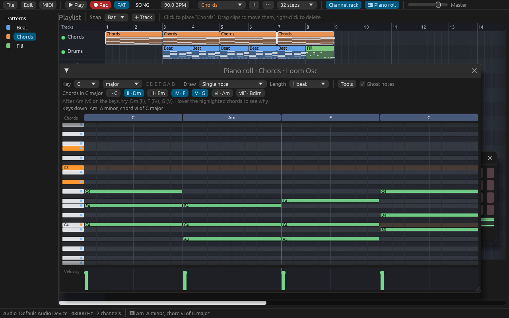
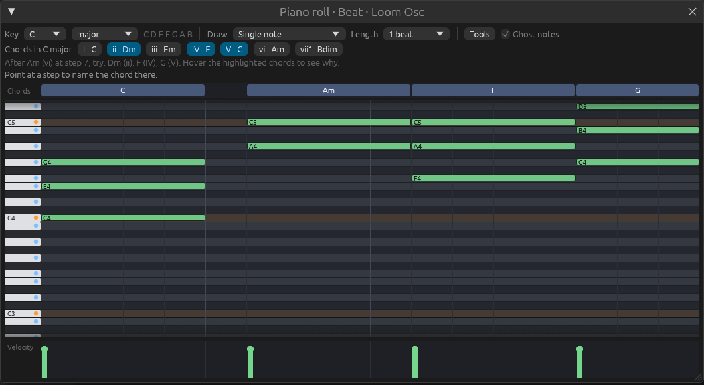
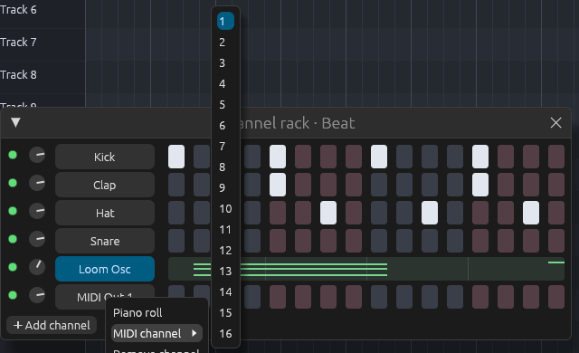
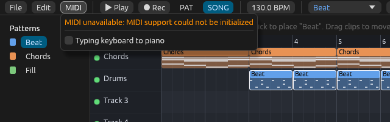

# Step 7: MIDI in and out

MIDI is how keyboards, synths and music programs talk to each other. It
has been the same since 1983: a few bytes that say "this key went down,
this hard" or "this key came up". Step 7 teaches Ferrous Loom to speak
it, both ways:

- **play from a MIDI keyboard**: pick it under **MIDI > Input**, and its
  keys play the *selected channel*. That is the channel the piano roll
  shows, highlighted in the channel rack; click a channel's name to
  select it,
- **the typing keyboard**: no MIDI keyboard at hand? Turn on **MIDI >
  Typing keyboard to piano**, and the letter keys play notes, laid out
  like a piano (see below),
- **chords named as you play**: hold some keys, and the status bar names
  the chord ("Am: A minor, chord vi of C major"). In the piano roll, the
  keys light up on the keyboard, and the chord buttons light up with the
  chords that often come *after the one you are holding*,
- **recording**: click **● Rec**, press Play and play. Each key becomes a
  note on the nearest step of the selected pattern, and a whole take is
  one undo step,
- **MIDI Out channels**: **Add channel > MIDI Out (external synth)**
  makes a channel that plays no sound of its own. Its notes go to
  another synth, a hardware one or another program, picked under **MIDI
  > Output**. Right-click it to choose its MIDI channel, 1 to 16,
- **MIDI files**: **File > Export song as MIDI…** and **Export pattern
  as MIDI…** write a `.mid` file with the notes, which every other
  studio can open. The built-in drums go on channel 10 with the notes
  General MIDI drum kits expect, so they come out as drums there too.







## How to use it

| Do this | To |
|---------|----|
| MIDI > Input > a port | play the selected channel from a MIDI keyboard |
| MIDI > Output > a port | send MIDI Out channels to a synth |
| MIDI > Typing keyboard to piano | play notes with the letter keys |
| click a channel's name | hear it, and select it for the keyboards and the piano roll |
| ● Rec, then Space | record into the selected pattern while it loops |
| Space again | stop; keys still down end there |
| Ctrl+Z | undo the whole take |
| Add channel > MIDI Out | add a channel for an external synth |
| right-click a MIDI Out channel > MIDI channel | choose its channel, 1 to 16 |
| File > Export song as MIDI… | save the song's notes as a `.mid` file |
| File > Export pattern as MIDI… | save the selected pattern's notes |

The typing keyboard uses two rows of letters for the white keys, and the
row above each for the black keys, the way a piano's black keys sit
between and above the white ones:

```text
  black keys:   S  D     G  H  J      2  3     5  6  7     9  0
  white keys:  Z  X  C  V  B  N  M   Q  W  E  R  T  Y  U  I  O  P
  notes:       C4 D4 E4 F4 G4 A4 B4  C5 D5 E5 F5 G5 A5 B5 C6 D6 E6
```

The keys are found by where they are on the keyboard, not by the letter
printed on them, so the piano has the same shape on a French or German
layout. None of these keys did anything before, so nothing is lost
while the typing keyboard is on: Space, L, F6, F7, the arrow keys and
every Ctrl shortcut still work as before.

**Rec** switches to pattern mode, because a take goes into the pattern
that loops. Recording in song mode is [exercise 5](exercises.md).

## How it was tested

This step was built on a virtual machine with no MIDI system: on Linux,
MIDI goes through the ALSA *sequencer*, which needs the `/dev/snd/seq`
device, and that machine had none. So there, the MIDI menu says
**MIDI unavailable**:



What was tested in the running app:

- the typing keyboard: the notes sound while held and stop when let go
  (checked by recording the app's sound), and the chord is named,
- recording takes, a key still down when playback stops, and undoing a
  take,
- MIDI Out channels: adding one, changing its MIDI channel, and the
  messages the audio thread makes for it (in the tests),
- MIDI files: the exported files were read back by a separate program,
  Python's `mido` library, which found the right tracks, notes, drum
  channel, tempo and length.

What could not be tested: a real MIDI keyboard or synth. That code is
small, and every part after the first byte is shared with the typing
keyboard or covered by tests. It builds for Linux, macOS and Windows,
but it has not met real hardware yet. If you have a MIDI keyboard, you
are the first to try it.

## What changed in the architecture

```text
  loom-core
    midi.rs (new):       MidiMessage, note-on and note-off, to bytes and back
    midi_file.rs (new):  song_to_midi and pattern_to_midi: Standard MIDI Files
    record.rs (new):     recorded_note: a key held down becomes a note on the grid
    project.rs:          ChannelKind::MidiOut { channel }
    sequencer.rs:        position(): where playback is, to a fraction of a step
    file.rs:             format 2, written only by projects that need it

  loom-audio
    instrument.rs:  held notes and note_off; the MidiOut instrument
    engine.rs:      the LiveInput and MidiOutput queues, Command::Live,
                    the shared playback position

  loom-app
    midi.rs (new):      midir: ports, the input callback, the sending thread
    app/live.rs (new):  the MIDI menu, the typing keyboard, keys held, recording
    app/export.rs:      MIDI export
    channel_rack.rs:    the selected channel, MIDI Out channels
    piano_roll.rs:      keys held, suggestions from the keys
```

Four threads now share the work. A key from a MIDI keyboard takes this
path:

```text
  MIDI keyboard
     │ 3 bytes
     ▼
  midir's thread: on_message ──▶ LiveInput (ring buffer) ──▶ audio thread ──▶ sound card
     │                                                          │
     │ a copy, with the playback position (mpsc channel)        │ MIDI Out channels' messages
     ▼                                                          ▼
  UI thread: keys held, chord name, recording              MidiOutput (ring buffer)
     │                                                          │
     │ typing keyboard: Command::Live ──▶ audio thread          ▼
                                                    sending thread ──▶ MIDI port ──▶ synth
```

Four ideas carry this step:

1. **Keys skip the UI.** The UI draws once per frame, and a key could
   wait a whole frame there before anything happens. So a key goes from
   the MIDI thread straight to the audio thread, and sounds within one
   audio block, a few milliseconds. The UI gets a copy, to show and
   record it.
2. **The audio thread still never waits.** Sending a MIDI message is a
   system call, which may take any time. So the audio thread leaves
   messages in a queue, and a thread of their own sends them.
3. **One clock for everything.** The audio thread publishes where it is
   in the pattern, to a fraction of a step. Each key is stamped with it
   as it arrives, and recording only has to round.
4. **The file format only moves when it must.** A project with a MIDI
   Out channel is written as format 2, which older versions of Ferrous
   Loom refuse. Every other project is still written as format 1, so
   they can still open it.

## Files in this step

```text
crates/loom-core/src/midi.rs           MidiMessage, DRUM_CHANNEL, all_notes_off (new)
crates/loom-core/src/midi_file.rs      Standard MIDI File export (new)
crates/loom-core/src/record.rs         recorded_note (new)
crates/loom-core/src/project.rs        ChannelKind::MidiOut, Channel::midi_out
crates/loom-core/src/sequencer.rs      Sequencer::position
crates/loom-core/src/file.rs           FORMAT_VERSION 2 and format_for
crates/loom-audio/src/instrument.rs    HELD, note_off, MidiOut
crates/loom-audio/src/engine.rs        LiveInput, MidiOutput, Command::Live, live_keys
crates/loom-audio/src/render.rs        the export's audio thread has no MIDI
crates/loom-app/src/midi.rs            the midir wrapper (new)
crates/loom-app/src/app/live.rs        typing keyboard, held keys, recording (new)
crates/loom-app/src/app/export.rs      MIDI export
crates/loom-app/src/app/files.rs       the File menu's MIDI items
crates/loom-app/src/app/edit.rs        a take is one undo step
crates/loom-app/src/app.rs             the MIDI menu, Rec, the selected channel
crates/loom-app/src/channel_rack.rs    selection, MIDI Out channels
crates/loom-app/src/piano_roll.rs      keys held, suggestions from the keys
```

The chapters follow a key on its way. First the bytes themselves, and
the MIDI file made of them. Then the trip through the threads, in and
out. Last, recording, where a key becomes a note.
