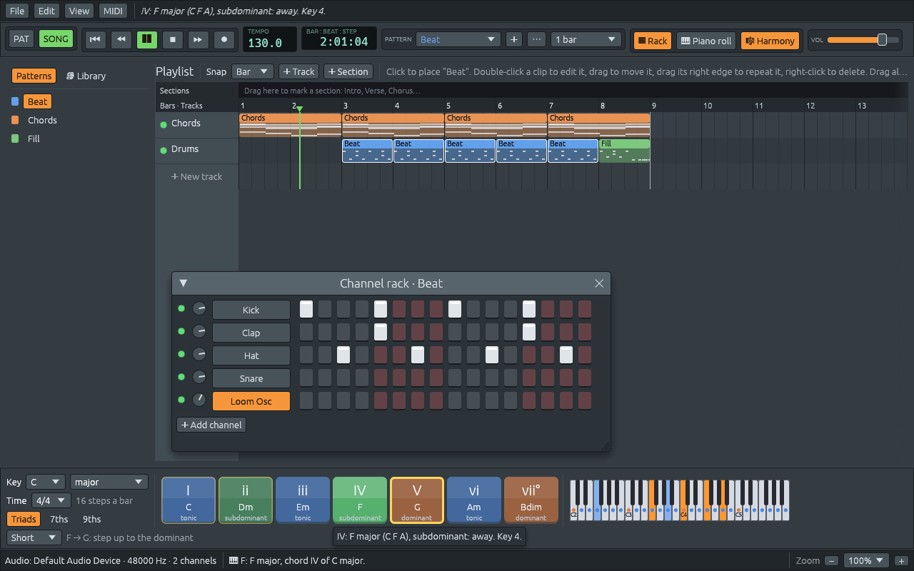
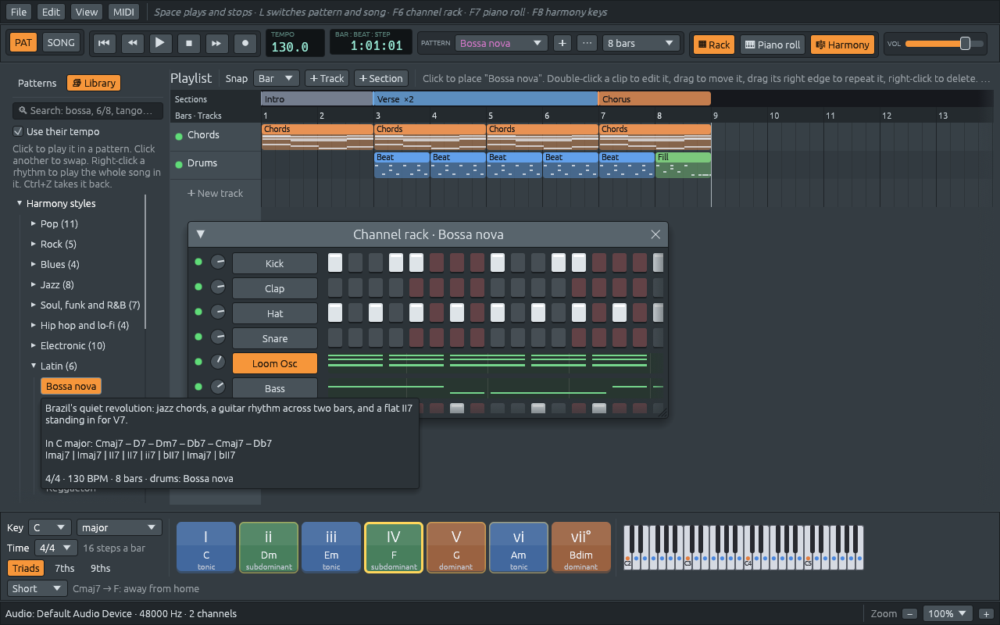
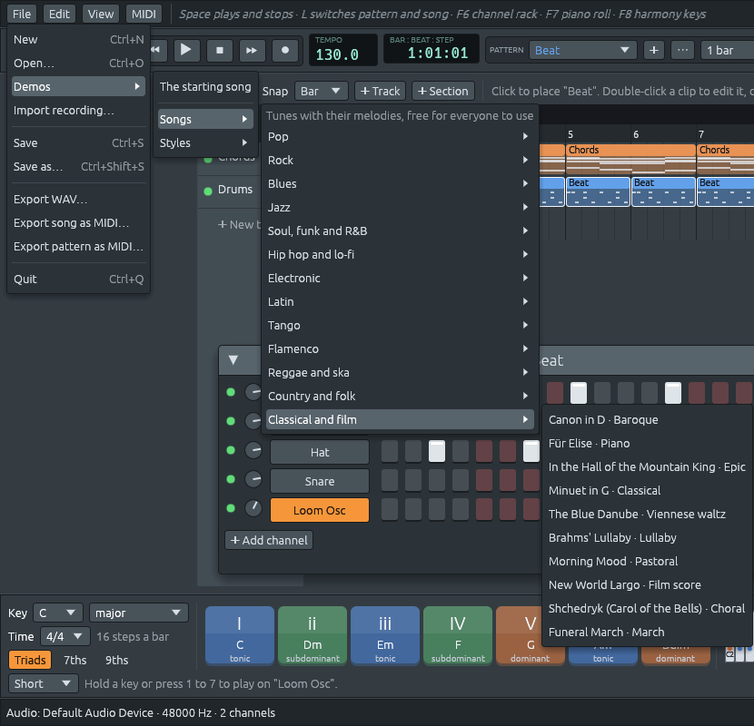

# Step 8: Harmony keys, a library of styles, and demos

Pattern-based studios give you a row of big chord keys: one for each
chord of the key you are in, so you can play a progression with one
finger and *see* how harmony works. Step 8 adds them to Ferrous Lineup,
and a library to go with them:

- **the harmony keys**, along the bottom of the main window. On the
  left, the project's **key** and **time signature**, always in view.
  In the middle, seven big keys, **I** to **vii°**, one for each chord
  of the key. They are coloured by what the chord *does*: blue for
  home (tonic), green for leaving home (subdominant), orange for
  tension (dominant). Hold one down, with the mouse or the number keys
  **1** to **7**, and it plays its chord on the selected channel; with
  **● Rec** on, it is recorded. The chords that often come next light
  up with a yellow outline, and the line below says why. On the right,
  a keyboard shows the notes of the scale and the notes playing,
- **chords followed as the music plays**: while a pattern or the song
  plays, the harmony key of the chord playing lights up, and the
  keyboard shows its notes in blue. Press Play on any demo and watch
  the progression move between home, away and tension,
- **time signatures**: 2/4, 3/4, 4/4, 5/4, 3/8, 5/8, 6/8, 7/8, 9/8 and
  12/8. The playlist's bars, the snap, the channel rack's beat colours,
  the piano roll's lines and the pattern lengths all follow it, and it
  goes into project files and MIDI files,
- **a library** in a new **Library** tab next to the pattern list:
  **78 harmony styles** and **49 rhythms** from 13 genres, from pop and
  the blues to bossa nova, flamenco, reggae and, of course, **tango**
  (marcato, síncopa, milonga, habanera and the tango vals). Click a
  style to hear it in your key, click another to swap, and **Ctrl+Z**
  takes it back. Hover over a style to see its chords in your key,
- **demos** under **File > Demos**: **62 songs**, sorted by genre,
  from *Ode to Joy* and *Für Elise* to *Korobeiniki*, the *Habanera*
  and *When the Saints Go Marching In*, each with its melody, chords,
  bass and drums. Most are in the public domain; genres with few free
  classics, like tango and flamenco, get new tunes written for them
  ([More demos](more-demos.md)). And every harmony style as a short
  song,
- **a new rhythm for a song**: pick a rhythm after a style, or
  right-click a rhythm and play the whole song in it, and the chords
  and bass follow the new rhythm, keeping the same chords, as in FL
  Studio. Ferrous Lineup works the chords out from the notes first
  ([A new rhythm for a song](new-rhythm.md)),
- **the accompaniment follows your chords**: turn it on in the MIDI
  menu, and while the music plays, the chord you hold on a MIDI or
  typing keyboard becomes the chord of the accompaniment, as on an
  arranger keyboard ([The accompaniment follows your
  chords](chord-follow.md)),
- **MIDI Out for every channel**: pick a synth in MIDI > Output and
  the whole song plays on it, drums on channel 10, without adding MIDI
  Out channels first ([MIDI Out for every channel](midi-out-every-channel.md)),
- **music without a key**: a twelve-tone row or a pitch-class set as
  the key, a window that shows a row's matrix with all 48 forms and
  writes any of them into the pattern, serialism of durations,
  dynamics and octaves, a browser of all 224 set classes, the set of
  any notes you select, and twelve-tone styles and demos
  ([Twelve-tone rows and pitch-class sets](twelve-tone.md)),
- **micromodes**: Francisco Kröpfl's twelve groups of three notes in
  his three families, drawn on a clock, heard, drawn with or used as the
  key; the micromodes inside any notes you select; the Sets and
  Micromodes windows linked both ways; and micromode styles and demos,
  with Webern's Concerto row, made of one micromode
  ([Micromodes](micromodes.md)),
- **nine new drums**, made by the synthesizer like the first four:
  open hi-hat, rim, low and high toms, ride, crash, cowbell, shaker and
  conga,
- **patterns up to sixteen bars long**, so a whole twelve-bar blues fits
  in one pattern.
- **a bug hunt**: the playlist and the piano roll zoom horizontally and
  vertically on their own; notes, scales and chords are
  spelled with the right letters (E# in F# major, E#dim); hints and
  harmony keys get their theory right in minor keys, modes and sets;
  held notes survive section edges, muting and tempo changes; and many
  small glitches are gone ([A bug hunt](bug-hunt.md)).







## How to use it

| Do this | To |
|---------|----|
| hold a harmony key, or **1** to **7** | play its chord on the selected channel |
| Triads, 7ths, 9ths (under the key) | play three-, four- or five-note chords |
| Key, Time (left of the harmony keys) | change the project's key (which moves the song into it) and time signature |
| **F8**, or the 🎼 Harmony button | show or hide the harmony keys |
| ● Rec, Space, then hold harmony keys | record chords into the pattern |
| Library tab, click a style | play it in a new pattern, in your key |
| click another style or rhythm | swap it in the same pattern |
| Ctrl+Z | take it back |
| Use their tempo (Library tab) | also set the style's usual tempo |
| click a rhythm after a style | play the style's chords and bass the way the rhythm goes |
| right-click a rhythm, Play the whole song in this rhythm | give the whole song new drums, and play its chords and bass again to match |
| MIDI > Accompaniment follows chords, then hold a chord while playing | play the chords and bass in the chord you hold |
| MIDI > Output, pick a synth (Send every channel is on) | play every channel on the external synth too, drums on channel 10 |
| File > Demos | open a song or a style as a whole project, and play it |
| Key menu > twelve-tone row, or Row… in the piano roll | make a row the key, see its matrix, write its forms |
| Sets… in the piano roll | look up any set, draw with it or use it as the key |
| Micromodes… in the piano roll | see Kröpfl's twelve micromodes and the ones in the selected notes; hear one, draw with it or use it as the key |
| Ctrl+wheel, Alt+wheel (or Ctrl and Alt with + and −), the zooms at the bottom right | make bars and steps wider, or tracks and keys taller; Ctrl+0 for 100% again ([A bug hunt](bug-hunt.md)) |
| View > Interface size | make text, buttons and menus bigger or smaller everywhere |
| View menu, or **Alt+F8** | show or hide each window, and the Patterns and Library panel |

The number keys play the harmony keys only while the typing keyboard is
off, because the typing keyboard uses them for black keys.

Once you change a pattern the library wrote (add a note, rename it),
it is yours: the next click in the library starts a new pattern instead
of replacing it.

## How it was tested

- The library is data, and its tests read every entry: every chart and
  melody parses, every bar adds up to the time signature, every style
  and rhythm can be written into a project, every demo survives saving
  and loading, and at least 80% of every melody's notes are in its key
  (the rest are passing notes).
- Every one of the 94 demos (16 songs and 78 styles) was rendered
  offline, through the same audio code as the WAV export, and measured:
  none clips, and the loudest peaks at 0.96 of full scale.
- In the running app: the harmony keys with the mouse and the number
  keys, the suggestions, the Library tab (trying, swapping, undoing),
  the Demos menu with its "Save changes?" question, and time
  signatures in the playlist, the rack and the piano roll.
- The time signature in exported MIDI files is checked by a test.

## What changed in the architecture

```text
  lineup-core
    meter.rs (new):          TimeSignature: steps per bar and per beat
    harmony/keys.rs (new):   the seven chords of a key, their functions, playing them
    library/ (new):
      numeral.rs     "I V vi IV": chords counted from the tonic
      chart.rs       chord charts by the bar, melodies note by note
      voicing.rs     voice leading: each chord close to the last
      comping.rs     rhythms for chords and bass lines
      style.rs       78 harmony styles
      rhythm.rs      49 rhythms and 6 fills, one text line per drum
      song.rs        the Song type and SONGS, 62 songs
      song/          one file of songs per genre
      apply.rs       writing styles and rhythms into patterns
      demo.rs        whole demo projects
    project.rs:     the time signature, nine new drums, the chord at a step
    pattern.rs:     MAX_STEPS 256, set_notes
    file.rs:        format 3
    midi_file.rs:   the time signature and the new drums in .mid files

  lineup-audio
    drums.rs:       nine new drum sounds

  lineup-app
    harmony_keys.rs (new):      the harmony keys bar
    library_browser.rs (new):   the Library tab
    app/library.rs (new):       trying styles and rhythms, the demos
    playlist.rs, channel_rack.rs, piano_roll.rs:  bars and beats of any time signature
```

Three ideas carry this step:

1. **Knowledge as data.** A musician carries a lot in their head: which
   chords make a bossa nova, where the snare goes in a reggae beat, how
   *Greensleeves* goes. The library writes all of it down as short
   strings and tables that a person can read and check, and a few small
   functions turn them into notes. Adding a style is adding a few lines,
   not writing code.
2. **Relative, not absolute.** Styles are written in Roman numerals and
   rhythms in steps of a bar, so the same table plays in any key, and a
   rhythm keeps its place in any time signature.
3. **The library only writes patterns.** Trying a style is an ordinary
   edit through `LineupApp::edit`, so undo, saving, the audio thread and
   everything else work without knowing the library exists.

## Files in this step

```text
crates/lineup-core/src/meter.rs               TimeSignature (new)
crates/lineup-core/src/harmony/keys.rs        chord_keys, Function, ChordSize, play (new)
crates/lineup-core/src/harmony/scale.rs       Scale::ninth
crates/lineup-core/src/library/*.rs           the library (new)
crates/lineup-core/src/project.rs             time_signature, new drums, chord_notes_in_song
crates/lineup-core/src/pattern.rs             MAX_STEPS, set_notes
crates/lineup-core/src/file.rs                format 3
crates/lineup-core/src/midi_file.rs           time signature meta event, new drum notes
crates/lineup-audio/src/drums.rs              open hat, rim, toms, ride, crash, cowbell, shaker, conga
crates/lineup-app/src/harmony_keys.rs         the harmony keys bar (new)
crates/lineup-app/src/library_browser.rs      the Library tab (new)
crates/lineup-app/src/app/library.rs          auditions and demos (new)
crates/lineup-app/src/app.rs                  the bar, the chord playing, F8
crates/lineup-app/src/app/files.rs            File > Demos
crates/lineup-app/src/app/live.rs             play_typed is shared with the harmony keys
crates/lineup-app/src/playlist.rs             the Library tab, bars of any length
crates/lineup-core/src/midi_file/read.rs      reading MIDI files (new)
crates/lineup-core/src/midi_file/import.rs    a MIDI file becomes a project (new)
crates/lineup-core/src/harmony/key_finding.rs the key of a piece from its notes (new)
crates/lineup-app/src/channel_rack.rs         beat colours by time signature
crates/lineup-app/src/piano_roll.rs           bar and beat lines by time signature
crates/lineup-app/src/app/view.rs             the View menu and the zoom control (new)
```

The chapters start with the harmony keys, the part you see first. Then
time signatures, which everything else depends on. Then the library:
how a style, a rhythm and a song are written as data, and how they
become patterns and demos. The last chapter is about making every
control fit, whatever the size of the window, and about zoom.
