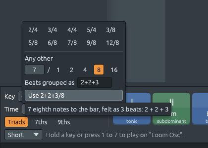

# Any time signature, and irregular meters

Files: [`crates/loom-core/src/meter.rs`](https://github.com/naelolaiz/ferrous-loom/blob/main/crates/loom-core/src/meter.rs),
[`crates/loom-app/src/time_picker.rs`](https://github.com/naelolaiz/ferrous-loom/blob/main/crates/loom-app/src/time_picker.rs),
[`crates/loom-core/src/file.rs`](https://github.com/naelolaiz/ferrous-loom/blob/main/crates/loom-core/src/file.rs)

The menus used to offer ten time signatures, from 2/4 to 12/8. Music
has many more: 11/8, 13/16, 7/4, 5/2. A time signature is just two
numbers, so now you can type any of them, and give the beats of an
irregular meter their grouping.



## The music: irregular meters

In 6/8 the six eighth notes are always felt as two beats of three:
*ONE* two three *FOUR* five six. In 7/8 there is no such rule. Seven
can't be split into equal beats, so it is felt as beats of two and
three, and which comes first changes the music completely:

| Written | Counted | Beats (in steps) | Where you hear it |
|---------|---------|------------------|-------------------|
| 2+2+3/8 | *one* two *one* two *one* two three | 4, 4, 6 | Bulgarian *rachenitsa* |
| 3+2+2/8 | *one* two three *one* two *one* two | 6, 4, 4 | Greek *kalamatianos*, Macedonian *lesnoto* |
| 3+3+2/8 | *one* two three *one* two three *one* two | 6, 6, 4 | the *tresillo* of Latin music, Piazzolla's tangos |
| 2+2+2+3/8 | four beats, the last one long | 4, 4, 4, 6 | Turkish *karşılama*, Brubeck's *Blue Rondo à la Turk* |
| 3+3+3+2/16 | three long beats and a short one | 3, 3, 3, 2 | one way to count a fast 11 |

These are called *irregular*, *additive* or *aksak* meters ("aksak" is
Turkish for "limping": the long beat feels like a limp). Notice that
3+3+2/8 has eight eighth notes, like 4/4, but it is not counted like
4/4: the beats fall on notes 1, 4 and 7. Writing it 3+3+2 says so.

A score writes the grouping in the time signature itself, as the top
number: (2+2+3)/8. Ferrous Loom does the same, and shows it on the
playlist's ruler:


## How to use it

- **Harmony keys > Time**, or **right-click a bar number** on the
  playlist for a change from that bar on.
- Click one of the usual time signatures, or under **Any other** set
  the top number, click the bottom one (1, 2, 4, 8 or 16), and
  optionally type how the beats are grouped. **Use …** applies it.
- If something does not fit, the menu says so in red, for example "the
  groups add up to 8, not 11".

There is no 32 at the bottom: Ferrous Loom's grid is sixteenth-note
steps, and a bar of 7/32 would end in the middle of a step.

## A grouping inside a `Copy` type

`TimeSignature` is passed around everywhere by value, because it is
`Copy`: two small numbers, copied like an integer. A grouping such as
`[2, 2, 3]` would naturally be a `Vec<u8>`, but a `Vec` owns memory on
the heap, and a type holding one can't be `Copy`. So the grouping is
stored as a *bitmask* instead:

```rust
pub struct TimeSignature {
    pub beats: u8,
    pub unit: u8,
    /// bit `i` is set when a beat starts on the bar's `i`-th note.
    /// 0 means the usual beats.
    groups: u64,
}
```

2+2+3/8 has beats starting on notes 0, 2 and 4, so its mask is
`0b10101`: bits 0, 2 and 4. A `u64` has room for 64 notes, more than
any real bar. Building it:

```rust
let mut mask = 0_u64;
let mut at = 0;
for &group in groups {      // [2, 2, 3]
    mask |= 1 << at;        // a beat starts here
    at += usize::from(group);
}
```

`1 << at` is a 1 moved `at` places to the left, and `|=` ("or-equals")
switches that bit on without touching the others.

The field is private (no `pub`), so code outside `meter.rs` can only
make a grouping through `TimeSignature::grouped`, which checks that the
groups are not empty and fit. That is how Rust keeps a value valid:
whatever can break the rules is hidden, and the public functions keep
them.

One more rule: if the grouping is the usual one, the mask is left at
0. So 3+3/8 and 6/8 are the same value and compare equal with `==`.
Otherwise the menu would think "6/8" and "3+3/8" were two different
time signatures.

## Beats that are not all the same length

Before, a time signature had one `steps_per_beat`, and code found the
beat a step is in by dividing. With 2+2+3/8 that no longer works: the
beats are 4, 4 and 6 steps long. So `steps_per_beat` is gone, and
every place that used it asks `beat_at` instead:

```rust
pub struct Beat {
    pub index: usize,   // 0 for the first beat of the bar
    pub start: usize,   // steps from the start of the bar
    pub length: usize,  // in steps
}

let balkan: TimeSignature = "2+2+3/8".parse().unwrap();
assert_eq!(balkan.beat_at(9), Beat { index: 2, start: 8, length: 6 });
```

Removing the old function was on purpose: the compiler then listed
every place that still called it (the playlist lines, the channel
rack's beat colours, the BAR:BEAT:STEP display, beat snapping, tempo
glides, and the Library's chord hearing), and each one was changed to
ask for the real beat. Deleting a function to let the compiler find
its users is a common Rust trick.

## Reading "2+2+3/8": `FromStr`

`"7/8".parse::<TimeSignature>()` works because `TimeSignature`
implements the standard trait `FromStr`. Its error type is a `String`
that the menu shows as it is:

```rust
impl FromStr for TimeSignature {
    type Err = String;

    fn from_str(text: &str) -> Result<Self, Self::Err> {
        let (top, bottom) = text
            .split_once('/')
            .ok_or("write it as two numbers, like 7/8")?;
        // ... the bottom must be 1, 2, 4, 8 or 16, and the top
        // a number or numbers joined by "+"
    }
}
```

`split_once('/')` returns `Some((before, after))` or `None`; `ok_or`
turns the `None` into an error, and `?` returns that error right away.
The `Display` implementation writes the same text back, so a test can
check that every time signature survives `to_string` then `parse`.

## Saving it without breaking old files

A project file stores a time signature as `(beats: 7, unit: 8)`. Files
without a grouping must stay exactly like that, so older versions of
Ferrous Loom keep opening them. The serde attribute
`#[serde(from = "SavedTime", into = "SavedTime")]` says: to save a
`TimeSignature`, turn it into a `SavedTime` first, and to load one,
read a `SavedTime` and turn it back:

```rust
#[derive(Serialize, Deserialize)]
struct SavedTime {
    beats: u8,
    unit: u8,
    #[serde(default, skip_serializing_if = "Vec::is_empty")]
    groups: Vec<u8>,
}
```

`SavedTime` can hold a friendly `Vec` (`groups: [2, 2, 3]`), because
it only exists for a moment while saving or loading. When there is no
grouping the field is skipped, and the file is the same as before.

A file *with* a grouping is saved as format 11. An older version would
read the 7/8 but ignore the grouping and draw a line on every eighth
note, so it is told the file is newer instead. 11/8 or 13/16 without a
grouping need nothing new: the two numbers were always saved as they
are.

## Try it

1. Set the harmony keys' Time to 7/8, then to 2+2+3/8, and watch the
   channel rack: the step buttons' colours change from seven pairs to
   two, two, three.
2. Right-click bar 5 on the playlist and make it 3+3+2/8. Its bars are
   16 steps like 4/4, but the beat lines fall elsewhere.
3. In a test, check that `"3+3/8".parse::<TimeSignature>()` equals
   `TimeSignature::new(6, 8)`. Why does that matter for the menu?
