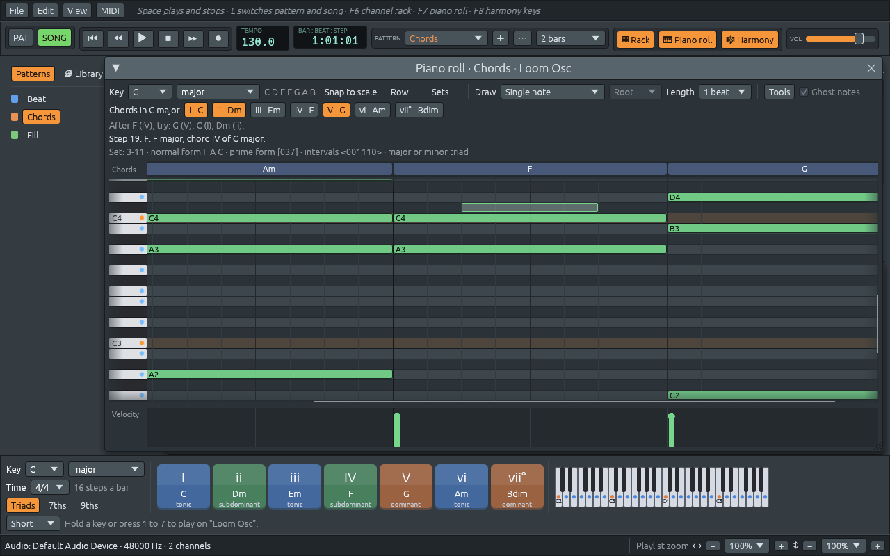
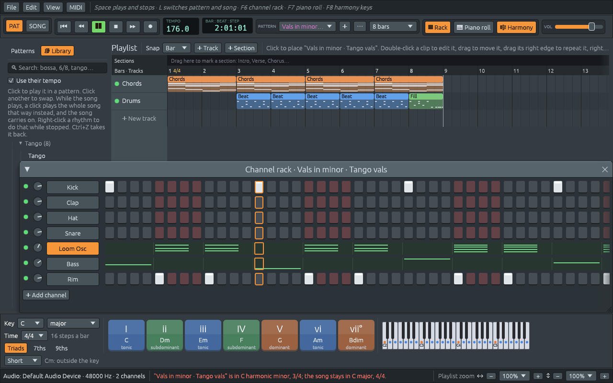

# A bug hunt: two-way zoom, notes spelled right, and playback

Files: [`crates/lineup-app/src/app/view.rs`](https://github.com/naelolaiz/ferrous-loom/blob/band-in-a-box/crates/lineup-app/src/app/view.rs),
[`crates/lineup-app/src/piano_roll.rs`](https://github.com/naelolaiz/ferrous-loom/blob/band-in-a-box/crates/lineup-app/src/piano_roll.rs),
[`crates/lineup-app/src/widgets.rs`](https://github.com/naelolaiz/ferrous-loom/blob/band-in-a-box/crates/lineup-app/src/widgets.rs),
[`crates/lineup-app/src/theme.rs`](https://github.com/naelolaiz/ferrous-loom/blob/band-in-a-box/crates/lineup-app/src/theme.rs),
[`crates/lineup-core/src/pitch.rs`](https://github.com/naelolaiz/ferrous-loom/blob/band-in-a-box/crates/lineup-core/src/pitch.rs),
[`crates/lineup-core/src/harmony/scale.rs`](https://github.com/naelolaiz/ferrous-loom/blob/band-in-a-box/crates/lineup-core/src/harmony/scale.rs),
[`crates/lineup-core/src/harmony/analysis.rs`](https://github.com/naelolaiz/ferrous-loom/blob/band-in-a-box/crates/lineup-core/src/harmony/analysis.rs),
[`crates/lineup-core/src/harmony/chord.rs`](https://github.com/naelolaiz/ferrous-loom/blob/band-in-a-box/crates/lineup-core/src/harmony/chord.rs),
[`crates/lineup-audio/src/instrument.rs`](https://github.com/naelolaiz/ferrous-loom/blob/band-in-a-box/crates/lineup-audio/src/instrument.rs)
and [`crates/lineup-audio/src/engine.rs`](https://github.com/naelolaiz/ferrous-loom/blob/band-in-a-box/crates/lineup-audio/src/engine.rs)

After many features in a row, the request was the opposite of a
feature: *find the bugs and fix them*. UI glitches, things that are hard
to use, playback that does not sound right, and, above all, anything the
app **shows or plays that is wrong**, because Ferrous Lineup is meant for
learning music. Two examples came with it: the piano roll "went crazy"
with a pitch-class set as the key and the zoom, and the main window's
zoom made *everything* bigger, instead of zooming the playlist
horizontally or vertically as in FL Studio.

This chapter is a tour of what was found and how each thing was fixed.
Most fixes are small; what is worth learning is *why* each bug was
there.

## How the hunt was done

A bug is only fixed when the flow that showed it has been played again
and now works. So the app ran on a virtual screen (`Xvfb`), driven by
`xdotool` (which moves the mouse, clicks and types) and photographed
with ImageMagick's `import`. Each reported flow was replayed click by
click: open the Chords pattern, pick *pitch-class set* as the key, pick
a set, zoom with Ctrl+wheel and Alt+wheel, drag notes, change the set,
zoom again.

The rest was split into three parts that could go on at the same time:
playback, music theory, and the user interface. Each part had its own
copy of the repository, made with `git worktree add`, so the three
could build and test without stepping on each other, and their branches
were merged back at the end. A worktree is a second working folder for
the same repository: it shares the history, but has its own checked-out
branch.

## Zoom in two directions

In FL Studio the playlist and the piano roll zoom each direction on its
own: **Ctrl and the wheel** makes bars and steps wider (less time on
screen, in more detail), **Alt and the wheel** makes tracks and keys
taller. Text and menus keep their size. Ferrous Lineup now does the same:

| Do this | To |
|---------|----|
| Ctrl+wheel over the playlist, piano roll or rack | wider or narrower, around the step under the pointer |
| Alt+wheel (or Ctrl+Alt+wheel) | taller or shorter |
| Ctrl and + or −, Alt and + or − | the same, in the window clicked last |
| Ctrl+0 | both back to 100% |
| ↔ and ↕ at the bottom right | the playlist's two zooms |
| View > Interface size | how big text, buttons and menus are everywhere |

The channel rack keeps a single zoom, since its steps are square
buttons.



### A zoom per area and per axis

The old code had one number per area. Now there is one per area *and*
per direction, so the key it is saved under includes both:

```rust
pub(crate) enum Axis {
    Horizontal,
    Vertical,
}

fn key(self, axis: Axis) -> egui::Id {
    let axis = if self.two_way() { axis } else { Axis::Horizontal };
    egui::Id::unique(("zoom-2", self, axis))
}
```

The `"zoom-2"` in the key is deliberate: egui saves these values with
the window positions, and zooms saved by the old version under `"zoom"`
meant something else (a scale for everything in the window, text
included). A new name means old values are simply not found, instead
of being read the wrong way.

The rack is not `two_way`, so both its axes share the horizontal key:
zooming it "vertically" zooms it both ways, which is what a grid of
square buttons wants.

Every way of zooming in steps (keys, wheel, menu, status bar buttons)
goes through `step_zoom`, which walks a ladder of sizes:

```rust
const STEPS: [f32; 19] = [
    0.25, 0.33, 0.4, 0.5, 0.6, 0.75, 0.9, 1.0, 1.1, 1.25, 1.5, 1.75, 2.0, 2.5, 3.0, 4.0, 5.0, 6.0,
    8.0,
];
```

Each step is roughly a fifth bigger than the one before, so it takes as
many steps to go from 100% to 200% as from 400% to 800%. That is how
zoom feels natural: our eyes compare sizes by ratio, not by difference.

### Reading the wheel ourselves

egui gives a single `zoom_delta()` for Ctrl+wheel, with no idea of
direction. So the app reads the frame's raw wheel events and sorts them
by the modifier keys held:

```rust
for event in &input.raw.events {
    if let egui::Event::MouseWheel { unit, delta, modifiers, .. } = event {
        let amount = if delta.y != 0.0 { delta.y } else { delta.x };
        if modifiers.alt {
            tall.add(*unit, amount);
        } else if modifiers.command {
            wide.add(*unit, amount);
        }
    }
}
```

`if let` with a pattern is how Rust picks one variant out of an enum and
names its fields at the same time; `..` ignores the fields we do not
need.

Then a surprise: on Linux (X11), **one notch of the wheel sometimes
arrives as two events**. Zooming two steps per notch felt jumpy. The fix
is to add the notches up and zoom at most one step per frame:

```rust
fn apply(self, area: Area, ctx: &egui::Context, axis: Axis) {
    if self.notches != 0.0 {
        area.step_zoom(ctx, axis, self.notches > 0.0);
    }
    if self.smooth != 1.0 {
        area.set_zoom(ctx, axis, area.zoom(ctx, axis) * self.smooth);
    }
}
```

A frame lasts a few milliseconds, so turning the wheel quickly still
zooms step by step. A touchpad sends many tiny movements instead of
notches (`MouseWheelUnit::Point`); those multiply the zoom smoothly.

### Zooming into what you point at

When the zoom changes, the step and the note under the pointer must stay
under the pointer. The grid is inside a scroll area, so this means
choosing a new scroll offset. Picture positions inside the content:
the thing under the pointer is at `from + anchor`, where `from` is how
far the view is scrolled and `anchor` is where the pointer is in the
view. Zooming by `ratio` moves it to `(from + anchor) * ratio`. For it
to stay under the pointer, the new scroll must be that minus `anchor`:

```rust
let x = KEY_WIDTH + (from.x + anchor.x - KEY_WIDTH) * ratio.x - anchor.x;
let y = (from.y + anchor.y) * ratio.y - anchor.y;
self.scroll_to = Some(vec2(x.max(0.0), y.max(0.0)));
```

The `KEY_WIDTH` terms are there because the piano keyboard at the left
does not stretch: only what is right of it grows.

### The view that sprang back

With that formula, the view still moved after each zoom, then slowly
slid back. The culprit was egui's **rubber band**: when you scroll past
the end of a scroll area, it lets you, then springs back. On the frame
of the zoom, the scroll area still knows the *old* size of the
contents, so the new offset looks like scrolling past the end, and it
springs. The fix turns that off for the grids:

```rust
pub fn no_rubber_band(ui: &mut egui::Ui) {
    ui.spacing_mut().scroll.kinetic.rubber_band = false;
}
```

### A keyboard that stays, lanes that follow

Zoomed in, the grid scrolls sideways a lot. The piano keys used to
scroll away with it. Now they are drawn at the left edge of what is
*visible* (`keys_left: visible.left()`), on top of the grid.

The chord lane above the grid and the velocity lane below it are drawn
outside the scroll area, so they did not know how far the grid was
scrolled, and with a wide zoom their steps no longer lined up with the
notes. A small struct carries what they need to line up:

```rust
struct Lanes {
    step_width: f32,
    /// How far the grid is scrolled sideways, in pixels.
    scroll_x: f32,
    length: usize,
}
```

Each lane builds its own `Grid` from it, shifted by `scroll_x`, and
uses the same functions as the note grid to find a step's position. One
source of truth for "where is step 12" is what keeps three separately
drawn strips lined up.

## Clicks that do what you meant

### A quick tap did nothing

On a touchpad, a tap can press and release the button within one frame.
egui's `press_origin()` is forgotten as soon as the button is up, so on
that frame it was `None`, and the tap drew no note and placed no clip.
The fix reads the press from the frame's list of events, which also
says *where* the button went down:

```rust
pub fn press_pos(
    input: &egui::InputState,
    only: Option<egui::PointerButton>,
) -> Option<egui::Pos2> {
    input.events.iter().find_map(|event| match *event {
        egui::Event::PointerButton { pos, button, pressed: true, .. }
            if only.is_none_or(|only| only == button) => Some(pos),
        _ => None,
    })
}
```

`find_map` walks the events until the closure returns `Some`, and
returns that. `Option::is_none_or` reads well here: "no button was asked
for, or it is this one".

The same idea fixed a subtler bug: the first note drawn after opening
the piano roll could land one step off. The note went where the pointer
*was at the end of the frame*, not where the button went down. Now the
grid uses the press position for a press.

### A click that closes a menu

Open a drop-down list, then click on the grid to close it: egui closes
the menu, but the click also reaches the grid, which draws a note (or
places a clip, or turns on a step). In FL Studio, as in most programs,
that click only closes the menu. So at the start of each frame the app
remembers whether the button now down went down while a menu was open:

```rust
pub fn track_dismissing(ctx: &egui::Context) {
    let id = dismissing_id();
    let (pressed, down, released) = ctx.input(|input| {
        (
            press_pos(input, None).is_some(),
            input.pointer.any_down(),
            input.pointer.any_released(),
        )
    });
    let open = egui::Popup::is_any_open(ctx);
    ctx.data_mut(|data| {
        let dismissing = data.get_temp_mut_or(id, false);
        if pressed {
            *dismissing = open;
        } else if !down && !released {
            *dismissing = false;
        }
    });
}
```

It runs before anything is drawn, so a menu that will close on this
click is still open at that moment. The grids ask `dismissing(ctx)` and
ignore the press, the drag and the release that belong to it. The value
lives in egui's temporary memory (`data_mut`), a map from ids to values
that any part of the program can read: a handy place for a little state
shared between widgets that do not know each other.

### The button that drew a note

An empty pattern shows "No notes here yet" with a button to open
another pattern. A click on the button also drew a note on the grid
under it, because the grid handled the click first. Now the message is
drawn *after* the grid, in a child `Ui` placed over it, and the grid
remembers where it was drawn last frame and leaves clicks there alone.

### Windows that grow by themselves

A strange one: changing the key to F# major made the piano roll window
wider, and it never got narrower again. egui windows grow to fit their
contents, and **a single frame of contents that is too wide is enough to
widen the window for good**. The toolbar is a wrapping row
(`horizontal_wrapped`), which should move what does not fit to a second
row. But it only wraps *single widgets*: a group such as "Length" and
its list, put together with `ui.horizontal`, is placed in what is left
of the row and only measured afterwards. If it is too wide, it runs past
the edge. F# major's scale, "F# G# A# B C# D# E#", is longer than "C D
E F G A B", and pushed the last group out.

The main toolbar already had a fix for this, which now has a public
helper. It remembers how wide the group was last time and, if that is
more than what is left of the row, starts a new row first:

```rust
pub fn keep_together<R>(ui: &mut Ui, guess: f32, add: impl FnOnce(&mut Ui) -> R) -> R {
    wrapping_from(ui, Some(guess), |ui| ui.horizontal(add)).inner
}
```

`guess` stands in for the width on the very first frame, before the
group has ever been drawn, because in a window even that first frame
counts. The checkbox at the end of the row is a single widget, so it
just uses `ui.add_enabled` instead of a group.

The channel rack had the same problem the other way round: picking a
pattern with fewer channels left the window as tall as before, with an
empty space. Its window is given its natural size for one frame
(`fixed_size`) whenever its rows change, and then left free again so
you can still resize it.

### Opening one row off

When the piano roll opens, it scrolls to the middle of the notes. The
middle was worked out like this:

```rust
let middle = lowest / 2 + highest / 2;
```

With integers, `/` throws away the remainder. The demo's chords go from
F2 (MIDI 41) to G4 (67), whose middle is 54; but `41 / 2 + 67 / 2` is
`20 + 33 = 53`. Both halves lost their half, so the view sat one row too
low, and the top note was just out of sight. Adding first,
`(lowest + highest) / 2`, would have been right: MIDI notes stop at
127, so the sum is at most 254 and still fits in a `u8`. The fix avoids
the arithmetic altogether: it asks egui to centre the whole block of
rows, from the top of the highest note to the bottom of the lowest.

### "?" was one block for several chords

The chord lane joined neighbouring steps that had the same *label*. Every
group of notes without a chord name has the label "?", so several
different unnamed chords in a row became one long "?" block, as if one
chord were held. Now steps are joined when their harmony *and* their
bass are the same, and two different unnamed chords stay two blocks.

## Notes spelled by letter

This was the biggest problem in what the app *showed*. Notes were named
from a table of twelve names, with sharps or flats depending on the
key. That is fine for most keys, but music does not work that way:

- In **F# major** the seventh note is **E#**, not F. Each of the seven
  letters is used once in a seven-note scale, and F# has already taken
  the letter F. Its chord vii° is **E#dim**, not Fdim.
- In **D harmonic minor** the raised seventh is **C#**, even though the
  key signature has a flat.
- In **G# harmonic minor** it is **F##** (F double sharp).
- The seventh of **C diminished seventh** is **Bbb**: C Eb Gb Bbb,
  because it is a seventh above C, and B is seven letters from C.

So notes now have a name with a letter, separate from the key they are:

```rust
pub enum Letter { C, D, E, F, G, A, B }

pub struct NoteName {
    pub letter: Letter,
    /// Sharps if above zero, flats if below: 1 is "#", -2 is "bb".
    pub accidental: i8,
}
```

`PitchClass` says *which key* of the keyboard; `NoteName` says *what it
is called*. E# and F are the same `PitchClass` and different `NoteName`s.
Keeping the two apart in two types is a very Rust way to avoid a whole
family of bugs: the compiler will not let you print a `PitchClass` where
a spelled name is expected.

A scale spells a note by counting letters from its tonic:

```rust
pub fn spell(self, pitch_class: PitchClass) -> NoteName {
    if !self.kind.is_tonal() {
        return NoteName::chromatic(pitch_class);
    }
    let name = NoteName::with_letter(
        pitch_class,
        self.tonic_name()
            .letter
            .up(i32::from(self.letters_above_tonic(pitch_class))),
    );
    if self.has_letter_for(pitch_class) {
        name
    } else {
        name.simplified()
    }
}
```

A note of the scale takes the letter of its place in the scale. A note
from outside it is written the way musicians most often meet it, counted
from the tonic: a flat second, third, sixth or seventh, a sharp fourth.
Rows and sets have no letters of their own, so they use the usual names
(C# Eb F# Ab Bb).


**Chords** are spelled from their own root, in thirds: the quality says
which letters each note takes (1, 3, 5, 7, 9...). The third of A is two
letters up, so A major is A C# E, in any key. The sharp ninth of E7#9 is
one letter above E: F##, not G.

**Intervals** are named from the letters too. C up to E is a third (C,
D, E) and C up to D# is a second (C, D), even though D# sounds like Eb:

```rust
let letters = usize::from(low.letter.steps_up_to(high.letter));
let semitones = low.pitch_class().semitones_up_to(high.pitch_class()) as i8;
// How far it is from the major or perfect interval, from -6 to 5.
let off = (semitones - MAJOR[letters] + 18).rem_euclid(12) - 6;
```

The letters give the number (third, fifth...), and the distance from
the major or perfect interval of that number gives the quality: 0 is
major or perfect, -1 minor (or diminished, for fourths and fifths), +1
augmented. `rem_euclid` is the remainder that is never negative, unlike
`%`, which keeps the sign: `-1 % 12` is `-1`, `(-1i8).rem_euclid(12)` is
`11`.

## Theory a teacher would sign

The theory part went through every hint and label:

- **Minor keys own their V.** In A minor, E major and E7 are the key's
  dominant, made with the G# of harmonic minor, and so are G#dim and
  G#dim7. The app used to treat E major in A minor as a chord from
  outside the key. Now `uses_raised_seventh` says when a chord belongs
  to the key thanks to the raised seventh.
- **Secondary dominants and borrowed chords** are told apart. In C
  major, E major is V/vi, the dominant of Am; D major is V/V. Fm is
  *borrowed* from C minor. Each is named for what it is.
- **Roman numerals count from the major scale** everywhere, the way pop
  and jazz books write them: in C minor, Eb is bIII and Ab is bVI.
  (Classical books count from the minor scale itself and write III and
  VI; both say the same thing.)
- **Functions only where they exist.** Tonic, subdominant and dominant
  are ideas of major and minor keys. A mode (Dorian, Lydian...) no
  longer labels its chords with them, and its harmony keys are drawn in
  a neutral colour.
- **Next-chord hints** follow the chords harmonic and melodic minor
  really have, and never suggest a chord whose root is outside the
  scale.
- **Bass lines** used to play a perfect fifth under every chord, so
  Bm7b5 (B D F A) got an F# against the chord's F. They now play the
  chord's own fifth, and the chord's own sixth or seventh: Am6 gets F#.
- **Two more chords**: the dominant seventh with a flat fifth (C7b5: C
  E Gb Bb) and with a sharp fifth (C7#5: C E G# Bb, the augmented
  seventh, written V+7 as a numeral). Before, they had no name. C7b5 has
  a special symmetry: F#7b5 (F# A# C E) is the same four keys, which is
  also the sound of the French augmented sixth. Both count as dominants
  wherever the app asks "is this a dominant?", which is now one method,
  `ChordQuality::is_dominant`, instead of two lists that could drift
  apart.
- **Set keys are named by their chord.** With a pitch-class set as the
  key, the harmony keys stack the set's notes into chords and name them:
  set 3-11 on C gives Cm, Cm/Eb and Cm/G, not three copies of "3-11".
  No key offers a chord with more notes than the set has.
- The **blues scale's** extra note is written as a flat fifth: Gb in C
  blues, Fb in Bb blues.
- The **Four triads** row preset keeps its original notes (C E G D F# A
  Bb C# F B Eb Ab): C major, D major, Bb minor and G# minor, with every
  note once. Rows built from triads, like the one of Berg's Violin
  Concerto, can sound almost tonal. Its description now says which
  triads they are.


## Playback that keeps its promises

- **Sections no longer cut notes.** The song is played as a list of
  pieces, one per clip and per time a section plays. A piece started at
  every section edge, and a note ends at the end of its piece, so a long
  chord across the start of a verse was cut and played again. Now a clip
  that carries straight on across an edge stays one piece; only a jump
  back, to play a section again, cuts its notes.
- **Muting stops what is sounding.** Muting a channel or a track used to
  silence only the notes that started afterwards. Each voice now
  remembers where in the song its note came from, so the audio thread
  can release exactly the notes the song no longer plays: those of a
  muted track, or of a clip moved or deleted. Keys held on a keyboard
  play on, as they always do on a muted channel.
- **A new tempo stretches the notes being held.** A note's end is
  counted in audio frames. When the tempo changes, the frames up to the
  next step stay, and the rest are stretched, so the note still ends on
  the step it should:

  ```rust
  fn stretched(left: f64, next_step: f64, stretch: f64) -> f64 {
      if left <= next_step {
          left
      } else {
          (next_step + (left - next_step) * stretch).round()
      }
  }
  ```

- **Voice stealing** takes a voice that is only fading out before one
  whose note is still held, so quick chords no longer cut a long bass
  note:

  ```rust
  let index = voices
      .iter()
      .position(Voice::is_idle)
      .or_else(|| oldest(true))
      .or_else(|| oldest(false))
      .unwrap_or(0);
  ```

  Each `or_else` is tried only if everything before it found nothing: a
  silent voice, else the oldest fading one, else the oldest of all.
- **MIDI channels**: the channels given out for MIDI export and *Send
  every channel* skip those that MIDI Out channels already use, so a
  Lineup Osc no longer shares channel 1 with a MIDI Out on channel 1.
- **Write out the repeats** is refused, with an explanation, when a
  clip lies partly inside the section: a clip always starts at the
  start of its pattern, so copies of the section could not sound like
  the repeats.

## Small things that were wrong

- **Pattern colours.** A pattern's colour came from its number, so
  deleting the first pattern recoloured all the others. Now each
  pattern keeps a `color`, saved in the project file (only when it
  differs from its number, so older files read the same).
- **Trying a style keeps the song's key and time.** Trying a waltz from
  the library in a 4/4 song in C major used to change the whole song to
  3/4 and the waltz's key. Now, when the song already has music, the
  try-out plays in its own key and time (a pattern can have its own
  `time` while no clip of it is in the song), and the status bar says
  so. In an empty song it still sets the key and time, as before.
- **Changing key** moved all notes except "one-step C4s", which are how
  the channel rack writes a synth's steps. But a short C4 in the middle
  of a melody is not a step: now only a channel whose notes are *all*
  such steps stays put.
- **The loop region's bars** in the song position display were counted
  from the loop's start; they now show the ruler's bar numbers.
- **Back a bar** (Page Up) while playing only ever went to the start of
  the bar it was in: the playhead is never exactly on a bar line, so
  pressing again went back to the same bar. Within the first beat of a
  bar it now counts as being at its start, so two quick presses go back
  two bars, as on a tape machine.
- **Removing the channel the piano roll shows** left it pointing at a
  channel that no longer existed, and it would not open again.
- **File > New** kept the last chord played in the hints.
- **Small windows**: at 900 × 640 the piano roll hides its hint lines
  (they move into the tooltip of the line that stays), the harmony
  keys' keyboard shrinks to fit beside the chords, and the pattern list
  in the toolbar has a fixed width, with long names shortened.




## How it was tested

- 53 new tests, among them: each zoom direction on its own and the
  wheel zooming one step a frame; every letter used once in each
  seven-note scale; F# major, D and G# harmonic minor, F Locrian and the
  blues scale spelled right; intervals named by their letters; minor
  keys owning their raised dominant; borrowed chords and secondary
  dominants; modes without functions; C7b5, F#7b5 and G7#5 named and
  spelled; a section played once not cutting a note; muting stopping
  the notes of the song but not keys held down; a new tempo moving the
  end of held notes and MIDI note-offs; fading voices stolen first;
  patterns keeping their colours in a file; a song with music keeping
  its key and time.
- In the running app, on a virtual screen: the reported flow (a set as
  the key, zoom both ways, drag and resize notes, change the set, zoom
  again), quick taps, the first note after opening, clicks that close
  menus over the playlist and the piano roll, the "No notes here"
  button, the rack refitting its rows, F# major and E#dim, harmonic
  minor and Dorian harmony keys, set keys named by their chords, the
  library try-out keeping the song in C major 4/4, deleting a pattern
  keeping colours, the piano roll after removing a channel, File > New,
  the loop's bar numbers, Page Up while playing, the piano roll keeping
  its width in F# major, and the 900 × 640 layout.
