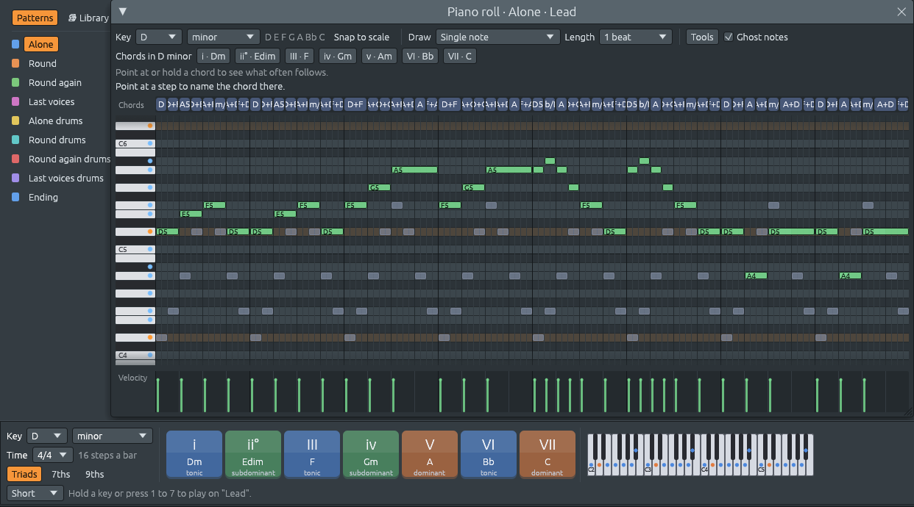
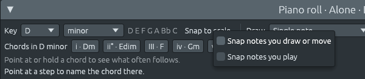

# Changing key: moving the song, and snapping to the scale

Files: [`crates/lineup-core/src/tools.rs`](https://github.com/naelolaiz/ferrous-lineup/blob/main/crates/lineup-core/src/tools.rs),
[`crates/lineup-core/src/project.rs`](https://github.com/naelolaiz/ferrous-lineup/blob/main/crates/lineup-core/src/project.rs),
[`crates/lineup-app/src/piano_roll.rs`](https://github.com/naelolaiz/ferrous-lineup/blob/main/crates/lineup-app/src/piano_roll.rs),
[`crates/lineup-app/src/midi.rs`](https://github.com/naelolaiz/ferrous-lineup/blob/main/crates/lineup-app/src/midi.rs)
and [`crates/lineup-app/src/app/live.rs`](https://github.com/naelolaiz/ferrous-lineup/blob/main/crates/lineup-app/src/app/live.rs)

Until now the **Key** and mode menus (left of the harmony keys, and at
the top of the piano roll) only changed what you *saw*: which rows the
piano roll highlights and what the harmony keys are called. The song
kept playing in its old key, so picking D minor while Frère Jacques
played in C major changed nothing you could hear.

Now a new key moves the song. Pick D and the chords, the bass and the
melody all go up a tone. Pick minor and every note moves to the same
step of the minor scale. The drums stay as they are, and **Ctrl+Z** puts
everything back in one go.




## What FL Studio does, and what we do

In FL Studio the piano roll's key and scale menu never moves a note: it
only highlights the scale and makes notes you draw or drag *snap* to it
("for safety", as its manual puts it). To move a whole song you transpose
its patterns from the playlist. Ferrous Lineup's key menu is the key of the
whole song, the one the harmony keys and hints use, so it moves the song
as well; and the piano roll gets FL Studio's snapping on top (below).

## One note at a time

As with every [tool](../step-6/tools.md), the musical part is a plain
function that changes nothing itself. It answers one question: where does
this note go when the key changes from `from` to `to`?

```rust
pub fn change_key(note: Note, from: Scale, to: Scale) -> Note {
    let up = from.root.semitones_up_to(to.root) as i32;
    let shift = if up > 6 { up - 12 } else { up };
    let Some(moved) = note.transpose(shift) else {
        return note;
    };
    let old = Scale::new(to.root, from.kind);
    let Some(degree) = old.degree_of(moved.pitch_class()) else {
        return moved;
    };
    let (old_steps, new_steps) = (from.kind.intervals(), to.kind.intervals());
    if old_steps.len() == new_steps.len() {
        let offset = new_steps[degree] as i32 - old_steps[degree] as i32;
        moved.transpose(offset).unwrap_or(moved)
    } else {
        nearest_in_key(moved, to)
    }
}
```

It works in two moves:

1. **A new root moves every note by the same distance.** C to D is two
   semitones up. C to G could be seven up or five down; `shift` takes the
   nearer one, so the song stays roughly where it was on the keyboard
   instead of jumping up a fifth. `semitones_up_to` always counts
   upwards (0 to 11), and anything over 6 becomes a step down.
2. **A new mode moves each note to the same degree.** After the first
   move, the note is compared with the *old* kind of scale on the *new*
   root. If it is the third note of D major (F#), it becomes the third
   note of D minor (F). `intervals()` lists each scale's notes as
   semitones above the root, so the difference between the two lists at
   the same index is exactly how far that degree moves:

   | degree        | 1 | 2 | 3  | 4 | 5 | 6  | 7  |
   |---------------|---|---|----|---|---|----|----|
   | major         | 0 | 2 | 4  | 5 | 7 | 9  | 11 |
   | natural minor | 0 | 2 | 3  | 5 | 7 | 8  | 10 |
   | moves by      | 0 | 0 | -1 | 0 | 0 | -1 | -1 |

   So C major to C minor flattens E, A and B, and leaves C, D, F and G.

Two kinds of notes need a rule of their own:

- **Notes outside the old scale**, such as a borrowed chord or a part
  written in a key of its own, have no degree. `degree_of` returns
  `None`, and the `let ... else` returns the note after the first move
  only. It keeps its distance from the root, so a modulation stays a
  modulation.
- **Scales of different sizes**, like major (seven notes) and major
  pentatonic (five), have no matching degrees. Then a note that is not in
  the new scale goes to the nearest one that is, with `nearest_in_key`
  from step 6.

The `let Some(x) = ... else { return ... };` lines are Rust's
*let-else*: if the pattern does not match, the `else` block must leave
the function. Here it is used twice, for "would leave the MIDI range" and
"not in the scale".

## The whole project

`Project::change_key` runs the function over every note that should move:

```rust
pub fn change_key(&mut self, scale: Scale) {
    let from = self.scale;
    if from == scale {
        return;
    }
    let pitched: Vec<bool> = self.channels.iter().map(Channel::is_pitched).collect();
    for pattern in &mut self.patterns {
        for (channel, _) in pitched.iter().enumerate().filter(|(_, p)| **p) {
            let notes: Vec<NoteEvent> = pattern
                .notes(channel)
                .iter()
                .map(|note| match note.is_step() {
                    true => *note,
                    false => NoteEvent {
                        pitch: tools::change_key(note.pitch, from, scale),
                        ..*note
                    },
                })
                .collect();
            pattern.set_notes(channel, notes);
        }
    }
    self.scale = scale;
}
```

Why collect `pitched` first? The loop borrows `self.patterns` mutably,
and Rust will not let it look at `self.channels` through `self` at the
same time. Reading the channels into a small `Vec<bool>` before the loop
ends that borrow early.

`Channel::is_pitched` is a `matches!` on the channel kind: built-in drums
and a MIDI Out channel on the General MIDI drum channel (10) do not move.
Step-sequencer steps (`is_step`) do not move either, because their pitch
only means "play the sample".

Both key menus send their choice to the app, which does

```rust
self.edit("change key", |project| project.change_key(scale));
```

and [`edit`](../step-5/history.md) keeps the project as it was before,
so one Ctrl+Z restores the key *and* every note. The audio thread gets the
new patterns the usual way, so a song that is playing carries on, now in
the new key.

## Snap to scale

Next to the key's notes the piano roll now has a **Snap to scale**
button, like FL Studio's. While it is on:

- a note you draw lands on the nearest note of the key (the outline that
  follows the pointer shows where it will go);
- a note you drag moves only along the key's rows;
- a selection you drag snaps once it has moved. As in FL Studio, notes
  already there are left alone until you touch them: select them and drag
  them up a semitone and back to snap them all.

Right-click the button for its menu, which also has **Snap notes you
play**: keys played on the typing keyboard or a MIDI keyboard sound, and
are recorded, as the nearest note of the key.



In the piano roll it is one small method, used wherever a pitch comes
from the pointer:

```rust
fn snapped(&self, pitch: Note, scale: Scale) -> Note {
    match self.snap_to_scale {
        true => tools::nearest_in_key(pitch, scale),
        false => pitch,
    }
}
```

The group drag needs one more fact: whether the notes have moved yet.
`GroupDrag` gets an `edited: bool` that turns true as soon as the
pointer leaves the cell it started on, and only then are the notes
snapped. Without it, merely clicking on a selection would move it.

### Snapping a MIDI keyboard

The MIDI keyboard is trickier, because its notes never pass through the
UI on their way to the sound: midir calls `on_message` on its own thread,
which sends the note straight to the audio thread (see
[step 7](../step-7/live.md)). So the key to snap to has to be shared
with that thread:

```rust
snap: Arc<Mutex<Option<Scale>>>,
```

The UI writes it once a frame (`Midi::snap_to`), and the callback reads
it for each Note On. There is a catch: if you hold a key, change the key
of the song, and let go, the Note Off would snap to a *different* note
and the first one would ring for ever. So the callback remembers which
note each key started, in `sounding: Vec<(Note, Note)>`, and a Note Off
stops that one. The typing keyboard already kept such a list
(`typing_down`), and now uses the note stored there for the Note Off
too.

## Trying it

1. Open **File > Demos > Songs > Country and folk > Frère Jacques**.
   It starts playing.
2. In the harmony keys bar, pick **D** as the key: the song carries on a
   tone higher. Pick **minor**: it turns dark.
3. Press **Ctrl+Z**: back to D major.
4. Open the piano roll, turn on **Snap to scale**, and move the pointer
   over a dark (out of key) row: the outline sits on the row next to it.
