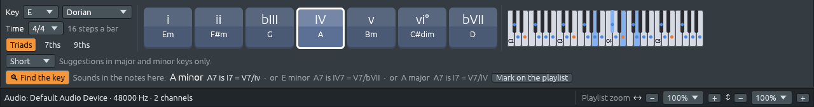
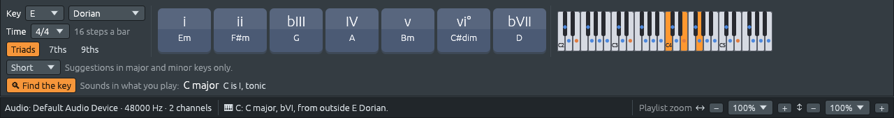

# Finding the key from the music (experimental)

Files: [`crates/lineup-core/src/harmony/key_finding.rs`](https://github.com/naelolaiz/ferrous-lineup/blob/main/crates/lineup-core/src/harmony/key_finding.rs),
[`crates/lineup-core/src/project.rs`](https://github.com/naelolaiz/ferrous-lineup/blob/main/crates/lineup-core/src/project.rs),
[`crates/lineup-listen/src/keys.rs`](https://github.com/naelolaiz/ferrous-lineup/blob/main/crates/lineup-listen/src/keys.rs),
[`crates/lineup-app/src/app/key_finder.rs`](https://github.com/naelolaiz/ferrous-lineup/blob/main/crates/lineup-app/src/app/key_finder.rs)
and [`crates/lineup-app/src/harmony_keys.rs`](https://github.com/naelolaiz/ferrous-lineup/blob/main/crates/lineup-app/src/harmony_keys.rs)

The question that started this: *"Will the MIDI import (and the audio
import) check for key changes on unknown new sources, or chords played by
MIDI in and previous bars context? If it is not clear, it should
highlight the best match and the other alternatives (less highlighted)."*

Until now a key came from somewhere: the project's Key menu, a key marker,
a key signature in a MIDI file, or one guess for a whole recording. The
notes themselves were never asked. This chapter teaches the app to listen
for the key, bar by bar, and to say so when it is not sure.

It is an experiment, so it is off until you turn on **🔍 Find the key**
under the harmony keys.

## What a key sounds like

A key is a home note and the scale around it. You can hear it because
some notes come back far more often than others. In C major, C, E and G
(the home chord) sound most, then the other white keys; the black keys
hardly ever. In A minor the same white keys sound, but A, C and E lead,
and G♯ turns up whenever the music cadences (the raised seventh of
harmonic minor).

Psychologists measured this. Carol Krumhansl and Edward Kessler (1982)
played a scale, then a single note, and asked listeners how well the note
fitted. The answers make a *key profile*: twelve numbers, how much each
note above the tonic belongs. Later, others counted notes in real scores
instead. Ferrous Lineup uses the profiles of Albrecht and Shanahan (2013),
counted over 490 classical pieces:

| note above the tonic | 1 | ♭2 | 2 | ♭3 | 3 | 4 | ♯4 | 5 | ♭6 | 6 | ♭7 | 7 |
|---|---|---|---|---|---|---|---|---|---|---|---|---|
| major | .24 | .01 | .11 | .01 | .14 | .09 | .02 | .21 | .01 | .08 | .01 | .08 |
| minor | .22 | .01 | .10 | .12 | .02 | .10 | .01 | .21 | .06 | .02 | .06 | .05 |

The tonic and the fifth stand out in both; the third tells major (3)
from minor (♭3).

## The Krumhansl-Schmuckler method

To find the key of a stretch of music:

1. Add up how long each of the twelve notes sounds, in any octave. Those
   twelve numbers are the music's *chroma*, C first.
2. Turn each profile so it starts on each of the twelve possible tonics:
   24 keys.
3. Compare the chroma with each of the 24 profiles using their
   *correlation*: 1 when they rise and fall together, 0 when unrelated.
4. The key with the highest correlation wins.

In Rust, the comparison is two lines: subtract the average so both lists
centre on 0, scale them to length 1, then take the dot product.

```rust
fn normalized(values: &Chroma) -> Option<Chroma> {
    let mean = values.iter().sum::<f32>() / 12.0;
    let centered = values.map(|v| v - mean);
    let length = centered.iter().map(|v| v * v).sum::<f32>().sqrt();
    (length > 1e-9).then(|| centered.map(|v| v / length))
}
```

`Option` handles silence: when nothing sounds, all twelve numbers are
equal, the length is 0, and there is no key to find, so the function
returns `None` instead of dividing by zero.

## Sure or not sure

The correlations alone don't say how sure the answer is. C major and A
minor have the same notes, so a tune that stays on the white keys may fit
both almost equally well. `rank_keys` turns the 24 correlations into
*shares* that add up to 1 (a *softmax*): a key's share is
`e^(12 × (fit − best fit))`, divided by the total. A fit better by 0.05
gets a share about 1.8 times larger.

A key is **clear** when its share is at least twice the second best.
Otherwise the next keys whose share is at least 40% of the best are its
**alternatives**, at most two of them. That is what the app shows fainter
after the best key. The numbers were chosen by measuring (see below): a
key shown as clear is right 97% of the time.



E Dorian uses the same notes as A minor and G major, so the profiles
cannot pick its home note with confidence, and the app says so: A minor,
or E minor, or A major. Modes are the hardest case for this method,
because the profiles only know major and minor.

## Where the key changes

A whole song has no single chroma if it modulates. So the music is cut
into bars, and each bar gets a score for each key. A single bar is too
little to go on, though: a bar holding only D7 fits G major better than
C major, even in the middle of a C major song (D7 is the "V of V", a
*secondary dominant*). So each bar is scored over the bars around it:
itself counted three times, its neighbours twice, the bars two away
once.

Then the same trick as for chords in `lineup-listen` (see the spike
chapter): **changing key costs a penalty**, 1.5 in units of correlation,
and the *Viterbi algorithm* finds the sequence of keys with the best total
score. For each bar and each key it keeps only the best way of arriving
there, either staying in the same key or changing from the best key so
far and paying the penalty:

```rust
for k in 0..count {
    let (previous, total) = if best[k] >= leader_score - CHANGE_COST {
        (k, best[k])
    } else {
        (leader, leader_score - CHANGE_COST)
    };
    from[i][k] = previous;
    next[k] = total + here[k];
}
```

At the end it walks back through `from` to read off the path. A new key
wins only when it fits better for long enough to pay back the penalty,
which is exactly "a change only once the new key holds". One borrowed
chord is not a modulation.

Scoring over neighbouring bars blurs *where* a change happens by a bar or
two. So each change is then moved, within three bars, to the bar where the
bars' own notes switch from fitting the old key to fitting the new one.
On the Habanera from *Carmen* it lands exactly on bar 10, where Bizet's
D minor turns to D major.

`Project::heard_keys` does all this for a song's notes: synths and MIDI
Out channels count, drums and samplers (such as an imported recording)
do not, and each note counts for as long as it sounds in each bar. It
gives back `KeySpan`s: a start, an end, and every key ranked.

## While you play

For chords played on a MIDI or typing keyboard there is no score to look
ahead in, only the bars played so far. `KeyListener` keeps a chroma of
the past that fades: each bar, everything heard before counts 0.84 times
as much, so a bar from four bars ago counts half. A new key takes over
only after it has been ahead for two bars in a row.

The bars before you started count too. When you start playing, the
listener starts out believing the key the music around it is in (the
notes at the playhead, or the project's key), as if it had heard a bar
in that key. Play C, F and G7 over an E Dorian song and it first hears
them in the light of A minor; a few bars later it settles on C major,
clear.



## What a chord is in each key

The same chord does a different job in each key it could belong to, and
that is the point of showing the alternatives. G7 is:

| key | numeral | what it does |
|---|---|---|
| C major | V7 | dominant: pulls home to C |
| A minor | ♭VII7 = V7/♭III | the dominant of C, the relative major |
| G major | I7 = V7/IV | the home chord with a flat seventh, pulling to C, the IV |

`read_chord` works this out with what the app already knows about keys:
the Roman numeral (counted along the major scale of the tonic, as
everywhere in Ferrous Lineup, so G in A minor is ♭VII, not VII), the
function of the chords of the key (tonic, subdominant, dominant), a
dominant seventh heard as the dominant of the chord it resolves to, and
the chords borrowed from the parallel key (A♭ in C major is ♭VI,
borrowed from C minor).


## In a recording

A recording has no notes, only sound. `lineup-listen` already measures the
chroma of every beat for its chords; for keys, the beats are put together
into bars and each bar's chroma stands for its notes. Two corrections
mattered:

- **Overtones.** A note sounds its own pitch and a series of fainter
  ones: an octave up, then an octave and a fifth up (the third harmonic),
  and so on. So a recording of C major is full of G, D and B that nobody
  played, and the key often came out a fifth too high (G major for
  C major, D for G). Taking away 0.3 of the note a fifth below from each
  pitch class cancels much of that.
- **Only the treble.** The bass chroma is mostly overtones of low notes.
  With treble and bass together, 66% of the beats were in the right key;
  with the treble alone, 83%, and 84% with the overtone correction.

## Putting it on the playlist

In song mode the bar offers **Mark on the playlist**: the key changes
heard in the whole song become key markers (see the chapter on key
changes), the first one the key the song starts in. No note moves, and
Undo takes them back. It is the way to give an imported recording or MIDI
file without key signatures the key changes it really has.


## How well it works

Measured on the library's demo songs, whose keys (and key markers) come
from their scores. The reports are tests you can run yourself:
`cargo test -p lineup-core --test key_finding -- --ignored --nocapture` for
the notes, and `cargo test --release -p lineup-listen --test key_changes --
--ignored --nocapture` for the demos rendered to audio.

| | from the notes | from audio |
|---|---|---|
| in the right key | 95.2% of 6 091 bars | 84% of 7 303 beats |
| key changes found (within a bar / two beats) | 17 of 37 | 9 of 37 |
| one-key songs given a change that is not there | 6 of 166 | 1 of 34 |

For a whole recording's main key, it is right on 34 of 45 songs, against
32 for the `bpm-key` crate the import used until now.

Where it goes wrong, and why:

- **Short visits.** Most missed changes last four to eight bars, often to
  the dominant (the Badinerie's F♯ minor, the Mountain King's F♯ major
  phrases). Over so few bars the method can't tell a change of key from a
  passage that only *tonicizes* the dominant, and many musicians would
  read those bars as tonicizations too.
- **Relative keys.** Ballin' the Jack (B♭ major) comes out as G minor, and
  Sunday Seventh (C major) as A minor: same notes, another home.
- **Modes.** E Dorian, A Dorian and E Phrygian come out as the major or
  minor key with the same notes, shown as unclear, with the real tonic
  among the alternatives.
- Some of the "changes that are not there" are real: the second half of
  Bach's Air passes through B minor. The scores used for the demos
  only mark the bigger key changes.

## Exercises

1. Open the Habanera, turn on Find the key, and click bar 2 and then
   bar 11 on the ruler. Where exactly does the key change, and why is
   the D major refrain not just "the same tune in another key"?
2. In `key_finding.rs`, set `CHANGE_COST` to 0.8 and run the notes report.
   How many changes are found, and how many of them are not in the
   scores? What does that tell you about the penalty?
3. Hold A C E on the typing keyboard for a few bars, then add G♯ (the
   raised seventh). Does the listener become surer of A minor? Why does
   one note matter so much?
