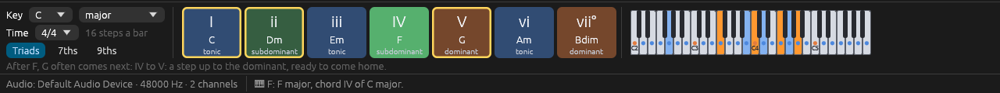
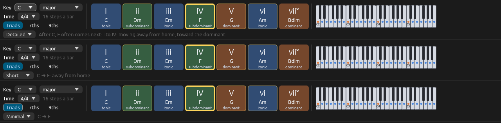

# The harmony keys

Files: [`crates/loom-core/src/harmony/keys.rs`](https://github.com/naelolaiz/ferrous-loom/blob/main/crates/loom-core/src/harmony/keys.rs),
[`crates/loom-core/src/library/voicing.rs`](https://github.com/naelolaiz/ferrous-loom/blob/main/crates/loom-core/src/library/voicing.rs),
[`crates/loom-app/src/harmony_keys.rs`](https://github.com/naelolaiz/ferrous-loom/blob/main/crates/loom-app/src/harmony_keys.rs)
and [`crates/loom-core/src/project.rs`](https://github.com/naelolaiz/ferrous-loom/blob/main/crates/loom-core/src/project.rs)



## The music: seven chords and three jobs

Step 3 built chords by stacking every other note of a scale: in C
major, C E G on the first note, D F A on the second, and so on up to
B D F on the seventh. A key has exactly seven of these chords, and
musicians number them with Roman numerals, upper case for major and
lower case for minor:

```text
  I    ii    iii   IV    V     vi    vii°
  C    Dm    Em    F     G     Am    Bdim
```

Each chord does one of three jobs in the key. This is called its
**function**, and it is the most useful idea in all of harmony:

| Function | Chords | Feels like |
|----------|--------|------------|
| **Tonic** | I, iii, vi | home: the music can rest here |
| **Subdominant** | ii, IV | leaving home, on the way to the dominant |
| **Dominant** | V, vii° | tension that pulls back home to I |

Most songs walk this circle again and again: home, away, tension,
home. *I IV V I* is the plainest version; *ii V I* is the jazz version;
*vi IV I V* is the same walk starting from a sadder home. The harmony
keys are coloured by function, blue, green and orange, so you can see
the walk while you hear it.

In a minor key the seven chords come from the natural minor scale, with
one change that almost all music in minor keys makes: the chord on V is
**major**. A minor's natural V is E minor, E G B. Raising the G to G#
gives E major, E G# B, and that G# is a semitone below the tonic A: a
*leading tone* that pulls up to it. That raised note is what the
harmonic minor scale is, so the keys take their V from there.

## The model: `chord_keys`

The harmony keys are pure music theory, so they live in `loom-core`,
with tests, and know nothing about egui:

```rust
pub fn chord_keys(scale: Scale, size: ChordSize) -> Vec<ChordKey> {
    let scale = chord_scale(scale);
    let leading_tone = Scale::new(scale.root, ScaleKind::HarmonicMinor);
    (0..7)
        .filter_map(|degree| {
            let from = if scale.kind == ScaleKind::NaturalMinor && degree == 4 {
                leading_tone
            } else {
                scale
            };
            let chord = chord_on(from, degree, size)?;
            Some(ChordKey {
                degree,
                chord,
                numeral: scale.roman_numeral(chord)?,
                function: Function::of(degree),
            })
        })
        .collect()
}
```

`filter_map` runs the closure on every degree and keeps only the
`Some`s, and inside the closure `?` turns a `None` into "leave this one
out". `chord_scale` handles scales that have no seven chords of their
own: a pentatonic or blues scale borrows the major or minor scale with
the same root.

`ChordSize` picks triads, sevenths or ninths:

```rust
#[derive(Debug, Clone, Copy, PartialEq, Eq, Default)]
pub enum ChordSize {
    #[default]
    Triads,
    Sevenths,
    Ninths,
}
```

Ninths stack five notes, and on two degrees of a major key (iii and
vii) the fifth note lands a semitone above the root, an octave up. That
"minor ninth" clashes, and players leave it out, so `Scale::ninth`
returns `None` there and the key falls back to the seventh chord:

```rust
ChordSize::Ninths => scale.ninth(degree).or_else(|| scale.seventh(degree)),
```

`Option::or_else` tries the closure only when the first value is
`None`. It is the `Option` version of "if that did not work, try this".

## Playing a chord: voice leading

Pressing **C** and then **F** could play C E G and then F A C, all
three notes jumping up. A pianist would not: from C E G they move to
C F A, keeping the C and moving the other two fingers a step each. That
is **voice leading**, and it is most of what makes chords sound smooth
instead of mechanical.

`library::voicing::voice` does this. It tries every inversion of the
new chord (the same notes, each one in turn at the bottom) and keeps
the one closest to the chord before:

```rust
pub fn voice(chord: Chord, previous: Option<&[Note]>) -> Vec<Note> {
    let candidates = inversions(chord);
    // ...
    let best = match previous {
        Some(previous) => candidates
            .into_iter()
            .min_by_key(|notes| distance(notes, previous)),
        None => /* the one nearest the middle of the keyboard */,
    };
    best.unwrap_or_default()
}
```

`min_by_key` walks an iterator and returns the item for which the
closure gives the smallest number. `distance` adds up, for each note of
one chord, how far it is from the nearest note of the other.

The harmony keys remember the last voicing, and `keys::play` adds the
chord's root below it, the way a left hand would:

```rust
pub fn play(chord: Chord, previous: Option<&[Note]>) -> (Vec<Note>, Vec<Note>) {
    let voicing = voice(chord, previous);
    let mut notes = voicing.clone();
    if let Some(&lowest) = voicing.first() {
        let down = match chord.root.semitones_up_to(lowest.pitch_class()) {
            0 => 12,
            gap => gap,
        };
        if let Some(root) = lowest.transpose(-i32::from(down)) {
            notes.insert(0, root);
        }
    }
    (voicing, notes)
}
```

It returns a *tuple* of two vectors: the voicing, to remember for next
time, and the notes to play. A tuple is the lightest way to return two
things; the caller takes it apart with `let (voicing, notes) = ...`.
`match` with a named pattern, `gap => gap`, catches every other value
and gives it a name.

## Holding a key down

egui buttons are *clicked*: the click happens when the mouse button
comes up. A harmony key is not a button, it is a key. Its chord must
start when the mouse goes down and stop when it comes up. egui answers
that question too: `Response::is_pointer_button_down_on()` is true on
every frame while the button is held on that widget. So each frame the
bar finds the key the mouse is holding, if any, and compares it with
the key that is sounding:

```rust
enum Holder {
    Mouse,
    /// A number key on the computer keyboard, 1 to 7.
    Digit(Key),
}

struct Down {
    key: usize,
    holder: Holder,
    notes: Vec<Note>,
}
```

`Holder::Digit(Key)` is an enum variant that *carries a value*: which
number key is down. When that key comes up, only a `Down` held by the
same digit is released; the mouse cannot release a chord the keyboard
is holding, or the other way round. `Down` keeps the exact notes it
started, so the right notes stop even if the key or the chord size
changed while it was held.

The chord's notes go the same way as the typing keyboard's from step 7:

```rust
HarmonyAction::NoteOn(notes) => {
    for pitch in notes {
        self.play_typed(MidiMessage::NoteOn {
            channel: 0,
            pitch,
            velocity: DEFAULT_VELOCITY,
        });
    }
}
```

`play_typed` sends them to the audio thread, which plays them on the
selected channel, and to `key_played`, which keeps the list of held
keys and records them. So the chord is named in the status bar, lights
up in the piano roll, and is recorded with **● Rec**, without any of
that code knowing the harmony keys exist. Reusing a path that is
already tested is cheaper and safer than building a second one.

## Which chord is playing?

While the music plays, the bar lights the key of the chord *you hear*.
That needs the notes sounding at the playhead, but not all of them: a
melody's passing notes or a walking bass would turn C major into
"three notes that are not a chord". `Project::chord_notes_in_song`
keeps only the channels that hold two notes or more, which is the
accompaniment:

```rust
fn chord_notes(parts: Vec<Vec<Note>>) -> Vec<Note> {
    let chords: Vec<Note> = parts
        .iter()
        .filter(|part| part.len() >= 2)
        .flatten()
        .copied()
        .collect();
    if chords.is_empty() {
        parts.into_iter().flatten().collect()
    } else {
        chords
    }
}
```

`flatten` turns an iterator of lists into one long iterator of their
items, and `copied` turns the `&Note`s it gives into `Note`s. If no
channel holds a chord (a solo melody), all the notes count.

The bar runs `analyze` from step 3 on these notes, and on the keys held
down, which win. The chord found lights its key, and is what the
suggestions from step 6, `next_chords`, start from.

## How much the hints say



After a chord, up to four keys can be outlined: every chord that often
comes next. The most usual one gets a slightly brighter outline than
the others, and the hint line talks about it.

### Now and next


Two marks share the bar, and they must not be confused: the chord
**sounding now**, and the chords that **may come next**. At first the
next chord had the louder mark, a thick bright yellow frame, while the
current one was only a little brighter. While a song played, the eye
went to the frame, so the bar seemed to show the next chord and hide
the one you were hearing. Now the chord sounding is lit and framed in
thick white, and the suggestions are only a thin yellow line. A key
that is sounding never gets the yellow line too, so each key carries
one mark at most.

Both kinds of key, the seven chords and the keys of a twelve-tone row
or a pitch-class set, draw the frame with the same small function:

```rust
fn paint_playing(painter: &Painter, rect: Rect) {
    painter.rect_stroke(rect, 6.0, Stroke::new(3.0, PLAYING), StrokeKind::Inside);
}
```

`StrokeKind::Inside` draws the line inside the key's rectangle, so the
frame never spills onto the gap between keys. Which key is sounding
did not change: it is still worked out from the notes at the playhead,
as above, so it follows tempo changes too.

The hint line, the keys' tooltips and the piano roll's "Chords in"
row explain at one of three levels, picked in the small menu at the
start of the hint line:

| Level | After C, the hint line says |
|---|---|
| Detailed | After C, F often comes next: I to IV: moving away from home, toward the dominant. |
| Short (the default) | C → F: away from home |
| Minimal | C → F |

The level is a small enum in `loom-core/src/harmony/hints.rs`. With
`#[derive(Default)]`, the variant marked `#[default]` is the one
`HintLevel::default()` returns:

```rust
#[derive(Debug, Clone, Copy, PartialEq, Eq, Default)]
pub enum HintLevel {
    Detailed,
    #[default]
    Short,
    Minimal,
}
```

Each move in the tables of `progression.rs` now carries its reason
twice, in a few words and in a sentence. The tables are constants, and
a constant can only be built by code the compiler can run while
compiling. A `const fn` is such code, so a tiny one keeps every move on
one line:

```rust
const fn go(to: usize, short: &'static str, reason: &'static str) -> Move {
    Move { to, short, reason }
}

// I
&[
    go(3, "away from home", "I to IV: moving away from home, toward the dominant."),
    // ...
],
```

`Suggestion::why(level)` then picks the words to show, and returns an
`Option`, because at the Minimal level there are none:

```rust
pub fn why(&self, level: HintLevel) -> Option<&'static str> {
    match level {
        HintLevel::Detailed => Some(self.reason),
        HintLevel::Short => Some(self.short),
        HintLevel::Minimal => None,
    }
}
```

The menu lives in the harmony bar, but the piano roll needs the level
too. Rather than sharing it through a reference, the app copies it into
the piano roll every frame (`self.piano_roll.hints =
self.harmony_keys.hints`). `HintLevel` is `Copy`, so that is as cheap as
copying a number, and each view keeps owning its own state. The level
is not saved: it starts at Short each time the app opens.
