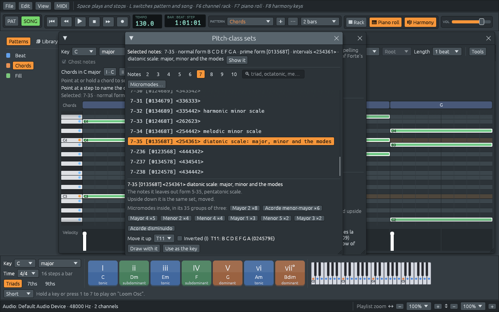

# Micromodes: Kröpfl's twelve colours of three notes

Files: [`crates/loom-core/src/harmony/micromode.rs`](https://github.com/naelolaiz/ferrous-loom/blob/main/crates/loom-core/src/harmony/micromode.rs),
[`crates/loom-core/src/micromodal.rs`](https://github.com/naelolaiz/ferrous-loom/blob/main/crates/loom-core/src/micromodal.rs),
[`crates/loom-core/src/library/micromodes.rs`](https://github.com/naelolaiz/ferrous-loom/blob/main/crates/loom-core/src/library/micromodes.rs),
[`crates/loom-core/src/library/rows.rs`](https://github.com/naelolaiz/ferrous-loom/blob/main/crates/loom-core/src/library/rows.rs),
[`crates/loom-app/src/micromodes.rs`](https://github.com/naelolaiz/ferrous-loom/blob/main/crates/loom-app/src/micromodes.rs)
and [`crates/loom-app/src/twelve_tone.rs`](https://github.com/naelolaiz/ferrous-loom/blob/main/crates/loom-app/src/twelve_tone.rs)

The last chapter gave every group of notes a name: its pitch-class set.
This one looks closely at the smallest groups that still have a
character of their own, the groups of **three** notes, the way the
Argentine composer **Francisco Kröpfl** taught his students to hear
them. He called them **micromodes** (*micromodos*): twelve small
"modes" of three notes, each with a colour you learn to recognise.

What Ferrous Loom gains:

- **Micromodes…** in the piano roll opens a window with Kröpfl's twelve
  micromodes in his three families. Each one is drawn on a clock, with
  its prime form in solfège (*do - do# - mi*), its intervals, its
  pitch-class set and its hour on Peter Schat's Tone Clock. You can
  hear it, draw with it or use it as the key.
- Select some notes and the window lists the micromodes inside them:
  the seven notes of C major hold 35 groups of three, and you see how
  many of each colour.
- The **Sets** window and the **Micromodes** window point at each
  other. A set of three notes says which micromode it is, a larger set
  lists the micromodes inside it, and every name is a button that
  opens the other window on the right class.
- The Library gets a group **Micromodes (Kröpfl)** with seven styles,
  and **File > Demos > Micromodes** plays each of them as a short
  piece in five sections.
- The row of Webern's *Concerto*, Op. 24, made of four groups of three
  that are all the same micromode, joins the famous rows, with a style
  and a demo of its own.




## What FL Studio does, and what we do

FL Studio has nothing like this; like the last chapter, this one is
not a copy of anything. It is the tool a student of Kröpfl's method
would want beside a piano roll: something that names the groups of
three in what you play, and plays them back to you, so that your ear
learns their colours.

## Three notes, twelve colours

Francisco Kröpfl (1931–2021) was born in Timișoara, Romania, and grew
up in Argentina. He was a pioneer of electronic music in Latin America:
in 1958 he founded the Estudio de Fonología Musical at the University
of Buenos Aires, the first electronic music studio of a university on
the continent. He was also a teacher of composition for decades, and
his piano piece *Música '66* was written to try out the method he
taught.

That method starts from a simple observation. Pick any three different
notes. However you spell them, in whatever order and in whatever
octaves you play them, the three notes have three intervals between
them, and those intervals give the group a colour: C, Db and E have
the same tense, bittersweet sound whether you play them as a chord, as
a melody, or spread over four octaves. Move the group up
(D, Eb, F#) and it keeps its colour. Turn it upside down (C, B, Ab, the
same intervals going down) and the colour is still the same family of
sound.

So Kröpfl counted three notes as **the same micromode** when they are:

- the same notes in another order or octave, or spelled another way
  (C# and Db are one note here),
- moved up or down (transposed), or
- turned upside down (inverted).

These are exactly the rules of the pitch-class sets of the last
chapter. Of the 220 ways to choose three notes out of twelve, the rules
leave only **twelve** different micromodes. Repeat one of them through
a passage and the passage takes its colour; Pablo Cetta, a composer and
theorist who studied Kröpfl's music, describes it as "un 'color' o
timbre global particular y reconocible", a particular, recognisable
overall colour or timbre.

### The table

Each micromode is written in its **prime form**: its most compact
shape, starting on C (*do*), the same prime form as in the set
browser. This is Pablo Cetta's table, with the numbers Allen Forte gave
the same twelve groups in 1973:

| | Micromode | Prime form | Forte | Intervals (vector) | Forms |
|---|-----------|------------|-------|--------------------|-------|
| 1 | **Menor 1** | do - do# - re | 3-1 [012] | two minor seconds, a major second | 12 |
| 2 | **Menor 2** | do - do# - re# | 3-2 [013] | minor second, major second, minor third | 24 |
| 3 | **Menor 3** | do - do# - mi | 3-3 [014] | minor second, minor third, major third | 24 |
| 4 | **Menor 4** | do - do# - fa | 3-4 [015] | minor second, major third, fourth | 24 |
| 5 | **Menor 5** | do - do# - fa# | 3-5 [016] | minor second, fourth, tritone | 24 |
| 6 | **Mayor 1** | do - re - mi | 3-6 [024] | two major seconds, a major third | 12 |
| 7 | **Mayor 2** | do - re - fa | 3-7 [025] | major second, minor third, fourth | 24 |
| 8 | **Mayor 3** | do - re - fa# | 3-8 [026] | major second, major third, tritone | 24 |
| 9 | **Mayor 4** | do - re - sol | 3-9 [027] | major second, two fourths | 12 |
| 10 | **Acorde disminuido** | do - mib - solb | 3-10 [036] | two minor thirds, a tritone | 12 |
| 11 | **Acorde menor-mayor** | do - mib - sol | 3-11 [037] | minor third, major third, fourth | 24 |
| 12 | **Acorde aumentado** | do - mi - sol# | 3-12 [048] | three major thirds | 4 |

"Fourth" here means a perfect fourth *or* a perfect fifth: in a set, an
interval and its inversion count as one (C up to G is a fifth, G up to
C a fourth; the pair C and G is the same either way). "Forms" counts
how many different groups of three notes are that micromode: the prime
form and its inversion on each of the twelve notes. Most have 24; those
that are their own inversion have 12; the augmented triad only 4,
because moving it up a major third gives the same three notes again.
The forms add up to 220, every group of three there is.

### Three families, and their names

Kröpfl sorted the twelve into three families. Pablo Jaureguiberry, who
analysed the music of Kröpfl's student Diana Rud, gives the rules:

- "Los micromodos **menores** son todos aquellos que están compuestos
  por al menos un intervalo de segunda menor": the **minor**
  micromodes are all those with at least one minor second (a semitone).
  There are five, Menor 1 to 5.
- "Los **mayores** tienen todos al menos una segunda mayor y a su vez
  carecen de semitonos": the **major** ones all have at least one major
  second and no semitone. There are four, Mayor 1 to 4.
- "Los restantes contienen al menos dos terceras cada uno": the rest
  have at least two thirds each. They are the three triads, and they
  are named after them: the **diminished**, the **minor and major**
  (*menor-mayor*), and the **augmented** chord.

The names come from the prime form, as Cetta explains: the first nine
start with a second, minor (*do - do#*) or major (*do - re*), and the
number counts up as the third note rises. So Menor 3 is "the third
group that starts with a minor second", *do - do# - mi*.

One micromode deserves a second look: **Acorde menor-mayor**. Its prime
form, C Eb G, is a minor triad. Turned upside down from C it is C, A
and F: an F major triad. Minor and major triads are mirror images of
each other, so they are one micromode, and its name says both. Every
chord of a I–IV–V–I progression is the same micromode; what tonal music
does with them is a matter of *which* forms, not which colour.

### Finding the micromode of three notes by hand

Cetta gives two examples of Menor 3: E, F and Ab, and F, D and Gb.

1. **E F Ab.** Put the notes in order inside one octave, as close
   together as they go: E F Ab spans four semitones, the smallest
   span. Move the group so it starts on C: C C# E. That is
   *do - do# - mi*, the prime form of Menor 3.
2. **F D Gb.** In order and as close as possible: D F Gb, a span of
   four semitones. From C: C Eb E, which is *do - mib - mi*, not in the
   table. Turn it upside down: the intervals 3 then 1 become 1 then 3,
   C C# E. Menor 3 again.

That is the whole algorithm: the **normal form** (the closest order),
moved to C, compared with its inversion, the more compact of the two
winning. The set browser of the last chapter already does it, so
Ferrous Loom finds the micromode of three notes by asking for their
prime form and looking it up in the table.

### The same twelve, three times

Kröpfl was not the only one to find these twelve. In *The Structure of
Atonal Music* (1973), the American theorist **Allen Forte** listed
every set class, and his twelve trichords, 3-1 to 3-12, are the
micromodes in the same order. The Dutch composer **Peter Schat** found
them again and arranged them as the twelve hours of his **Tone Clock**
(*The Tone Clock*, 1993): hour I is Menor 1, hour III is Menor 3, hour
XII the augmented triad.

The three did not mean the same thing by them, though. Marcela Pavia,
comparing Forte and Kröpfl, describes Forte's classification as
mathematical, and Kröpfl's as built on how we *perceive* groups of
notes, after the Gestalt psychologists; she finds that the two give
very different results when you use them to analyse music. Forte
counts every subset of every chord; Kröpfl listens for the groups the
music makes you hear as a unit. Ferrous Loom shows both: the Forte
number beside every micromode, and the micromodes beside every Forte
set.

## Bigger sets are made of micromodes

A set of *n* notes holds *n*(*n*−1)(*n*−2)/6 groups of three: 4 for a
four-note chord, 10 for a pentatonic scale, 35 for a seven-note
scale. Counting which micromodes they are gives the set's **micromode
content**, a fingerprint of its colours. Some examples, all checked by
the tests:

- **The dominant seventh**, C E G Bb: C E G is a major triad (Acorde
  menor-mayor), E G Bb a diminished triad, C E Bb is Mayor 3 (the
  chord without its fifth) and C G Bb is Mayor 2. One of each.
- **The pentatonic scale**, C D E G A (5-35): Mayor 2 four times,
  Mayor 4 three times, Acorde menor-mayor twice (C E G and A C E) and
  Mayor 1 once (C D E). No semitone, so no minor micromode at all,
  which is why the pentatonic scale sounds so smooth.
- **The diatonic scale**, the seven notes of C major (7-35): Mayor 2
  ×8, Acorde menor-mayor ×6 (the three major and three minor triads),
  Mayor 4 ×5, Menor 2 ×4, Menor 4 ×4, Mayor 1 ×3, Menor 5 ×2, Mayor 3
  ×2 and one diminished triad (B D F). No Menor 1, Menor 3 or augmented
  triad: you cannot play those with the white keys alone.
- **The whole-tone scale** (6-35): Mayor 1 ×6, Mayor 3 ×12 and the
  augmented triad twice. Nothing else, because every interval in it is
  even.
- **C C# D# E** (4-3), from Jaureguiberry's analysis of Diana Rud's
  *Tres amores* (1986): two Menor 2 and two Menor 3. Rud builds her
  four-note chords so that each bar keeps three notes of the bar
  before and adds a new one, and the micromodes inside them change
  bit by bit.
- **C C# F# G** (4-9), from Cetta's analysis of *Música '66*: four
  groups of three, all Menor 5. Kröpfl sets these next to Menor 3 in
  the piece.

This is how the two windows link. A micromode *is* a pitch-class set,
one of the twelve with three notes, so the Sets window marks those
twelve with their micromode's name, and a larger set is *made of*
micromodes, so the Sets window lists them under its details. In the
Micromodes window, the notes you select are analysed the same way.

## A row made of one micromode: Webern's Concerto

Composers before Kröpfl had heard the same thing. Arnold Schoenberg's
*Piano Piece*, Op. 11 No. 1 (1909), opens with B, G# and G: Menor 3.
Anton Webern went further. The row of his *Concerto for nine
instruments*, Op. 24 (1934), is made of four groups of three:

```text
B Bb D | Eb G F# | Ab E F | C C# A
```

Every group is Menor 3, and each is a form of the first:

| group | notes | intervals | form of the first group |
|-------|-------|-----------|-------------------------|
| 1 | B Bb D | down 1, up 4 | itself |
| 2 | Eb G F# | up 4, down 1 | backwards and upside down (RI) |
| 3 | Ab E F | down 4, up 1 | backwards (R) |
| 4 | C C# A | up 1, down 4 | upside down (I) |

At the start of the Concerto the four groups are played by oboe,
flute, trumpet and clarinet, one after another, so you hear the same
colour four times in four instruments. Schat built harmonies the same
way, from forms of one hour that together use all twelve notes; in his
terms, Webern's row is made of hour III.

Webern did not think in micromodes: the word came decades later. The
Concerto is a twelve-tone piece, and Webern built its row from four
forms of one group. "Menor 3" and "3-3" are later names for that group,
the way a theorist would describe it. Cetta notes
that Kröpfl, like the composers of Schoenberg's circle, favoured groups
of three notes, which is why the two meet here.

The row is now one of the famous rows in the Row window, as
**Webern's Concerto**, and the Library and **File > Demos >
Micromodes** have a style built on it, **Webern's trichords**: the row
as a melody leaping over three octaves, with each group of three as a
chord under it. The rhythm is Ferrous Loom's, not Webern's.

**Why this one is allowed.** Only music in the public domain is copied
into Ferrous Loom. Webern died in 1945, so his music is in the public
domain wherever copyright lasts 70 years after the author's death, and
only the twelve notes of the row are used, never his score. Kröpfl died
in 2021 and his students are alive, so their music is still under
copyright, and none of it is in the app: the seven micromode styles
were written for Ferrous Loom.

## Music from one micromode

How do you write music with one micromode? Alejandro Martínez describes
the micromode as "elemento mínimo de construcción melódico/armónica",
the smallest building block of melody and harmony alike. The chords are
forms of the micromode, and so are the groups of the melody, so the
whole passage has one colour. The question is which form comes next.
Ferrous Loom offers two answers, in `micromodal.rs`.

### Moving every note the same distance

The simplest is a **sequence**: move all three notes up by the same
interval each time. *Whole-tone haze* moves Mayor 1 up a whole tone
every bar: C D E, D E F#, E F# G#... It never leaves one whole-tone
scale, the sound of Debussy's *Voiles*. *Augmented drift* slides the
augmented triad down a semitone at a time; after four chords the fifth
has the notes of the first, because there are only four augmented
triads.

### Keeping two notes, moving one

The smoother way is to keep **two** notes of each group and move only
the third, so that each group grows out of the last. For the triads,
this gives a famous set of moves. From C major (C E G):

| move | keeps | moves | gives |
|------|-------|-------|-------|
| **P** (parallel) | C and G | E down to Eb | C minor |
| **L** (leading-tone exchange) | E and G | C down to B | E minor |
| **R** (relative) | C and E | G up to A | A minor |

These are the three moves of **neo-Riemannian theory**, which
theorists use to explain the chromatic chord changes of Wagner and
Liszt. The demo *Triads, two notes kept* walks this way: C minor, C
major, E minor, E major, C# minor, Db major, Bb minor, Bb major...

The same walk works for every micromode, with a surprise. Three of
them cannot get out of a small corner of the twelve notes:

- **Mayor 1** (C D E) and **Mayor 3** (C D F#) have only even
  intervals: 2, 4 and 6 semitones. A form that keeps two of their
  notes must add a third at an even distance from them, so it stays in
  the same **whole-tone scale**. The walk reaches 6 notes, never 12.
- The **diminished triad** has only intervals of 3 and 6 semitones, so
  it stays in one **diminished seventh chord**: 4 notes.
- The **augmented triad** has only intervals of 4 semitones. Two of its
  notes fix the third, so no other form shares two notes with it. Its
  walk moves it up a semitone instead.

Every other micromode has an odd interval somewhere, and its walk goes
round all twelve notes. The tests check each of these numbers.

### Which form to keep

Several forms share two notes with the current one (for Menor 3 on C
C# E there are three: A C C#, C D# E and C# E F), so the walk needs a
rule to pick one. Ferrous
Loom's rule, in order:

1. the form whose **new note** has not been heard for the longest
   time, so the music goes round all the notes it can reach,
2. then the form itself used least recently, so a walk shut inside a
   few notes (Mayor 1, the diminished triad) still goes round all its
   forms instead of rocking between two,
3. then the smallest movement of the notes that change,
4. and finally the set's bits, so the choice is always the same.

### Textures

A walk is a list of forms. A **texture** says how one instrument plays
them: as **chords** (the shared notes stay where they are and the
changing note moves to the nearest place, smooth voice leading), as
chords struck again and again (**pulse**), as a **line** (the new note
first, then the others), as an **arpeggio** (up and down), or as a
**bass** (the root of a triad, otherwise the first note of the normal
form). Every instrument of a style plays the same walk, each in its own
texture, so the bass, the chords and the tune always share their three
notes.

A line plays the note that just arrived first, so you hear what
changed, then the two that stayed. `write_forms` splits the form's
notes in two with `partition`, which sends each item to one of two
collections by a yes-or-no closure, in one pass:

```rust
let (new, kept): (Vec<PitchClass>, Vec<PitchClass>) =
    normal.into_iter().partition(|p| !old.contains(*p));
new.into_iter().chain(kept).collect()
```

`old` is the form before; the notes not in it are new. `chain` then
joins the two lists again, new notes first.

The seven styles:

| style | micromode | walk | sound |
|-------|-----------|------|-------|
| Menor 3 colour | Menor 3 | keep two notes | chords, tune and bass in one colour |
| Viennese points | Menor 5 | keep two notes | single notes leaping over three octaves over soft chords |
| Cluster pulse | Menor 1 | keep two notes | clusters creeping up a semitone at a time, over a techno beat |
| Whole-tone haze | Mayor 1 | up a whole tone | arpeggios in 3/4 |
| Fourths groove | Mayor 4 | keep two notes | sus chords over a neo-soul beat |
| Triads, two notes kept | menor-mayor | keep two notes | P, L and R moves |
| Augmented drift | aumentado | down a semitone | four augmented triads, round and round |

A demo plays one pass from the micromode on C, then upside down, then
from a tritone away (F#), then upside down from there, and the first
pass again. Click a style in the Library while the song plays and the
whole song goes over to it: its chords and bass are replaced by the
walk, the patterns start from those four places in turn, and the key
becomes the micromode itself, a pitch-class set, so the harmony keys
play its forms.

## The micromodes in Rust: a table in a `static`

A micromode is data: a name, a family, a prime form, a line of text.
The twelve are a `static` array of a plain struct:

```rust
/// One of the twelve micromodes.
#[derive(Debug, Clone, Copy, PartialEq, Eq, Hash)]
pub struct Micromode {
    /// From 1 to 12: its place in the table, which is also its Forte
    /// number (3-`number`) and its hour on Peter Schat's Tone Clock.
    pub number: u8,
    pub family: MicromodeFamily,
    /// Kröpfl's name, in Spanish, as his students use it: "Menor 3".
    pub name: &'static str,
    /// The name in English.
    pub english: &'static str,
    /// The prime form, from C.
    pub prime: PitchSet,
    /// The prime form in solfège, as in Cetta's table: "do - do# - mi".
    pub solfege: &'static str,
    /// Where you hear it: a chord or scale it belongs to, or music that
    /// is built from it.
    pub about: &'static str,
}
```

```rust
static MICROMODES: [Micromode; 12] = [
    Micromode {
        number: 1,
        family: MicromodeFamily::Minor,
        name: "Menor 1",
        english: "Minor 1",
        prime: prime(0b0000_0000_0111),
        solfege: "do - do# - re",
        about: "Three notes a semitone apart: the smallest cluster, a chromatic scale in \
                miniature.",
    },
    // ... eleven more
];
```

`prime(0b0000_0000_0111)` is the set {C, C#, D} written as the bits of
a `u16`, one bit per note, as in the last chapter (C is the lowest
bit). `prime` is a `const fn`, so the whole table is built at compile
time and costs nothing when the program starts. Because every field is
`Copy` (numbers, enums, `&'static str` and `PitchSet`, which is a
`u16`), `Micromode` derives `Copy` too, but the rest of the code passes
`&'static Micromode` around: a reference into the table, which can
never dangle because the table lives as long as the program.

Finding the micromode of three notes reuses the set theory:

```rust
pub fn of(set: PitchSet) -> Option<&'static Micromode> {
    if set.len() != 3 {
        return None;
    }
    let prime = set.prime_form();
    MICROMODES.iter().find(|m| m.prime == prime)
}
```

### Checking a table with tests

A hand-written table can have typos. The tests check it from three
directions, none of which trusts the table:

- **Against Forte.** The set classes of the last chapter, filtered to
  three notes, must be the twelve prime forms in the same order, named
  3-1 to 3-12.
- **Against counting.** A loop over all 4096 sets (every `u16` from 0
  to 4095) checks that exactly the sets of three notes have a
  micromode, that there are 220 of them, and that each micromode's
  forms match how often it was found.
- **Against the rules.** The families are worked out again from the
  intervals, with Jaureguiberry's rules, by a function that only the
  tests can see:

```rust
#[cfg(test)]
fn of_intervals(vector: [u8; 6]) -> MicromodeFamily {
    if vector[0] > 0 {
        MicromodeFamily::Minor
    } else if vector[1] > 0 {
        MicromodeFamily::Major
    } else {
        MicromodeFamily::Chord
    }
}
```

`#[cfg(test)]` on a single function compiles it only for `cargo test`.
Without it, `cargo clippy` warns that the function is never used,
because only the tests call it. The solfège is checked too: each
syllable is turned back into a number (`"do#"` is 1, `"mib"` is 3) and
the notes must be the prime form.

The interval vector is read in that function as `vector[0]` (minor
seconds), `vector[1]` (major seconds) and so on; the same vector also
gives the intervals in words, for the window:

```rust
pub fn intervals(&self) -> String {
    const NAMES: [(&str, &str); 6] = [
        ("minor second", "minor seconds"),
        ("major second", "major seconds"),
        ("minor third", "minor thirds"),
        ("major third", "major thirds"),
        ("perfect fourth or fifth", "perfect fourths or fifths"),
        ("tritone", "tritones"),
    ];
    let vector = self.prime.interval_vector();
    let mut parts = Vec::new();
    for (class, &count) in vector.iter().enumerate() {
        let (one, many) = NAMES[class];
        match count {
            0 => {}
            1 => parts.push(format!("a {one}")),
            2 => parts.push(format!("two {many}")),
            _ => parts.push(format!("three {many}")),
        }
    }
    match parts.as_slice() {
        [one] => one.clone(),
        [first @ .., last] => format!("{} and {last}", first.join(", ")),
        [] => String::new(),
    }
}
```

The last `match` is a **slice pattern** with a binding. `[one]` matches
a slice of exactly one item. `[first @ .., last]` matches any slice of
two or more: `..` stands for "the rest", and `first @` gives that rest
a name, so `first` is a slice of everything but the last item. Then
`["a minor second", "a minor third", "a major third"]` becomes "a minor
second, a minor third and a major third", with the "and" in the right
place and no index arithmetic that could go wrong.

The plurals are a pair of strings instead of `format!("{name}s")`,
because English plurals are not always an added "s": "two perfect
fourths or fifths", not "two perfect fourth or fifths".

### Counting groups of three

`trichords` lists every group of three notes of a set, with three
nested loops whose indexes always go up, so no group is listed twice:

```rust
pub fn trichords(set: PitchSet) -> Vec<PitchSet> {
    let notes: Vec<PitchClass> = set.iter().collect();
    let mut trios = Vec::new();
    for a in 0..notes.len() {
        for b in a + 1..notes.len() {
            for c in b + 1..notes.len() {
                trios.push([notes[a], notes[b], notes[c]].into_iter().collect());
            }
        }
    }
    trios
}
```

`[notes[a], notes[b], notes[c]].into_iter().collect()` turns an array of
three pitch classes into a `PitchSet`: `PitchSet` implements
`FromIterator<PitchClass>`, so `collect` knows how to build one, and
the return type `Vec<PitchSet>` tells it which collection to build.

`micromode_content` counts them into a `[u16; 12]`, one counter per
micromode. To show them, `micromodes_in` keeps the ones found and sorts
them, the most common first:

```rust
pub fn micromodes_in(set: PitchSet) -> Vec<(&'static Micromode, u16)> {
    let counts = micromode_content(set);
    let mut found: Vec<(&'static Micromode, u16)> = MICROMODES
        .iter()
        .zip(counts)
        .filter(|(_, count)| *count > 0)
        .collect();
    found.sort_by_key(|(m, count)| (std::cmp::Reverse(*count), m.number));
    found
}
```

`sort_by_key` sorts from the smallest key up, and here we want the
*largest* count first. `std::cmp::Reverse` wraps a value and compares it
the other way round, so `Reverse(8)` comes before `Reverse(6)`. The key
is a **tuple**, and tuples compare item by item: first the counts
(reversed), and only when two counts are equal, the micromode's number.
So equal counts keep the table's order, and the list is the same every
time it is drawn.

## The walk: choosing with a tuple

The walk's rule, "the freshest new note, then the form used least
recently, then the smallest move", is one `min_by_key` with a tuple of
four:

```rust
members
    .iter()
    .copied()
    .filter(|&set| set != current && shared(set) == most)
    .min_by_key(|&set| {
        let new = PitchSet::from_bits(set.bits() & !current.bits());
        // The new note heard most recently decides; never heard is best.
        let freshest = new
            .iter()
            .map(|p| heard[usize::from(p.semitone())].map_or(0, |i| i + 1))
            .max()
            .unwrap_or(0);
        // How far the moving notes go, each to its nearest new note.
        let moves: u8 = /* ... */;
        // Then the form itself heard least recently, so a walk shut in
        // a few notes still goes round all its forms.
        let used = before.iter().rposition(|&f| f == set).map_or(0, |i| i + 1);
        (freshest, used, moves, set.bits())
    })
    .unwrap_or(current)
```

A few things to notice:

- `members` is every form of the micromode (24, 12 or 4 of them).
  `shared(set)` counts the notes a form has in common with the current
  one, with the bits: `set.bits() & current.bits()` keeps the notes in
  both. `set.bits() & !current.bits()` keeps the notes of `set` that
  are *not* in `current`: the new note.
- `heard` is an array of twelve `Option<usize>`, one per pitch class:
  `None` if the note has not been played yet, or `Some(i)` if it was
  last played in form number `i`. `map_or(0, |i| i + 1)` turns "never"
  into 0, the smallest key, so a note never heard always wins, and a
  note heard long ago beats one heard just now.
- `rposition` searches a slice **from the end** and gives the index of
  the last item that matches: when the form was last used. Again
  "never" becomes 0.
- Because the tuple compares item by item, the order of the four items
  *is* the order of the rules. Changing the rules means reordering a
  tuple, not rewriting a chain of `if`s.

How many forms does one pass need? A style says how many steps each
form lasts, and the pattern has a length in steps; the count rounds
up, so a last form that only half fits still gets written:

```rust
let count = length.div_ceil(self.steps.max(1)).max(1);
```

`div_ceil` is division that rounds up: `16.div_ceil(6)` is 3, where
`16 / 6` is 2.

## Styles take over the harmony

A micromode style, like a twelve-tone style, has no chords to follow.
When you click it while the song plays, it has to *replace* the song's
harmony: silence the chords and the bass it does not play, and write
its own voices on the right channels. The row styles already did this,
so the code was moved out of `use_row_style` into one function both
kinds of style call:

```rust
pub(super) fn take_over_harmony(
    project: &mut Project,
    uses: &dyn Fn(&str) -> bool,
    rhythm: Option<&Rhythm>,
    mut write: impl FnMut(&mut Project, usize, usize, Option<usize>),
) -> RhythmChange {
```

The two closures are passed in two different ways, on purpose:

- `uses` only answers a question ("does the style play this
  channel?"), so it is an `&dyn Fn`: a **trait object**, a reference
  to some closure whose type is decided at run time. One compiled copy
  of `take_over_harmony` works for every closure.
- `write` is called once per pattern with `&mut Project`, and does the
  writing. It is an `impl FnMut`: the compiler makes a copy of
  `take_over_harmony` for each closure type passed in (for the row
  styles and for the micromode styles), which is a little faster and
  allows the closure to change what it captured. `FnMut` is the
  loosest bound that can still be called many times.

The micromode styles call it like this:

```rust
pub fn use_micromode_style(project: &mut Project, style: &MicromodeStyle) -> RhythmChange {
    let key = project.scale.root;
    let uses = |name: &str| style.voices.iter().any(|voice| voice.channel == name);
    let change = take_over_harmony(
        project,
        &uses,
        style.rhythm(),
        |project, pattern, n, keys| {
            let start = DEMO_SECTIONS[n % DEMO_SECTIONS.len()].0;
            write_voices(project, pattern, style, key, start, keys);
        },
    );
    if change.harmony > 0 {
        project.scale = style.scale(key);
    }
    change
}
```

`n` counts the patterns written so far, so the first pattern of the
song starts from the micromode, the next upside down, the next a
tritone away, and so on: the song does not repeat itself. Note that
the closure is given `project` as an argument instead of capturing it:
`take_over_harmony` already holds `&mut Project`, and Rust allows only
one mutable borrow at a time, so the project is lent to the closure for
each call.

The demos reuse the arrangement of the twelve-tone demos. The code that
made a row demo's five sections was split into `section_patterns` (one
pattern per section, filled by a closure) and `arrange_sections` (the
playlist, with the drums coming in after the first section), and
`micromode_demo` uses both with its own closure.

## The window: a clock drawn with egui's painter

The twelve notes sit round a circle like the hours of a clock, C at the
top, and the micromode's three notes are joined into a triangle. The
shape *is* the micromode: moving the group turns the triangle round the
clock, and turning it upside down mirrors it. That is why Schat called
the trichords hours.

```rust
/// The point for pitch class `n` on a clock face: C at the top, going
/// round clockwise a semitone at a time.
fn on_clock(center: Pos2, radius: f32, n: u8) -> Pos2 {
    let angle = f32::from(n) / 12.0 * TAU;
    center + Vec2::new(angle.sin(), -angle.cos()) * radius
}
```

`TAU` is 2π, a whole turn, so pitch class `n` is `n` twelfths of a turn.
In maths, angle 0 points right and angles go anticlockwise; here we
want 0 at the top, going clockwise. Using `sin` for x and `-cos` for y
does both: at 0, x is 0 and y is −1, which is *up* on a screen, because
screen y grows downwards.

`clock` then asks for a square of the window with
`ui.allocate_exact_size`, takes a `painter_at` that rect (anything
drawn outside it is clipped), and draws: the circle with
`circle_stroke`, the triangle with `Shape::convex_polygon` (filled with
the accent colour at a quarter strength, `gamma_multiply(0.25)`), a dot
for every note, bigger for the three in the group, and the names round
the outside. The buttons of the list, with a tiny clock and the name,
are drawn the same way: `allocate_exact_size` with `Sense::click()`
gives a `Response` that knows about hovering and clicks, like a real
button.

### Two windows that point at each other

Neither window calls the other. Each returns a list of **actions**, as
the other windows of the piano roll do:

```rust
/// Something done in the micromode window.
pub enum MicroAction {
    /// Click the grid to place this group above the note clicked.
    Stamp(PitchSet),
    /// Make this group the key.
    UseAsKey(Scale),
    /// Play these notes now.
    Hear(Vec<Note>),
    /// Show this set in the set browser.
    ShowSet(PitchSet),
}
```

The Sets window got two new actions of its own, `ShowMicromode` and
`OpenMicromodes`. The piano roll owns both windows, so it handles the
actions: `ShowSet` calls the Sets window's `pick` and opens it;
`ShowMicromode` calls the Micromodes window's `pick`. Each window only
knows how to show a set it is given, and the piano roll connects them.

`pick` shows not only the micromode but the very form that was
clicked. If you click Menor 3 under Webern's row in the Sets window,
the Micromodes window opens on B Bb D, not on C C# E:

```rust
pub fn pick(&mut self, form: PitchSet) {
    if let Some(micromode) = Micromode::of(form) {
        self.micromode = micromode;
        let (n, inverted) = micromode.prime.moved_to(form).unwrap_or((0, false));
        self.transposition = n;
        self.inverted = inverted;
        self.raise = true;
    }
}
```

`moved_to`, from the last chapter, finds how to move the prime form
onto the form: up `n` semitones, upside down or not.

A window opened from another must come to the front, or it may open
*behind* the window you clicked in. `raise` is a flag for that: `pick`
sets it, and the next frame reads it and clears it in one go with
`std::mem::take`, which returns the value and leaves `false` behind:

```rust
if std::mem::take(&mut self.raise) {
    ctx.move_to_top(egui::LayerId::new(egui::Order::Middle, window_id()));
}
```

The Sets window does the same with a `reveal` flag, and also scrolls
its long list to the class it was asked to show:
`response.scroll_to_me(Some(egui::Align::Center))` on the line of that
class, for one frame only.

### Spelling the triads as triads

C, Eb and F# and C, Eb and Gb are the same three keys, but only one is
a diminished triad on paper: C Eb Gb, a stack of two minor thirds. The
three chord micromodes are spelled as the chords they are. The
`NoteNames` trait, which writes notes either in the key's spelling or
in plain sharps or flats, got a second method for this:

```rust
pub trait NoteNames: Copy {
    fn note_name(self, pitch_class: PitchClass) -> NoteName;
    /// The notes of a chord, from its root up.
    fn chord_names(self, chord: Chord) -> Vec<NoteName>;
}
```

`Micromode::chord` finds the triad for a form (the root is the note of
the normal form from which the other two make a known chord), and the
window writes its notes with `chord_names`. The augmented triad has no
real root (each of its notes is a major third from the next), so it is
named from the first note of its normal form.

## Sources

Kröpfl never published his theory; as Jaureguiberry writes, "esta
propuesta nunca fue publicada por su autor". It is known from his
students and from analyses of their music. These are the sources used
for this chapter and for the texts in the app:

- Pablo Cetta, "*La tercera es la vencida* de Francisco Kröpfl y Oscar
  Steimberg", *Cuadernos de Análisis y Debate sobre Músicas
  Latinoamericanas Contemporáneas* 1 (2018), pp. 8–36. The table of the
  twelve micromodes (Ejemplo 1) with Forte's numbers, the prime forms
  in solfège, the examples E F Ab and F D Gb, the analysis of *Música
  '66* (Menor 3 and Menor 5, the set 4-9) and of the witch's song in
  Kröpfl's chamber opera (2011), built mainly on Menor 3. Online at the
  repository of the Universidad Católica Argentina.
- Pablo Jaureguiberry, "*Tres amores* de Diana Rud: otras
  particularidades de los micromodos de Francisco Kröpfl" (Universidad
  Nacional de Rosario, 2016), pp. 499–510. The definition, the three
  families and their rules, Menor 3 as a favourite of Kröpfl's
  students, and four-note sets made of two Menor 2 and two Menor 3.
- Alejandro Martínez, "Algunos aspectos de los micromodos de Francisco
  Kröpfl y su contextualización histórica", in *Actas de la XXI
  Conferencia de la Asociación Argentina de Musicología* (2015),
  pp. 399–415. The micromode as the smallest unit of melody and harmony,
  its use by Argentine composers of several generations, and its place
  beside Forte's sets, Gilbert's trichordal analysis and Schat's Tone
  Clock.
- Marcela Pavia, "La estructura de la música atonal: dos enfoques",
  *CodeXXI* 1 (1998), pp. 199–214. Kröpfl's classification, built on
  perception, compared with Forte's, built on mathematics.
- Allen Forte, *The Structure of Atonal Music* (Yale University Press,
  1973). The trichords 3-1 to 3-12.
- Peter Schat, *The Tone Clock* (Harwood Academic Publishers, 1993).
  The twelve hours.

The musical examples by other composers are only named, never copied,
except for the twelve notes of Webern's row.

## How it was tested

- **The table**: the twelve match Forte's trichords in order; all 4096
  sets give 220 groups of three, each in exactly one micromode, with
  12, 24 or 4 forms; the families follow from the intervals by
  Jaureguiberry's rules; the solfège spells each prime form; names
  are found in Spanish and English, in any case.
- **The sources' examples**: Cetta's E F Ab and F D Gb, Schoenberg's
  B G# G and the four groups of Webern's row are Menor 3; C C# D# E
  holds two Menor 2 and two Menor 3; 4-9 holds four Menor 5; the
  dominant seventh holds one each of Mayor 2, Mayor 3, the diminished
  triad and menor-mayor; the whole-tone scale holds only Mayor 1,
  Mayor 3 and the augmented triad.
- **The walk**: every step keeps two notes; it reaches all twelve
  notes, or 6 for Mayor 1 and Mayor 3, or 4 for the diminished triad;
  the triads' moves are P, L or R; a sequence of Mayor 1 stays in one
  whole-tone scale.
- **Writing**: chords keep their shared notes in place; every texture
  writes notes of the right forms and never past the pattern's end;
  the bass plays roots.
- **Styles and demos**: every style names a micromode and a rhythm that
  exist, writes in any key, takes over a song's harmony, and makes a
  demo with five sections.
- **In the running app**: the window and its three families, the
  clock, the chord spelling (C Eb Gb), *Hear it* (checked by
  recording the sound and finding its pitches), the selection's
  micromodes, the links between the two windows in both directions and
  in front, the Library styles both stopped and while the song plays,
  and the demos, again with their pitches checked from the sound.

## Trying it

1. Open the piano roll (**F7**) on the **Chords** pattern of the
   starting song, click the piano roll's title bar, press **Ctrl+A**,
   and click **Micromodes…**. Read the colours of C major: eight
   Mayor 2, six triads, one diminished.
2. Click **Menor 3**, then **▶ Hear it**. Try **Inverted (I)** and
   **Move it up**, and watch the triangle turn and flip on the clock.
3. Click **3-3 in Sets →**. The Sets window opens on 3-3, which it
   calls Menor 3 in its list. Pick **7-35** and click one of the
   micromodes under it to come back.
4. Open **File > Demos > Micromodes > Triads, two notes kept** and
   press Space. Listen for the one note that moves in each chord.
5. Click **Webern's trichords** under **Twelve-tone rows** in the
   Library. The key becomes Webern's row, and with **3 notes** chosen
   under the key, the harmony keys play its four groups of three: each
   is labelled 3-3. Now switch the key menu from **twelve-tone row** to
   **pitch-class set**: the key becomes the row's first group, C B Eb,
   and the harmony keys play its forms, all 3-3. (Before this was
   fixed, the switch gave the diminished seventh chord, the menu's
   default set, and the keys showed 3-10: the harmony keys always play
   chords of the *key*, not of the notes in the pattern. The function
   `set_key` in `twelve_tone.rs` now takes a row's first group of three
   instead.)
6. Back on the starting song, while it plays, click **Fourths groove**
   in the Library: the song goes on in sus chords.

## Exercises

1. **The micromodes of a melody (loom-core, small).** Write
   `melody_micromodes(notes: &[PitchClass]) -> Vec<Option<&'static
   Micromode>>`, which names the micromode of every three notes in a
   row: notes 1–3, 2–4, 3–5 and so on (look up `windows` in the
   glossary). Why is the answer `None` for some windows? Test it on
   Webern's row: which windows besides the four groups are Menor 3?
2. **Every colour at once (loom-core, small).** Loop over
   `SetClass::all()` and find the smallest sets whose micromode content
   has no zero: sets that hold all twelve micromodes. How many notes do
   they need, and which are they? (A hint for the size: the augmented
   triad and Menor 1 must both fit.)
3. **Schat's tonalities (loom-core, medium).** Webern's row splits the
   twelve notes into four forms of Menor 3. Write a backtracking search,
   like `random_all_interval` in the last chapter, that finds every way
   to split the twelve notes into four forms of one micromode, and
   count them for each of the twelve. One micromode cannot do it at
   all: which, and why? (Think about which notes the forms of each
   chord micromode can take.)
4. **A walk that remembers more (loom-core, medium).** The common-tone
   walk only remembers when each note and each form was last used.
   Make a walk that never uses a form again until it has used every
   form it can reach, and test that Menor 3 visits all 24 forms in 24
   steps. Is that always possible? (For which micromodes can a walk of
   "keep two notes" visit every form exactly once? This is a question
   about paths in a graph.)
5. **Hear the family (loom-app, small).** Add a **▶** button next to
   each family's name in the Micromodes window that plays its
   micromodes one after another, from middle C. `MicroAction::Hear`
   plays notes together; what would you add to play them in turn? Look
   at how the piano roll's preview of a chord is stopped.
