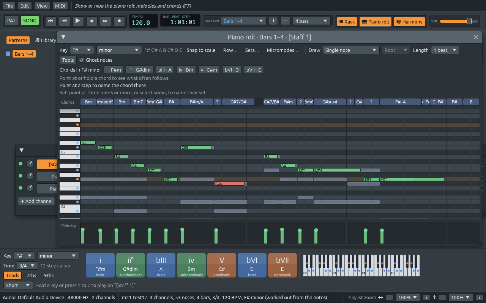

# Opening MIDI files

Files: [`crates/lineup-core/src/midi_file/read.rs`](https://github.com/naelolaiz/ferrous-lineup/blob/main/crates/lineup-core/src/midi_file/read.rs),
[`crates/lineup-core/src/midi_file/import.rs`](https://github.com/naelolaiz/ferrous-lineup/blob/main/crates/lineup-core/src/midi_file/import.rs),
[`crates/lineup-core/src/midi_file.rs`](https://github.com/naelolaiz/ferrous-lineup/blob/main/crates/lineup-core/src/midi_file.rs),
[`crates/lineup-core/src/harmony/key_finding.rs`](https://github.com/naelolaiz/ferrous-lineup/blob/main/crates/lineup-core/src/harmony/key_finding.rs),
[`crates/lineup-core/src/harmony/scale.rs`](https://github.com/naelolaiz/ferrous-lineup/blob/main/crates/lineup-core/src/harmony/scale.rs),
[`crates/lineup-core/src/pattern.rs`](https://github.com/naelolaiz/ferrous-lineup/blob/main/crates/lineup-core/src/pattern.rs),
[`crates/lineup-audio/src/engine.rs`](https://github.com/naelolaiz/ferrous-lineup/blob/main/crates/lineup-audio/src/engine.rs)
and [`crates/lineup-app/src/app/import.rs`](https://github.com/naelolaiz/ferrous-lineup/blob/main/crates/lineup-app/src/app/import.rs)

Ferrous Lineup could already *write* MIDI files (see
[MIDI messages and MIDI files](../step-7/messages.md)) and import a
recording, but it could not *open* a MIDI file. That is a pity, because
MIDI files are the easiest way to get real music into the app: almost
every piece ever written can be found as one, often typed in by someone
from the score, sometimes played in on a keyboard.

**File > Import MIDI file…** (or opening a `.mid` file from the command
line, or dropping one on the window) now turns a MIDI file into a new
project, ready to play:

- every track (or every MIDI channel, in a file of one track) becomes a
  channel of the rack, named after its track or its instrument;
- the drums of channel 10 become one channel per drum sound;
- every note keeps its **velocity** and its **exact time**, even when it
  falls between two steps;
- the tempo changes become tempo markers, the time signatures time
  markers, and the key signatures the project's key and
  [key markers](key-changes.md);
- the song is cut into patterns at bar lines and laid out on the
  playlist.

Because the notes land in ordinary patterns, everything that already
understands notes works on them: the **Chords** lane of the piano roll
names the chord at every step, and the **harmony keys** light up the
chord sounding now while the song plays.


This chapter follows the bytes of a file all the way to the patterns:
first *reading* the file into a list of events, then *importing* those
events into a project.

## Reading: from bytes to events

[Step 7](../step-7/messages.md) showed how a MIDI file is built: a
header chunk `MThd`, then one `MTrk` chunk per track, each a list of
events written after *delta times*. Reading is the same walk backwards,
with one difference that changes how the code is written: **a file we
read can be wrong.** It may be cut short by a broken download, it may
claim a chunk is longer than it is, it may not be a MIDI file at all.
Whatever the bytes are, the program must not crash.

### A cursor that cannot fall off the end

The reader walks the bytes with a small *cursor*: a slice and a position
in it.

```rust
struct Bytes<'a> {
    data: &'a [u8],
    at: usize,
}

impl<'a> Bytes<'a> {
    fn byte(&mut self) -> Option<u8> {
        let byte = *self.data.get(self.at)?;
        self.at += 1;
        Some(byte)
    }

    fn take(&mut self, count: usize) -> Option<&'a [u8]> {
        let end = self.at.checked_add(count)?;
        let slice = self.data.get(self.at..end)?;
        self.at = end;
        Some(slice)
    }
}
```

Two Rust ideas make this safe:

- **`'a` is a lifetime.** `Bytes<'a>` borrows the file's bytes; it does
  not copy them. The lifetime says "a `Bytes` cannot outlive the bytes
  it points into", and the compiler checks that. `take` returns
  `&'a [u8]`: a slice of the *original* bytes, which stays valid even
  after the cursor moves on.
- **`get` instead of indexing.** `data[at]` panics when `at` is past the
  end; `data.get(at)` returns `None`. The `?` after it returns that
  `None` from `byte` straight away. `checked_add` does the same for a
  length so large that adding it would overflow. So every read either
  gives a value or `None`, and the caller decides what a missing value
  means.

The test `a_file_cut_short_keeps_what_was_read` takes a small file and
cuts it at *every* possible length, from 0 bytes to the whole file:
each one is read without a panic.

### Variable-length numbers, read back

A delta time is a *variable-length quantity*: seven bits per byte, the
top bit set on every byte but the last. Writing it was a loop that cut
the number into pieces of seven bits; reading it glues them back:

```rust
fn variable_length(&mut self) -> Option<u32> {
    let mut value = 0u32;
    for _ in 0..4 {
        let byte = self.byte()?;
        value = (value << 7) | u32::from(byte & 0x7F);
        if byte & 0x80 == 0 {
            return Some(value);
        }
    }
    None
}
```

`81 00` is `1 << 7 | 0` = 128. The standard allows four bytes at most;
a fifth would mean the file is damaged, so after four the loop gives
up.

### Running status

A track of a piano piece is mostly note on, note off, note on... To save
space, a file may leave out the **status byte** (the `90` of `90 3C 64`)
when it is the same as the one before: this is *running status*. The
reader can always tell, because a status byte has its top bit set and a
data byte does not:

```rust
let (status, first_data) = if first & 0x80 != 0 {
    (first, bytes.byte())                    // a new status byte
} else {
    (running.unwrap_or(0), Some(first))      // the last one again
};
```

So `90 3C 64 00 40 64` is two notes on: C4 and E4, both at velocity 100.

A note off has its own status, `80`, but most files instead send a note
on with velocity 0, which also works with running status. The reader
turns both into `EventKind::NoteOff`.

### Events as an enum

Each event the import needs becomes a variant of one enum, with its data
inside:

```rust
pub enum EventKind {
    NoteOn { channel: u8, key: u8, velocity: u8 },
    NoteOff { channel: u8, key: u8 },
    Controller { channel: u8, number: u8, value: u8 },
    Program { channel: u8, program: u8 },
    Tempo(u32),                               // microseconds per beat
    TimeSignature { beats: u8, unit: u8 },
    KeySignature { sharps: i8, minor: bool },
    ExactKey(Scale),
    TrackName(String),
    InstrumentName(String),
}
```

Everything else (pitch bend, lyrics, system exclusive messages for a
particular synth) is read past and dropped. `meta_event` uses **slice
patterns** to check a meta event's data has the right shape before
trusting it:

```rust
(KEY_SIGNATURE, &[sharps, mode]) => {
    let sharps = sharps as i8;
    ((-7..=7).contains(&sharps) && mode <= 1)
        .then_some(EventKind::KeySignature { sharps, minor: mode == 1 })
}
```

A key signature is exactly two bytes. `&[sharps, mode]` only matches a
slice of length two and names its bytes; a key signature of three bytes,
or one claiming 9 sharps, is not a key signature and is skipped.

### Forgiving, but honest

Real files are often slightly broken, and every program that opens them
is forgiving about it. So is this one: a track cut short keeps the
events read so far, a chunk longer than the file is read as far as it
goes, unknown chunks are skipped, a header that says "3 tracks" when
there are 4 is ignored in favour of the chunks themselves. But the
result says so: `MidiFile::damaged` is set, and the notice after the
import ends with "The file is damaged: everything before the damage was
read".

Two more things a reader meets in the wild:

- **RMID files** (`.rmi`). Windows used to wrap MIDI files in RIFF, the
  container of WAV files: `RIFF`, a size, `RMID`, then chunks. The MIDI
  file is the chunk called `data`; others hold a title or a copyright.
  Unlike MIDI, RIFF writes its numbers least significant byte first, so
  `unwrap_riff` uses `u32::from_le_bytes` where MIDI uses
  `u32::from_be_bytes`.
- **Ticks per second.** A header's *division* usually counts ticks per
  beat (480 and 960 are common). With its top bit set it counts ticks
  per frame of film or video instead (24, 25 or 30 frames a second).
  Such a file has no beats at all; the import counts its time in beats
  of 120 BPM, so it plays at the right speed.

## Importing: from events to a project

`import(&file, title)` turns a `MidiFile` into a `Project` and a
`Report` of what it did. The report becomes the notice in the status
bar, such as *"m21-k525MIDIMvt1: 5 channels, 6398 notes, 192 bars, 4/4,
100 BPM (81 tempo changes), G major (worked out from the notes)"* for
the first movement of *Eine kleine Nachtmusik*.

### Notes between steps: ticks and nudges

A pattern counts time in **steps**, sixteenth notes. A MIDI file counts
it in ticks, typically 480 or 960 to the beat. Rounding every note to
the nearest step would ruin a lot of music:

- **Triplets** split a beat in three. Eighth-note triplets start at
  0, ⅓ and ⅔ of a beat: none of those is a sixteenth.
- **Swing** plays the second eighth of each beat late.
- A file **played in** on a keyboard has every note a little early or
  late, and that is a large part of what makes it sound alive (see
  [playing like a person](tempo-and-feel.md)).

So a note now has two more fields, both counted in **ticks of 24 to
the step** (96 to the beat):

```rust
pub struct NoteEvent {
    pub pitch: Note,
    pub start: usize,   // the step it starts in
    pub length: usize,  // the steps it sounds in
    pub velocity: u8,
    pub nudge: u8,      // ticks after the start of its first step
    pub trim: u8,       // ticks before the end of its last step
}
```

Why 24? Because 24 divides by 2, 3, 4, 6, 8 and 12. An eighth-note
triplet is 32 ticks long, a sixteenth triplet 16: both whole numbers,
so triplets land *exactly*. 96 to the beat is also what the MIDI export
has always written, so a note keeps its exact tick on the way out and
on the way back in.

`NoteEvent::exact` builds a note from its exact ticks:

```rust
pub fn exact(pitch: Note, start: usize, ticks: usize) -> Self {
    let end = start + ticks.max(1);
    let first = start / TICKS_PER_STEP;
    let last = end.div_ceil(TICKS_PER_STEP);
    NoteEvent {
        nudge: (start % TICKS_PER_STEP) as u8,
        trim: (last * TICKS_PER_STEP - end) as u8,
        ..NoteEvent::new(pitch, first, last - first)
    }
}
```

The triplet on tick 32 is in step 1 (`32 / 24`), nudged by 8 ticks
(`32 % 24`). The `..NoteEvent::new(...)` at the end is **struct update
syntax**: "every other field as in this value". It also made adding the
two fields painless: every place that built a `NoteEvent` field by field
now says `NoteEvent { velocity, ..NoteEvent::new(pitch, start, length) }`
and gets `nudge: 0, trim: 0` for free.

A note on the grid has both at 0, and the project file leaves them out
(`#[serde(skip_serializing_if = "is_zero")]`), so files without
off-grid notes look exactly as before. A project that has one is saved
as **format 10**, so an older Ferrous Lineup says "this file is newer"
instead of quietly moving the notes onto the grid.

The piano roll draws a nudged note where it really starts, and the
audio engine plays it there: the note is held back by `nudge` ticks, the
same way [loose timing](tempo-and-feel.md) holds a note back, and let
go `trim` ticks early. **Tools > Quantize to the steps** moves selected
notes (or all of them) onto the nearest step, for when you want them on
the grid.



### Pairing note on with note off

A file does not store notes. It stores *key down* and *key up*, and the
import has to pair them. For each channel the import keeps a list of
the notes still sounding on each key:

```rust
struct ChannelState {
    open: Vec<Vec<Open>>,   // for each of the 128 keys, oldest first
    pedal: bool,
    notes: Vec<Played>,
}
```

Usually a key has one note open at most. But a file can strike a key
again before letting it go (two voices of a fugue on the same note, or
a round where the parts overlap), and then each key up ends the
**oldest** note on that key, first in, first out. This matters: with
"newest first", three of the demo rounds came back with some notes cut
short.

Two more things the import does like a piano would:

- **The sustain pedal** (controller 64). While it is down, a key let go
  keeps sounding; the note ends when the pedal comes up, or when the
  same key is struck again. Without this, a piano piece played in with
  the pedal sounds dry and choppy, because the player's fingers left the
  keys long before the sound was meant to stop.
- **A note let go on the tick it started** (a grace note, a drum hit)
  still lasts one tick, so it is heard.

### Tracks, channels and drums

Most files are **format 1**: one track per instrument. Each track that
plays notes becomes a channel of the rack, named after the track
("Violin I"), or after its General MIDI instrument when the track has
no name. A **format 0** file puts everything in one track, with the
instruments on different MIDI channels; there, each MIDI channel becomes
a rack channel.

MIDI channel 10 is the **drum channel** in General MIDI: each key is a
drum sound, 36 a bass drum, 38 a snare, 42 a closed hi-hat. The import
gives each built-in drum that the file uses a channel of its own, as in
a new project, so the drums show up in the channel rack as a step
sequencer. Sounds the built-in drums do not have go to the closest one
(a triangle to the ride, a tambourine to the shaker, bongos to the
conga); a sound with nothing close, such as a whistle, is left out, and
the notice counts it.

The **program change** that chose each track's instrument is kept on
its channel too, as `Channel::program`: 40 is a violin, 0 a grand piano.
It names the channel, the Lineup Osc plays a sound close to that
instrument, and MIDI Out and the MIDI export send it on (see
[every voice on its own channel](voices-and-instruments.md)).

A channel's **volume** (controller 7) sets the rack channel's volume, so
a quiet accompaniment stays quiet.

### Cutting the song into patterns

A pattern holds at most 256 steps (16 bars of 4/4), and a song may last
200 bars. So the import cuts the song into patterns at **bar lines**, at
most 16 bars each, and lays them one after another on the playlist.

Where to cut? A note that sounds across the cut has to be split in two,
which is harmless for the sound but ugly to edit. So among the bar
lines in the second half of each stretch, `chunks` picks the one the
fewest notes sound across. To count them for every step at once, it uses
a **difference array**: for each note, +1 on the step after it starts
and -1 on the step after it ends; adding the numbers up from the left
gives, at every step, how many notes are sounding across it. That is
one pass over the notes and one over the steps, instead of checking
every note at every step.

A stretch that comes back **note for note** (a repeated verse, a da
capo) plays the same pattern again instead of a copy, as you would
build the song by hand.

### Tempo and time

Every tempo change becomes a **tempo marker** (see
[tempo changes](tempo-and-feel.md)); a file can have hundreds, when it
was played in or when a slow-down was written as many small steps. Every
time signature becomes a **time marker** (see
[changing time signature partway through](time-markers.md)).

### The key

A MIDI file says its key with a **key signature** event: how many sharps
(or flats, as a negative number) and whether the key is minor. Two
flats and minor is G minor; two flats and major is Bb major. The import
takes the key from it as it is written, with two exceptions.

**A file that says C major but is not.** Many programs write "no sharps,
major" into every file, whether or not anyone chose a key. The MIDI file
of *Eine kleine Nachtmusik* used for the screenshots above does: its
track name says "G major", its key signature says C major. So when the
signature is C major, the import checks it against the notes, and if
another key fits *clearly* better it takes that one (and the notice
says "worked out from the notes").

**A file with no key signature at all.** Then the notes decide.

How do notes decide a key? Not by which notes are used: C major and A
minor use the same seven. What tells them apart is which notes *matter*.
In C major, C, E and G (the home chord) are heard the most, the rest of
the scale less, the five notes outside it hardly at all. In the 1980s
the psychologists Carol Krumhansl and Edward Kessler measured this:
they played listeners a few chords that set up a key, then one note, and
asked how well it fitted. The answers, for the twelve notes counted up
from the tonic, are the **key profiles**:

```text
          tonic  ♭2    2    ♭3    3    4    ♯4    5    ♭6    6    ♭7    7
major      6.35 2.23 3.48 2.33 4.38 4.09 2.52 5.19 2.39 3.66 2.29 2.88
minor      6.33 2.68 3.52 5.38 2.60 3.53 2.54 4.75 3.98 2.69 3.34 3.17
```

The tonic fits best, then the fifth, then the third (the major third in
major, the minor third in minor): the home chord.

`key_fits` adds up how long each of the twelve pitch classes sounds in
the whole piece, and compares those twelve numbers with the profile of
each of the 24 major and minor keys, turned to start on that key's
tonic. The comparison is a **correlation**: 1 when the two lists rise
and fall together, 0 when they have nothing to do with each other. The
best-fitting key is most likely the key of the piece. When it is wrong,
it is wrong the way a listener could be: it hears a closely related key,
such as the relative minor.

A file can also change key partway through, with more key signatures:
the *Rondo alla turca* goes from A minor to A major and back. The first
key signature is the key the song starts in, and every later one that
names a different key becomes a **key marker** on the playlist, as if
you had added it yourself; the notice counts them ("9 key changes").
Files often repeat the same signature at the start of every section,
and `KeyMap::tidy` leaves those out.

## Writing the key into exported files

Until now an exported MIDI file had no key signature, so importing it
again could not know the key. The export now writes one at the start of
the first track, and another at every key marker. `Scale::key_signature` works it out by going round the
**circle of fifths**: each fifth up from C adds a sharp (G has one, D
two, A three...), each fifth down adds a flat (F has one, Bb two...).

```rust
let major = self.root.transpose(self.kind.relative_major() as i32);
let fifths = (0..12i8)
    .find(|&n| PitchClass::C.transpose(7 * i32::from(n)) == major)
    .unwrap_or(0);
let sharps = match self.spelling() {
    Spelling::Flats => fifths - 12,
    Spelling::Sharps => fifths,
};
```

A minor key takes the signature of its **relative major**, three
semitones up: C minor has the three flats of Eb major. Going round the
circle, Eb is 9 fifths up from C, and 9 - 12 = -3: three flats. Whether
a key is counted in sharps or in flats follows how the app spells it
(see [`Scale::spelling`](changing-key.md)), so the signature always
agrees with the key's name: Db major has five flats, not seven sharps.

A key signature only knows major and minor. The harmonic and melodic
minors are written as their minor key, which is what a score does too:
the raised seventh is written as an accidental, not in the signature.
A **mode** takes the signature of the major key it comes from, so
D Dorian has none, like C major, and E Dorian has the two sharps of D
major. A tone row or a pitch-class set has no key, so no signature.

That loses something: a file that says "two sharps, major" cannot say
whether it means D major or E Dorian. So the export also writes the
exact key in a **sequencer-specific** meta event (`FF 7F`), the one
place the standard leaves for a program's own data. It starts with the
maker's number `7D`, set aside for programs that are not sold, then the
words `Ferrous Lineup key ` (so another program's `7D` event is never
taken for ours), then the key the way a project file writes it:

```text
FF 7F 26  7D "Ferrous Lineup key (root:E,kind:Dorian)"
```

(`26` is the length in hexadecimal: 38 bytes follow.)

It is written next to every key signature, at the start and at every
key marker. Other programs skip this event. Ferrous Lineup reads it back
and gets E Dorian, C♯ harmonic minor or a twelve-tone row exactly.

## Testing it with every demo

The best test of an import is an export. `every_demo_comes_back_note_for_note`
exports each song demo as a MIDI file, imports it, exports the result
again, and compares the two files event by event: every note on with its
key and velocity, every note off, every tempo change, time signature, key
signature and program change, each at the same tick. It also checks the
imported project has exactly the demo's key and key markers. All of them
come back identical, including the tempo changes and the subtly shaped
velocities.

The other tests build small files by hand for the cases a demo never
has: triplets, a sustain pedal, a format 0 file, drums, a file without
notes, a damaged file, an RMID file, ticks per second, names in
Latin-1. And real files from other programs (a Clementi sonatina,
Mozart, a dance track with seventeen channels, a 25 MB file of the
digits of π) were opened in the app and played.

## Things to try

- Find a MIDI file of a piece you know, open it, and press Play with
  the harmony keys open (F8). Which chords does it use most?
- Open the piano roll on a played-in file and look at how far from the
  grid the notes are. Select a few and use **Tools > Quantize to the
  steps**: does it sound better or worse?
- Export a demo in a mode, such as *Scarborough Fair* in D Dorian, open
  the file in another program and look at its key signature. Then open
  it again in Ferrous Lineup: the key is D Dorian again.
