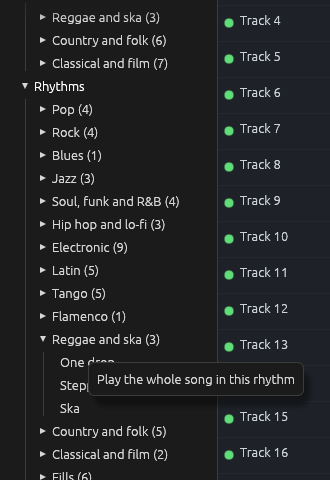
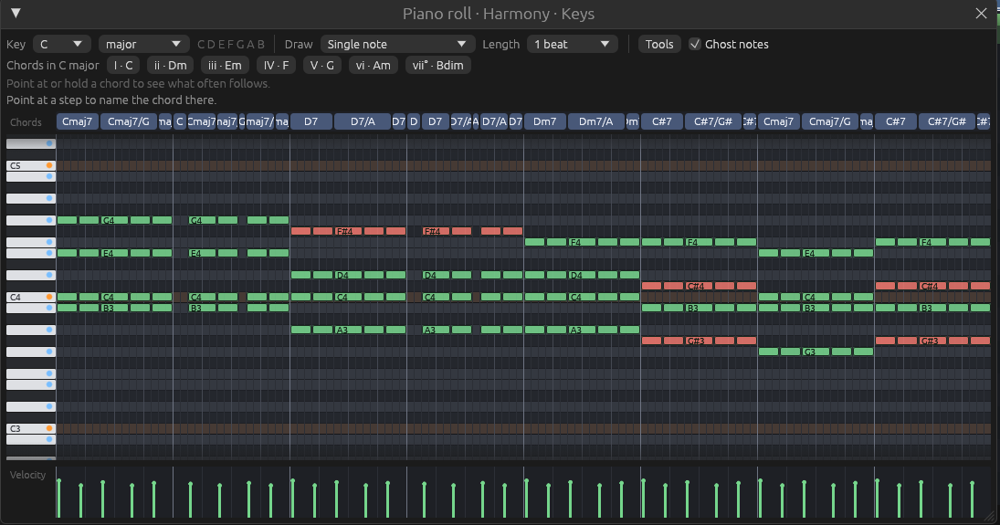

# A new rhythm for a song: hearing the chords

Files: [`crates/loom-core/src/library/listen.rs`](https://github.com/naelolaiz/ferrous-loom/blob/main/crates/loom-core/src/library/listen.rs),
[`crates/loom-core/src/library/apply.rs`](https://github.com/naelolaiz/ferrous-loom/blob/main/crates/loom-core/src/library/apply.rs),
[`crates/loom-app/src/library_browser.rs`](https://github.com/naelolaiz/ferrous-loom/blob/main/crates/loom-app/src/library_browser.rs)
and [`crates/loom-app/src/app/library.rs`](https://github.com/naelolaiz/ferrous-loom/blob/main/crates/loom-app/src/app/library.rs)

Until now, picking a rhythm in the Library only changed the drums. Put a
reggae beat under a bossa nova and the piano went on playing bossa nova
over it. FL Studio does better: change the rhythm and the chords and
the bass follow it. A band does the same when someone says "let's do
this one as a reggae": same chords, new way of playing them.

Now Ferrous Loom does it too, in two places:

- In the Library, a rhythm picked after a style changes how the style is
  played. "Four chords" with the "Salsa" rhythm comes out as a piano
  montuno over a tumbao bass.
- Right-click a rhythm and choose **Play the whole song in this
  rhythm**. Every pattern with drums gets the new beat, every pattern
  with chords has them played again, and the melody stays as it was.
  Ctrl+Z takes it all back in one step.



The hard part is not the playing. The library already knows how to play
any chord in any style: that is what `Comping` and `Bass` do (see [The
library](library.md)). The hard part is knowing *which* chords to play,
because a pattern does not store its chords. It stores notes.

## What a pattern remembers

When the library writes a style into a pattern, it plays the chords and
throws the chords away. The pattern keeps only `NoteEvent`s: a pitch, a
start, a length, a velocity. After that, you may have changed notes in
the piano roll, or the song may be your own and never came from the
library at all.

We could have stored the chords next to the notes. But then every
project file would need them, every edit in the piano roll would have
to keep them up to date, and songs you played in by hand would still
have none. So instead, Ferrous Loom does what a musician does when
someone plays them a song: it *listens* and works out the chords.

## Listening: a score for every chord

`listen.rs`

Take one stretch of a pattern, say a bar. Some notes sound in it, for
some number of steps each. For every chord there is (12 roots times 28
qualities, 336 chords) we ask: how well do these notes fit this chord?
The answer is a number, a **score**:

```rust
let mut score = inside
    - OUTSIDE * outside
    - stretch.busy * (MISSING * missing + SIZE * size)
    - GAP * gaps
    - SILENT * stretch.quiet;
if stretch.bass == Some(chord.root) {
    score += BASS_ROOT;
}
```

- `inside`: how many steps notes of the chord are heard. More is better.
- `outside`: how many steps other notes are heard. That counts double
  against the chord (`OUTSIDE` is 2), because a wrong note is a
  stronger sign than a right one.
- `missing`: notes of the chord nobody plays. A C major chord with no E
  in it might not be C major.
- `size`: how many notes the chord has. Without this, a thirteenth
  chord, which has almost every note of the scale, would fit everything.
  Small chords win unless the notes ask for a big one.
- `gaps`: how long each note of the chord is *not* heard while the
  chords play. This is what tells "a bar of C, then a bar of C7" from
  "two bars of C7".
- `quiet`: steps with no note at all. A beat of rest belongs to the
  chord around it; a bar of silence is better heard as no chord.
- A bonus when a bass note starts the stretch on the chord's root. The
  rest of the bass line is not listened to, because walking bass lines
  play passing notes that belong to no chord.

Two exceptions come from how chords are really played. A root that only
the bass plays is not "missing" (pianists leave it to the bass), and
neither is the fifth of a four-note chord (pianists leave it out, see
`voicing.rs`). Without the first rule, a G7 played in an Alberti bass
that never reaches its G would be heard as a B diminished chord.

The numbers (`OUTSIDE`, `MISSING`, `SIZE`...) are constants at the top
of the file. They were tuned by a test, `every_style_is_heard_as_its_chart`,
which plays all 78 styles of the library, each in its own way
(arpeggios, stabs, waltzes, walking bass...), listens to them, and checks
that the chords heard are the chords of the chart. Changing a constant
and running that test is the quickest way to see what each one does.

### Adding up quickly: prefix sums

Scoring a stretch needs "how many steps does each pitch class sound
between step `a` and step `b`". We ask that for thousands of stretches,
so it has to be quick. The trick is to add up once, from the start:

```rust
struct Heard {
    sums: Vec<[f32; 12]>,
    ...
}
```

`sums[s][pc]` is how many of the steps *before* `s` have pitch class
`pc` sounding. Then the time between `a` and `b` is one subtraction,
`sums[b][pc] - sums[a][pc]`, however long the stretch is. This is called
a **prefix sum**, and it turns up everywhere a program asks the same
"how much in this range" question many times.

`[f32; 12]` is an array of exactly twelve numbers, one per pitch class.
Arrays of a fixed size are `Copy` in Rust when their items are, so
`let mut next = heard.sums[heard.sums.len() - 1];` copies the last row,
and adding to `next` leaves the row in the vector untouched.

## Cutting: dynamic programming

Now, where do the chords change? We could try every way of cutting the
pattern into stretches and keep the best, but a pattern of 16 beats can
be cut in 32,768 ways, and one of 64 beats in about nine billion
billion ways, roughly one for every grain of sand on Earth.

**Dynamic programming** gets the same answer with far less work, from
one observation: the best way to cut the first `i` beats ends with some
last stretch, from beat `j` to beat `i`. Whatever it is, the cuts before
`j` must be the best way to cut the first `j` beats (if there were a
better one, we would use it). So:

```rust
for i in 1..lines.len() {
    best[i].0 = f32::NEG_INFINITY;
    for j in 0..i {
        let (chord, score) = best_chord(&candidates, &heard.between(lines[j], lines[i]));
        let total = best[j].0 + score - cut;
        if total > best[i].0 {
            best[i] = (total, j, chord);
        }
    }
}
```

`best[i]` keeps three things: the best total score for the first `i`
beats, where its last stretch starts (`j`), and the chord of that
stretch. Each one is worked out from the ones before it, which are
already known. At the end, `best[last]` holds the best score for the
whole pattern, and following the `j`s back from the end reads the cuts
in reverse order; `stretches.reverse()` puts them right.

`f32::NEG_INFINITY` is a float smaller than every other, so the first
real total always beats it. It is a common way to start a "find the
largest" search without a special case for the first candidate.

Each cut costs a little (`cut`), so a chord is only split in two when
the notes clearly ask for it. Cuts on a bar line cost least, cuts half
way through a bar a bit more, and cuts on the other beats most, because
that is how often chords change there in real music.

### Joining what belongs together

Two stretches in a row can come out with the same chord: they are
joined. And an arpeggio plays its notes one at a time, so its first beat
may sound like C and its second like C7. The loop that joins them uses
**match guards**, an `if` after a pattern:

```rust
match joined.last_mut() {
    Some(last) if last.chord == stretch.chord => last.length += stretch.length,
    Some(last) if !half_bar(stretch.start) && grows(last.chord, stretch.chord) => {
        last.chord = bigger(last.chord, stretch.chord);
        last.length += stretch.length;
    }
    _ => joined.push(stretch),
}
```

`last_mut()` gives an `Option<&mut HeardChord>`: a reference we can
change through, so the last stretch grows in place. The arms are tried
in order, and a guard that is false moves on to the next arm, so the
last arm, `_`, catches everything else.

The result is a list of `HeardChord`s. Each has an `Option<Chord>`:
`None` where no chord is heard, for example a pattern that only has a
melody for its first bars.

## Playing it again

`apply.rs`

With the chords known, the rest uses what the library already has.
`feel` finds how a rhythm likes its chords played: the comping and bass
line of the style whose drums it is.

```rust
pub fn feel(rhythm: &Rhythm) -> (Comping, Bass) {
    let same_time = |style: &&Style| style.time == rhythm.time;
    STYLES
        .iter()
        .find(|style| style.rhythm == rhythm.name)
        .or_else(|| STYLES.iter().filter(same_time).find(|style| style.genre == rhythm.genre))
        .or_else(|| STYLES.iter().find(same_time))
        .map_or((Comping::Pulse, Bass::Pulse), |style| (style.comping, style.bass))
}
```

The "Salsa" rhythm is the drums of the "Salsa montuno" style, so it
plays chords as a montuno and the bass as a tumbao. A rhythm no style
uses, like "March", borrows a style of its genre in its time signature,
so a rhythm in 3/4 never gets a way of playing meant for 4/4.

Why `&&Style` in `same_time`? `STYLES.iter()` gives `&Style`, and
`filter` hands its closure a reference to each item, so a reference to a
reference. `find` does the same. Writing the type out lets the one
closure serve both.

`recomp` then plays a pattern's chords again:

```rust
let heard = hear_chords(&old_chords, &old_bass, length, project.time_signature);
...
let voicings = voice_progression(&chords);
for (index, (chord, stretch)) in played.iter().enumerate() {
    let next = played[(index + 1) % played.len()].0;
    new_chords.extend(comping.play(&voicings[index], stretch.start, stretch.length));
    new_bass.extend(bass.play(*chord, next, stretch.start, stretch.length));
}
```

This is the same loop as `accompany` in `chart.rs`, with heard chords
in place of a chart. Stretches where no chord was heard keep their old
notes, so an intro without chords stays as it was.

`use_rhythm` does a whole song. For every pattern it re-comps the
chords and writes the new drums. Three things are left alone on
purpose: the melody (the "Lead" channel is never taken for chords), the
time signature, and endings. An ending is a pattern whose notes all
start on its first step, like the held final chord with a crash that
the demos end with. Turning that into a reggae skank would spoil it.

(Later, a rhythm in *another* time signature got to change the time
signature after all, bar for bar: see [Re-metering the
song](re-metering.md).)

Where the old drums had a fill in their last bar, the new rhythm's fill
goes there. How do we know there was one? A fill is a last bar that
plays like no bar before it:

```rust
let fill = length >= 2 * bar && {
    let last = drums_in(project, pattern, length - bar, bar);
    (0..length - bar)
        .step_by(bar)
        .all(|start| drums_in(project, pattern, start, bar) != last)
};
```

A block `{ ... }` is an expression in Rust, its value is its last line,
so it can sit after `&&`. And because `&&` stops as soon as the left side
is `false`, the block only runs for patterns of two bars or more.




## In the app

`library_browser.rs` and `app/library.rs`

The Library's actions are an `enum`, `LibraryAction`. Playing a whole
song in a rhythm is a new variant, `RhythmInSong(&'static Rhythm)`, sent
from a right-click menu:

```rust
response.context_menu(|ui| {
    if ui.button("Play the whole song in this rhythm").clicked() {
        picked = Some(LibraryAction::RhythmInSong(rhythm));
        ui.close();
    }
});
```

The closure changes `picked`, a variable outside it. Rust allows that
because `context_menu` takes an `FnOnce`, and the closure borrows
`picked` mutably only while it runs.

Adding a variant to an enum makes every `match` on it that does not
already cover it fail to compile. That is a feature: the compiler lists
every place that has to decide what the new action means. In
`try_from_library`, the new action is handled first and returns, and the
old `match` only needs an arm that says it cannot happen there.

The change itself goes through `edit()`, like every change since step 5,
so the whole song comes back with one Ctrl+Z:

```rust
let change = self.edit("change the rhythm", |project| {
    let change = apply::use_rhythm(project, rhythm);
    ...
    change
});
```

## How well does it listen?

All 78 styles, played their own way, are heard exactly right, and so
are the songs, apart from two very short chords: one that lasts a
single beat at the very end of Amazing Grace, and one that changes in
the middle of a beat in the Minuet in G. Playing every style in every way of comping with
seven bass lines (about 14,000 combinations) gets about 91% exactly
right. Most of the misses are arpeggios over a walking or tumbao bass,
where a change can come out a beat early or late: the bass anticipates
the next chord, and an arpeggio shows its notes one at a time. Exercise
10 is about doing better.
