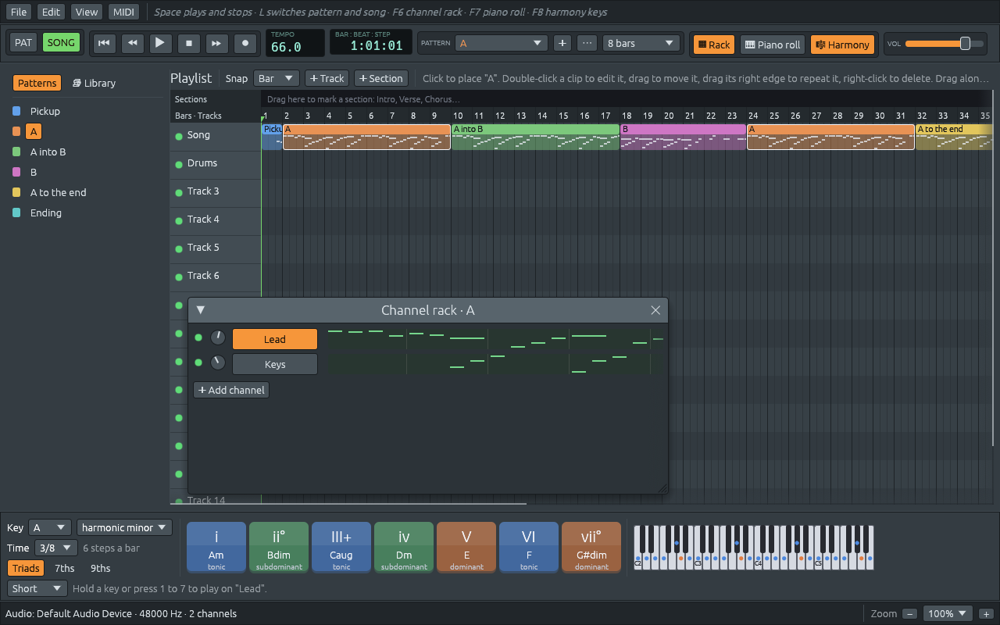

# From the library to patterns and demos

Files: [`crates/lineup-core/src/library/apply.rs`](https://github.com/naelolaiz/ferrous-loom/blob/band-in-a-box/crates/lineup-core/src/library/apply.rs),
[`crates/lineup-core/src/library/demo.rs`](https://github.com/naelolaiz/ferrous-loom/blob/band-in-a-box/crates/lineup-core/src/library/demo.rs),
[`crates/lineup-app/src/library_browser.rs`](https://github.com/naelolaiz/ferrous-loom/blob/band-in-a-box/crates/lineup-app/src/library_browser.rs)
and [`crates/lineup-app/src/app/library.rs`](https://github.com/naelolaiz/ferrous-loom/blob/band-in-a-box/crates/lineup-app/src/app/library.rs)

The tables of the last chapter know nothing about channels, patterns or
playlists. This chapter connects them: first to a pattern, then to a
whole project, then to the buttons you click.

## Which channel plays what

`apply.rs`

A style has chords and a bass line; a rhythm has drums. Each has to go
to a channel, and the project may or may not have one that fits. The
rules are written as small functions:

```rust
pub fn chords_channel(project: &mut Project, selected: Option<usize>) -> Option<usize> {
    let free = |channel: &Channel| plays_notes(channel) && channel.name != BASS && channel.name != LEAD;
    if let Some(index) = selected
        && project.channels().get(index).is_some_and(free)
    {
        return Some(index);
    }
    find_synth(project, KEYS)
        .or_else(|| { /* the first other synth */ })
        .or_else(|| synth_named(project, KEYS))
}
```

Chords go to the channel you selected, if it can play notes and is not
the bass or the lead; otherwise to a synth called "Keys"; otherwise to
the first other synth; and if there is none, a new "Keys" synth is
added. Each `or_else` only runs if everything before it found nothing.
The bass goes to a synth called "Bass", and each drum to the channel
that plays it, added if missing.

`free` is a closure stored in a variable, so it can be used twice:
once with `is_some_and`, and once inside the search for "the first
other synth". `is_some_and` is `true` when an `Option` is `Some` and its
value passes the test.

`write_style` and `write_rhythm` then fill a pattern. Both use a method
step 8 added to `Pattern`, `set_notes`, which replaces all the notes of
one channel at once.

## Demos: arranging like a producer

`demo.rs`

A pattern is a loop. A song is loops *arranged*: something alone
first, then more comes in, a fill now and then to mark a section, and
an ending. `style_demo` does that with any style:

```text
  Harmony   |Harmony|Harmony|Harmony|Harmony|Harmony|Ending
  Drums             |Drums  |Drums  |Drums  |Drums  |
                            and fill        and fill
```

The harmony plays once alone, so you hear the chords before the drums;
then they play together, with a fill at the end of every other pass and
of the last one. How many passes depends on how long the progression
is, so that every demo lasts about 32 bars:

```rust
let passes = (DEMO_BARS / bars).clamp(2, 6);
```

`song_demo` does the same with a song: a pattern per part, with the
melody on a "Lead" synth, the chords on "Keys" and the bass on "Bass";
a drum pattern per part; and the parts placed in the order of the
song's form. *Für Elise* has no drums at all, and its left hand is
written out note by note instead of being made from chords, because
Beethoven's left hand *is* the accompaniment.



Both return an ordinary `Project`. A demo is not special in any way:
you can change it, save it and take it apart like anything you made.

## The Library tab

`library_browser.rs`

The tab is drawn like the other views: it reads the mouse and returns
what was picked, and the app does the rest.

```rust
pub enum LibraryAction {
    Style(&'static Style),
    Rhythm(&'static Rhythm),
}
```

The variants carry `&'static` references straight into the `STYLES`
and `RHYTHMS` tables. They are as cheap to copy as a number, and they
cannot dangle, because the tables live as long as the program.

Genres are `CollapsingHeader`s, closed at the start so the list is
short. While you type in the search box, every genre with a match
opens. egui remembers whether a header is open by its id, and normally
the user decides; `.open(Some(true))` overrides that for one frame:

```rust
let header = egui::CollapsingHeader::new(format!("{} ({count})", genre.name()))
    .id_salt(format!("{kind}-{genre:?}"));
let header = if searching { header.open(Some(true)) } else { header };
header.show(ui, add);
```

The `id_salt` includes the kind, because "Pop" appears twice, once
under styles and once under rhythms, and two widgets with the same id
would share their open or closed state. `{genre:?}` formats the genre
with `Debug`, which for an enum is its name.

## Trying, swapping and undoing

`app/library.rs`

Clicking a style plays it at once. Clicking another should *replace*
it, not pile up patterns, so you can flick through the library. But if
you have started editing that pattern, it is yours, and the library
must not overwrite it. How does the app tell?

It keeps a copy of every pattern it wrote:

```rust
pub(super) struct Audition {
    pattern: usize,
    written: Pattern,
    style: Option<&'static Style>,
    rhythm: Option<&'static Rhythm>,
    rhythm_picked: bool,
}
```

and on the next click, it looks for one whose copy is still exactly
like the selected pattern:

```rust
fn unchanged_audition(&self) -> Option<&Audition> {
    let pattern = self.project.pattern(self.pattern)?;
    self.auditions
        .iter()
        .rev()
        .find(|audition| audition.pattern == self.pattern && &audition.written == pattern)
}
```

`==` on two `Pattern`s compares their names, lengths and every note,
thanks to the `PartialEq` derived on `Pattern`. This is the same idea as step 4's "unsaved
changes": instead of tracking every edit, keep a copy and compare.
Nothing else in the app has to remember to say "this pattern was
changed".

The app remembers every audition, not just the last, and searches from
the newest with `rev()`. That is for undo: after Ctrl+Z brings back the
previous style, the pattern matches an older copy, and the next click
still swaps it in place.

`rhythm_picked` remembers whether you chose the rhythm. A style brings
its own rhythm, and the next style brings its own; but once you have
picked a rhythm yourself, styles you try after it keep yours.

The writing itself is one call to `edit`, so it is one undo step, the
audio thread hears about it through the usual diff, and saving just
works:

```rust
let written = self.edit("try from the library", |project| {
    let index = match target {
        Some(index) => index,
        None => project.add_pattern()?,
    };
    // ... clear it, write the style, the rhythm, the tempo ...
    Some((index, project.pattern(index)?.clone()))
});
```

The closure returns an `Option`, so `?` works inside it: if there is no
room for another pattern, `add_pattern` gives `None`, the closure stops
there, and `edit` hands the `None` back. Nothing changed, so nothing is
recorded for undo either.

## File > Demos

Opening a demo throws the current project away, just like **File >
Open**, so it must ask about unsaved changes first. Step 4 built that
question around an enum of things that wait for an answer; a demo is
one more of them:

```rust
pub(super) enum Pending {
    New,
    Open,
    OpenPath(PathBuf),
    Demo(Demo),
    Quit,
}
```

and `Demo` says which one:

```rust
pub(super) enum Demo {
    Start,
    Song(&'static Song),
    Style(&'static Style),
}
```

After "Save", "Don't save", or straight away if nothing would be lost,
`perform` gets the `Pending::Demo`, builds the project and plays it.
Adding the demos took one variant and one match arm in the existing
code: that is what modelling "what is waiting" as an enum buys.
