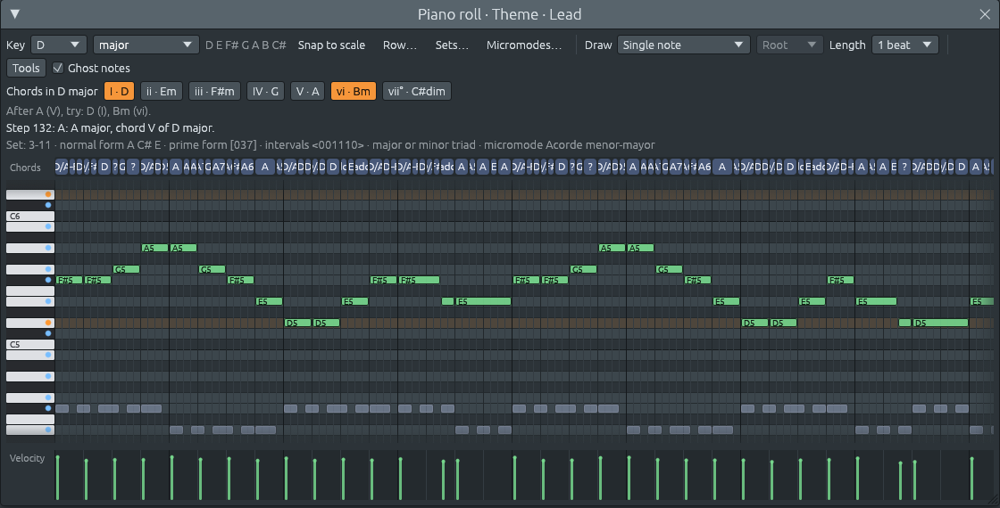

# A rhythm in another time signature: re-metering the song

Files: [`crates/lineup-core/src/remeter.rs`](https://github.com/naelolaiz/ferrous-lineup/blob/main/crates/lineup-core/src/remeter.rs),
[`crates/lineup-core/src/library/apply.rs`](https://github.com/naelolaiz/ferrous-lineup/blob/main/crates/lineup-core/src/library/apply.rs)
and [`crates/lineup-app/src/app/library.rs`](https://github.com/naelolaiz/ferrous-lineup/blob/main/crates/lineup-app/src/app/library.rs)

[A new rhythm for a song](new-rhythm.md) taught the whole song to play
in another rhythm: new drums, and the chords and bass played the way the
rhythm goes. It kept the song's time signature on purpose, because the
melody was not supposed to move. That works while the rhythm is in the
same time signature as the song. It goes wrong when it is not.

Pick "Jazz waltz" (3/4) while "Ode to Joy" (4/4) plays. A waltz bar is
twelve steps long, a 4/4 bar sixteen. Laid into 4/4 bars, the waltz plays
its "one two three" and then a beat of silence, every bar: the drums
change, but the time signature still says 4/4 and it never sounds like a
waltz. You asked for the song to become a waltz instead.

Now it does. A rhythm (or a style) in another time signature first puts
the whole song in that time signature, bar for bar, and then plays it in
the new rhythm.




## Squeezing a bar

The rule is simple: **bar n of the old song becomes bar n of the new
one, and every note keeps its place in its bar**. A note halfway through
a 4/4 bar lands halfway through the 3/4 bar. A note a quarter of the way
in (beat 2) lands a quarter of the way in.

```text
4/4: | F# . . . F# . . . G . . . A . . . |   16 steps
3/4: | F# . . F# . . G . . A . . |           12 steps
```

So the song keeps its bars, its phrases and its chords bar by bar, and
the new rhythm fits every bar exactly.

## Every bar lasts as long as before

The tempo counts quarter notes. A 3/4 bar has three of them, a 4/4 bar
four, so at the same tempo a 3/4 bar is over in three quarters of the
time and the whole song would rush. And with "Use their tempo" ticked it
used to be worse: the song took the waltz's own tempo, so El Choclo went
from 112 to 180 and ran about twice as fast.

So the tempo goes down in the same proportion as the bar: 4/4 at 112
becomes 3/4 at 84. A bar of 3/4 at 84 lasts exactly as long as a bar of
4/4 at 112 (2.14 seconds), and the song takes exactly as long as before.
Tempo changes inside the song (a ritardando at the end) are scaled the
same way. "Use their tempo" does not apply when the time signature
changes: the rhythm's own tempo would rush or drag the song.

That has a nice consequence: **the melody sounds exactly as before**.
Every note lasts as long in seconds and starts at the same moment. What
changes is how it is *written* and *counted*, and what the drums and the
accompaniment do around it:

- **4/4 to 3/4.** Four quarter notes at 112 become four dotted eighth
  notes at 84: the same sound, written another way. Against the waltz's
  three beats, the melody's four notes are "four against three", a
  cross-rhythm. A composer arranging "Ode to Joy" as a waltz would rather
  rewrite it, making one note of each group longer (a half note and a
  quarter, say). This is a mechanical change, not an arrangement.
- **4/4 to 6/8.** This one fits more naturally. 6/8 is felt in two big
  beats (two dotted quarters), and 4/4 also falls into two halves. Beat 1
  and beat 3 land on the two beats of 6/8. Beats 2 and 4 land halfway
  through each 6/8 beat: two even notes in a beat of three eighths, which
  musicians call a *duplet*.
- **3/4 to 4/4.** Three beats stretched over four: three even notes in a
  4/4 bar are a *half-note triplet*. The tempo goes up by a third.
- **3/4 to 6/8 (or back).** Both bars are twelve steps, so no note moves
  and the tempo stays. Only the time signature changes, and with it where
  the beats are felt: three beats of a quarter note, or two of a dotted
  quarter. The new rhythm makes you hear the difference.

A song that already changes time signature partway through, like a hymn
in 4/4 with a last line in 3/4, comes out in one time signature: every
bar, whatever it was, becomes one bar of the new one, and the time
markers go.

## The Time box does it too

At first only the library re-metered the song. Picking 3/4 in the Time
box of the harmony keys (or in the menu on bar 1 of the playlist) still
did what it always had: it changed the time signature and nothing else.
Every note stayed on its step, so the song sounded exactly the same; only
the bar lines were drawn in other places. A 4/4 tune "in 3/4" that way
has its downbeats wandering through the bars, and nothing tells you why
the music did not change.

Now both re-meter the song, the same way a rhythm does: every bar
squeezed or stretched into a bar of the new time signature, and the
tempo scaled so each bar lasts as long as before. 4/4 at 124 becomes 3/4
at 93. Two cases are different:

- **A song with no notes at all** has nothing to squeeze, so it only
  gets the new bars and keeps its tempo.
- **A change partway through**, from the menu on any bar but the first,
  still only changes the bars from there on: that is how you write a
  hymn with a last line in 3/4.

Both changes go through one method, `set_song_time`, which the Time box
and the bar 1 menu call. It remembers the library's original like the
rhythms do, so a rhythm picked afterwards still starts from the song as
it was:

```rust
let remetered = self.edit("change time signature", |project| {
    if project.patterns().iter().all(Pattern::is_empty) {
        project.time_signature = time;
        false
    } else {
        remeter(project, time)
    }
});
```

`Pattern::is_empty` is passed by name: `all` wants a function that takes
a `&Pattern` and answers `bool`, and the method is exactly that, so no
closure `|pattern| pattern.is_empty()` is needed.

The bar 1 menu is routed in a `match` with a *guard*: `SetTimeMarker(marker)
if marker.start == 0 => ...` takes only the markers on step 0, and the
next arm, without the guard, takes all the others.

## Exact, between the steps

Squeezing sixteen steps into twelve puts many notes between two steps:
eighth notes, two steps apart in 4/4, become 1.5 steps apart in 3/4.
Rounding them to the grid would make them uneven (long, short, long,
short) and the cross-rhythm would sound like a mistake.

So the squeeze is done in *ticks*, the 24 parts of a step that MIDI
import brought in ([Opening MIDI files](midi-import.md)). 1.5 steps are
36 ticks, so the eighth notes stay perfectly even: every other one starts
12 ticks after a step. The whole computation is one line of integer
arithmetic:

```rust
// Where tick `tick` of an old bar goes in the new one, to the nearest
// tick. `length` is the old bar's length in ticks, `new_bar` the new one.
bar.number * new_bar + ((tick - start) * new_bar + length / 2) / length
```

Adding `length / 2` before dividing rounds to the nearest tick instead of
always down, the usual trick for rounding with whole numbers. Multiplying
before dividing keeps the precision: `(tick - start) / length * new_bar`
would be 0 for every tick inside the bar.

That line lives in `Remap::tick`. A `Remap` holds the song's old
[`Meter`](time-markers.md) (where every old bar starts and how long it
is) and the length of a new bar. Everything placed in the song asks it
where it goes: notes, clips, sections, the loop, tempo and key markers.
A tempo marker's glide is mapped by its two ends, so a ritardando over
two bars of 4/4 lasts two bars of 3/4.

## When a pattern does not fit any more

A pattern holds at most 256 steps. Sixteen bars of 4/4 are exactly that,
but sixteen bars of 12/8 are 384 steps. Rather than drop notes, the
pattern is cut into pieces that fit (ten bars of 12/8, then six), named
"Theme", "Theme (2)" and so on, and every clip of it becomes clips of the
pieces, one after the other. The song sounds the same; only the playlist
shows one clip more.

## The original stays the reference

Each squeeze rounds a little. Squeeze 4/4 into 7/8, then that into 5/4,
then back into 4/4, and some notes that were together on one tick may
end up a tick apart. Worse, flicking through rhythms would make every
result depend on the order you tried them in.

So the app remembers the song as it was before the library first changed
it, and **every rhythm or style picked for the whole song starts again
from that original**. 4/4, then a waltz, then a zamba in 6/8, then a pop
beat: the pop beat gets the original 4/4 song back, note for note, not a
6/8 song stretched back out.

How does the app know the song is "still the library's"? The same way the
library knows a pattern it wrote is still unchanged ([The
library](library.md)): it keeps pairs of (song the library made, song it
started from) and compares the project with them. If you change a note,
the project matches none of them, so it becomes the new original: your
edit is kept. Undo and redo bring back versions the library made, which
still match, so the reference survives Ctrl+Z.

```rust
fn song_original(&self) -> Project {
    self.song_originals
        .iter()
        .rev()
        .find(|(version, _)| *version == self.project)
        .map_or_else(|| self.project.clone(), |(_, original)| original.clone())
}
```

`map_or_else` takes two closures: one for when there is nothing (use the
project itself) and one for when there is (use its original). Writing
`map_or(self.project.clone(), ...)` would also work, but would clone the
project every time, even when it is not needed; the closure only runs
when it has to.

Fills and the twelve-tone and micromode styles are played on top of what
plays now, as before, and the result is remembered with the same
original, so the next rhythm still starts from it.

## Keeping your place

While the song plays, you are somewhere: bar 13, beat 2. After the
squeeze, step 196 is no longer in bar 13 (in 3/4 it is in bar 17). So
the app moves the playhead with the song: it builds a `Remap` from the
meter of the song *as it was played* (repeats included) and sends the
audio thread to the new place. The song carries on from bar 13, beat 2,
in 3/4. The same happens to where Play starts and where Stop returns to,
and after Ctrl+Z and Ctrl+Y, which change the time signature back and
forth too. That one does not use `Remap` (the song you undo to may have
time markers of its own): it finds which bar the playhead is in, and how
far into it, and goes to the same bar and the same fraction of it.

## Rust corner

- **`pub(crate)`.** `remeter` rewrites the playlist's clips and markers
  directly, so the fields `patterns` and `playlist` of `Project` became
  `pub(crate)`: visible to every module of `lineup-core`, still hidden from
  the app. The project's rules (every clip points at a pattern that
  exists) are kept by code inside the crate.
- **`dedup_by`.** Two tempo markers one step apart in 2/4 can be
  squeezed onto the same step. `Vec::dedup_by` removes neighbours the
  closure calls equal; the closure gets the later element first and the
  earlier second, and can change the earlier one, so "the later marker
  wins" is a copy inside the closure before answering `true`.
- **Computing first, writing after.** `remeter` works out every new
  pattern from the untouched project before changing anything, then
  writes. Reading and writing the same `Project` at once would need the
  borrow checker's permission for both at the same time, which it rightly
  refuses.

## Try it

1. Open "Ode to Joy" from File > Demos and play it. In the Library,
   search "jazz waltz" and click the rhythm. The Time box says 3/4, the
   tempo goes from 124 to 93, the song carries on from the same bar, and
   the melody sounds just as before: only the drums and the chords
   change.
2. Click "Zamba" (6/8), then "Pop beat" (4/4). The last one gives back
   the 4/4 song exactly. Ctrl+Z steps back through each of them.
3. Change one note in the piano roll, then pick a 3/4 rhythm, then a
   4/4 one. Your note is still there: your edit made that version the new
   original.
4. Pause in the middle of the song, pick a waltz, then press Ctrl+Z and
   Ctrl+Y. The playhead stays on the same bar each time, and the tempo
   goes back and forth between the two.
5. Press Ctrl+Z until the song is back in 4/4, then pick 3/4 in the Time
   box. The song re-meters just as with the waltz, but keeps its drums:
   the Time box changes the time signature, not the rhythm.
