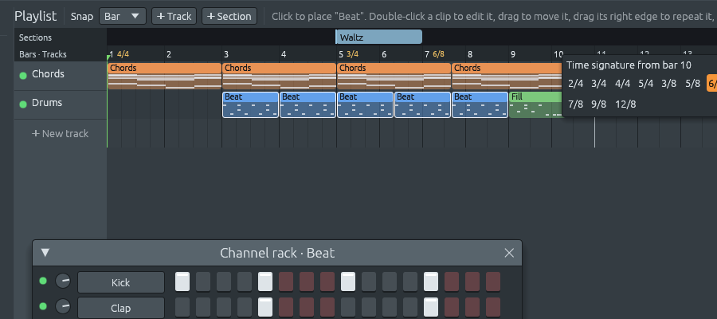

# Changing time signature partway through

Files: [`crates/lineup-core/src/meter.rs`](https://github.com/naelolaiz/ferrous-loom/blob/band-in-a-box/crates/lineup-core/src/meter.rs),
[`crates/lineup-core/src/project.rs`](https://github.com/naelolaiz/ferrous-loom/blob/band-in-a-box/crates/lineup-core/src/project.rs),
[`crates/lineup-core/src/midi_file.rs`](https://github.com/naelolaiz/ferrous-loom/blob/band-in-a-box/crates/lineup-core/src/midi_file.rs)
and [`crates/lineup-app/src/playlist/sections.rs`](https://github.com/naelolaiz/ferrous-loom/blob/band-in-a-box/crates/lineup-app/src/playlist/sections.rs)

[Time signatures](time-signatures.md) gave a project one time signature.
Real music does not always keep one: a hymn's last line can stretch into
3/4, a folk dance can switch between 6/8 and 3/4, a prog song changes
every few bars. FL Studio handles this with *time markers* on the
playlist, and now Ferrous Lineup does too.

Right-click the bar numbers and pick a time signature. From that bar on,
bars are counted in it. The ruler writes the time signature at bar 1 and
wherever it changes, and the same menu has **Remove this change**.




As before, a time signature never moves a note. The steps are still
sixteenth notes, and a 16-step pattern still lasts 16 steps when you
drop it into a 3/4 stretch. What changes is where the bar lines go.

## A marker, and a meter

A change is a tiny struct:

```rust
pub struct TimeMarker {
    pub start: usize,        // the step it starts on
    pub time: TimeSignature, // the bars from there on
}
```

The project keeps its own `time_signature` for the start of the song,
and the playlist keeps a sorted list of markers after it, like it keeps
its sections. A marker always starts a new bar. Put one in the middle
of a bar and that bar is cut short, which is how a score shows a bar
with a beat missing.

Before markers, every question about bars was simple arithmetic:
"which bar is step 50 in?" is `50 / 16`. With markers it depends on
everything before step 50, so the answers moved into one type,
`Meter`:

```rust
pub struct Meter {
    first: TimeSignature,
    markers: Vec<TimeMarker>,
}
```

Its methods are the questions the app asks: `bar_at(step)` (which bar,
where it starts, how long it is and in which time), `bar(number)`,
`is_bar_start`, `floor_to_beat`, `round_up_to_bar`, and `position(step)`
for the BAR:BEAT:STEP display. A song with no markers is
`Meter::steady(time)`, and gives exactly the same answers as the
`TimeSignature` alone; a test checks that, step by step.

`bar_at` walks the song in *stretches*, one per time signature,
counting the bars it passes:

```text
4/4 from 0, 3/4 from 32:
stretch 1: steps 0..32,  16 a bar -> bars 0 and 1
stretch 2: steps 32..,   12 a bar -> bars 2, 3, 4, ...
```

```rust
for (start, end, time) in self.stretches() {
    let bar = time.steps_per_bar();
    if step < end {
        let index = (step - start) / bar;
        // ... bar number `bars_before + index`, starting at start + index * bar
    }
    bars_before += (end - start).div_ceil(bar);
}
```

`div_ceil` rounds up, so a short bar before a marker still counts as a
bar. `stretches()` is a nice example of building an iterator out of
others: the starts (the first time signature, then each marker) are
`zip`ped with the ends (each marker, then `usize::MAX` for "never").

`bars()` gives every bar without end, made with `std::iter::from_fn`,
which turns a closure into an iterator. The playlist draws its grid with
`meter.bars().take_while(|bar| bar.start <= steps)`: the iterator never
stops on its own, `take_while` decides how much of it to use.

## Who needed to change

Anything that used to ask `project.time_signature` about bars now asks
`project.meter()`:

- the playlist grid, the bar numbers and the snapping, through
  `Snap::floor` and `Snap::next` (the end of the bar or beat the pointer
  is in, which is what dragging a section or a loop needs);
- the sections' bar counts and the "Looping bars" label;
- the length of the song, which is rounded up to the next bar line.

The channel rack and the piano roll show one pattern, not the song. They
ask `project.pattern_time(pattern)`: the time signature where the
pattern's first clip starts. A pattern used in the 3/4 stretch is drawn
in bars of three. The library's rhythms, fills and chord hearing use the
same, so applying a rhythm to a 3/4 pattern lays it out in 3/4 bars.

## The song as it plays

Sections can repeat ([song structure](song-structure.md)). If a section
in 3/4 plays twice, the song as heard has two 3/4 stretches, but the
playlist draws one. The arrangement's *passes* already say which part of
the timeline plays when, so `Project::played_meter` builds a second
`Meter` in song steps: at the start of each pass, the time signature
that part of the timeline is in, plus the markers inside it. Then
`tidy()` drops the markers that change nothing, such as a 4/4 pass that
follows another 4/4 pass on a bar line.

The transport uses that meter for the position display and for
Page Up/Page Down, so "next bar" means the next bar you hear. MIDI
export uses it to write a time signature meta event at every change,
the same four bytes as before, now at each change's tick instead of
only at tick 0.

Duplicating a section copies its markers too, and puts one at the
start of each copy, so the copy is counted like the original. Then the
markers are tidied, so a plain 4/4 section copied in a 4/4 song adds
none.

## In files

Markers are saved as `time_markers` after the loop region. A project
with markers is **format 5**: an older Ferrous Lineup would skip the field
it does not know and draw everything in the first time signature, so it
should refuse the file instead. A project without markers leaves the
field out and keeps its old format, so older versions can still open
it. On loading, every marker goes through `set_time_marker`, which
refuses one that is too late or whose bars would not fit in a pattern,
as if you had added it by hand.

## Demo songs in two times

A demo song's part can have its own time signature:

```rust
Part::new("Coda", "...", "I | IV | V").in_time(THREE_FOUR)
```

`song_demo` writes that part's pattern in bars of three, picks drums in
that time (the song's own rhythm if it fits, another rhythm of the same
genre if not), and puts a marker where the part starts and another one
back where the song's time comes again. The `in_time` name matches the
one rhythms already use.
