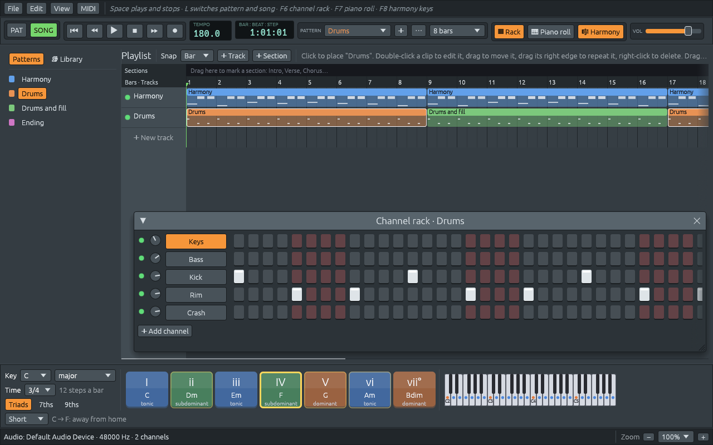

# Time signatures

Files: [`crates/lineup-core/src/meter.rs`](https://github.com/naelolaiz/ferrous-lineup/blob/main/crates/lineup-core/src/meter.rs),
[`crates/lineup-core/src/file.rs`](https://github.com/naelolaiz/ferrous-lineup/blob/main/crates/lineup-core/src/file.rs),
[`crates/lineup-core/src/midi_file.rs`](https://github.com/naelolaiz/ferrous-lineup/blob/main/crates/lineup-core/src/midi_file.rs)
and [`crates/lineup-app/src/playlist.rs`](https://github.com/naelolaiz/ferrous-lineup/blob/main/crates/lineup-app/src/playlist.rs)

Until now every bar in Ferrous Lineup had sixteen steps: four beats of
four sixteenth notes. That is 4/4, and most pop music is in it. But a
waltz counts *one two three*, a tango vals too, and *Greensleeves*,
*Amazing Grace* and *Für Elise* are not in four either. The library
needs them, so step 8 adds time signatures.

## The music

A time signature looks like a fraction. The bottom number says which
note is a beat (4 for a quarter note, 8 for an eighth), and the top
says how many make a bar:

| Time | A bar is | Steps | Feels like |
|------|----------|-------|------------|
| 4/4 | four quarter notes | 16 | *one* two three four |
| 3/4 | three quarter notes | 12 | *one* two three: a waltz |
| 2/4 | two quarter notes | 8 | *one* two: a march, a polka |
| 6/8 | six eighth notes | 12 | *one* two three *four* five six: two big beats of three |
| 7/8 | seven eighth notes | 14 | two and two and three, or another mix |

3/4 and 6/8 both have twelve steps to the bar, and the notes in them
can be the same. What differs is how they are *counted*: three beats of
four steps, or two beats of six. That is why a time signature in
Ferrous Lineup changes where lines are drawn, not what is played.

## `TimeSignature`

```rust
#[derive(Debug, Clone, Copy, PartialEq, Eq, Hash, Serialize, Deserialize)]
pub struct TimeSignature {
    pub beats: u8,
    pub unit: u8,
}

impl TimeSignature {
    pub const COMMON: TimeSignature = TimeSignature::new(4, 4);

    pub const fn new(beats: u8, unit: u8) -> Self {
        TimeSignature { beats, unit }
    }

    pub fn steps_per_bar(self) -> usize {
        let unit = usize::from(self.unit.clamp(1, 16));
        (usize::from(self.beats) * 16 / unit).max(1)
    }
}
```

`new` is a `const fn`, so it can be called where Rust needs a value
while compiling: in `COMMON`, and in the list of all the time
signatures the menu offers, `ALL`. `steps_per_bar` guards against
nonsense from a damaged file: `clamp` keeps the unit between 1 and 16,
so it never divides by zero, and `max(1)` makes sure a bar is never zero
steps long, which would make every "which bar is this?" a division by
zero too.

Where the beats fall is a separate question:

```rust
pub fn steps_per_beat(self) -> usize {
    let unit_steps = (16 / usize::from(self.unit.clamp(1, 16))).max(1);
    if self.unit == 8 && self.beats.is_multiple_of(3) && self.beats > 3 {
        unit_steps * 3
    } else {
        unit_steps
    }
}

pub fn is_bar_start(self, step: usize) -> bool {
    step.is_multiple_of(self.steps_per_bar())
}
```

6/8, 9/8 and 12/8 are felt in groups of three eighth notes, so their
beat is six steps long. `is_multiple_of` is the clear way to write
`x % n == 0`, and it does not panic when `n` is 0 (only `0` is a
multiple of `0`); Clippy suggests it whenever it sees the `%` version.

`TimeSignature` implements `Display`, the trait behind `{}` in
`format!` and behind `to_string()`:

```rust
impl fmt::Display for TimeSignature {
    fn fmt(&self, f: &mut fmt::Formatter<'_>) -> fmt::Result {
        write!(f, "{}/{}", self.beats, self.unit)
    }
}
```

Implement `Display` once, and every `format!("{time}")`, every label in
the UI and every error message writes "3/4" the same way.

## Everything that counted to sixteen

Finding them was a matter of searching for `16`, `STEPS_PER_BAR` and
`% 4`. Each one now asks the project's time signature:

- **the playlist**: the width of a bar, the bar numbers in the ruler,
  the bar and beat lines, and where clips snap. `Snap::Bar` used to be
  sixteen steps; now it asks:

  ```rust
  fn steps(self, time: TimeSignature) -> usize {
      match self {
          Snap::Bar => time.steps_per_bar(),
          Snap::Beat => time.steps_per_beat(),
          Snap::Step => 1,
      }
  }
  ```

- **the channel rack**: the step buttons alternate colours by beat, and
  start again in every bar, so all bars look alike,
- **the piano roll**: its bar and beat lines, in the grid and in the
  velocity lane,
- **the pattern length menu**: it offers whole bars (1, 2, 3, 4, 6, 8,
  12 and 16 of them) and writes "4 bars" instead of "64 steps". A
  length that is not a whole number of bars, like 16 steps in 3/4, is
  shown in steps,
- **the song's length**, which is rounded up to a whole bar.



The audio thread did not change at all. It plays steps, and a step is
a sixteenth note in every time signature.

## In files: format 3

A project file gets a new field, but only when it needs one:

```rust
#[serde(default, skip_serializing_if = "TimeSignature::is_common")]
time_signature: TimeSignature,
```

These are serde *field attributes*. `skip_serializing_if` names a
function that is asked before writing the field; for 4/4 it answers
yes, and the field is left out, so a 4/4 project is written exactly as
before. `default` works the other way, when reading: a file without
the field gets `TimeSignature::default()`, which is 4/4. Together they
mean old files open unchanged, and new 4/4 files can still be opened by
older versions of Ferrous Lineup.

A project in another time signature is written as **format 3**, which
older versions refuse, instead of opening a waltz and drawing it in
bars of four. Format 3 also covers the other things step 8 added that
an older version would get wrong: the nine new drums, and patterns
longer than four bars, which it would cut short without a word.
`format_for` checks all three, and returns the oldest format that can
hold the project, as in step 7.

## In MIDI files

A Standard MIDI File has a *meta event* for the time signature, which
step 7 always wrote as 4/4. It holds four bytes: the beats, the unit as
a power of two (2 for a quarter note, because 2² = 4; 3 for an eighth),
how many MIDI clocks a metronome click lasts (24 to a quarter note) and
a constant 8:

```rust
let signature = project.time_signature;
let unit_power = signature.unit.max(1).ilog2() as u8;
let clocks = (signature.steps_per_beat() * 6).min(255) as u8;
track.meta(0, TIME_SIGNATURE, &[signature.beats, unit_power, clocks, 8]);
```

`ilog2` is the integer base-2 logarithm: how many times you can halve
the number before reaching 1. `8u8.ilog2()` is 3. It panics on 0, which
is why the unit goes through `max(1)` first. In 6/8 a click is a dotted
quarter, six steps, so 36 clocks; a test checks exactly those bytes.

> Later in step 8 a time signature can be any two numbers, and beats can
> be grouped (2+2+3/8): `steps_per_beat` gave way to `beat_at`. See
> [Any time signature, and irregular meters](any-time-signature.md).
