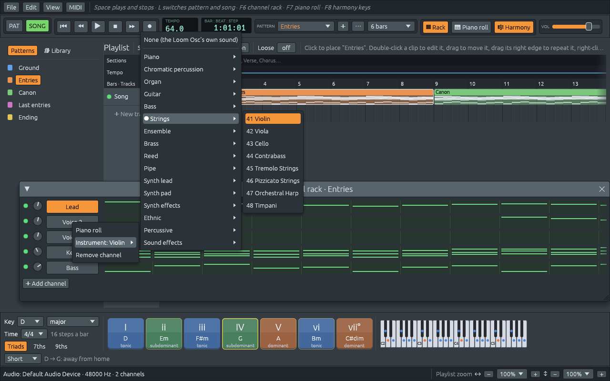

# Every voice on its own channel, with a real instrument

Files: [`crates/lineup-core/src/general_midi.rs`](https://github.com/naelolaiz/ferrous-loom/blob/band-in-a-box/crates/lineup-core/src/general_midi.rs),
[`crates/lineup-audio/src/timbre.rs`](https://github.com/naelolaiz/ferrous-loom/blob/band-in-a-box/crates/lineup-audio/src/timbre.rs),
[`crates/lineup-core/src/library/song.rs`](https://github.com/naelolaiz/ferrous-loom/blob/band-in-a-box/crates/lineup-core/src/library/song.rs)
and [`crates/lineup-core/src/library/demo.rs`](https://github.com/naelolaiz/ferrous-loom/blob/band-in-a-box/crates/lineup-core/src/library/demo.rs)

Open **Canon in D** before this change and look at the channel rack: one
Lead channel holds all three violins. Pachelbel wrote three violin parts
that play the same line, each two bars behind the one before; in the
rack they were one tangle of notes, and you could not mute the second
violin to hear what the first one does. Frère Jacques, Row, Row, Row
Your Boat and Three Blind Mice, the rounds, had the same problem.

And every channel of every demo played the same sound: the Loom Osc's
sawtooth. A violin, a choir and a bass guitar all buzzed alike. Sent to
a MIDI synth, everything came out as a piano, because nothing told the
synth otherwise.

Now each voice has a channel, and each channel has an instrument.

## What you see

Open **File > Demos > Songs > Classical and film > Canon in D**. The
rack has **Lead**, **Voice 2** and **Voice 3**, the three violins, then
**Keys** (the harpsichord, playing the chords) and **Bass** (the cello,
playing the ground bass). In the pattern **Entries**, Voice 2 starts two
bars after Lead, and Voice 3 two bars after that. Mute any of them with
its light to hear the canon without it.

Right-click a channel's name: **Instrument** shows the one it plays, and
its submenu has all 128 instruments of General MIDI, sorted in their
sixteen families.



Hover over a channel's name to see its instrument too.

## General MIDI: 128 instruments by number

A MIDI cable or a MIDI file carries notes, not sounds. To say which
sound should play them, MIDI has the *program change* message: "from
now on, channel 3 plays program 40". Two bytes: `0xC2` (program change,
on channel 3, counted from 0) and `40`.

On its own, 40 means nothing. In 1991, *General MIDI* fixed a list:
program 40 is a violin, 0 a grand piano, 52 a choir, 73 a flute, on
every synth that follows it, from a phone to a stage keyboard. Channel 10
is kept for drums. The programs come in families of eight: pianos 0 to
7, organs 16 to 23, guitars 24 to 31, basses 32 to 39, strings 40 to 47,
and so on. Manuals count from 1 ("41 Violin"), the bytes from 0; the
menu shows the manual's numbers.

`general_midi.rs` holds the names and the numbers the demos use:

```rust
pub const VIOLIN: u8 = 40;
pub const CELLO: u8 = 42;
pub const CHOIR_AAHS: u8 = 52;

pub fn name(program: u8) -> &'static str {
    NAMES[usize::from(program.min(LAST))]
}
```

## A channel's instrument

`Channel` got one field:

```rust
#[serde(default, skip_serializing_if = "Option::is_none")]
pub program: Option<u8>,
```

`Option<u8>` because a channel can have no instrument in particular:
then nothing is sent to a synth, and the Loom Osc keeps its own sound.
The two serde attributes keep old files readable: a file without the
field reads as `None` (`default`), and a channel without an instrument
writes no field at all (`skip_serializing_if`). Only a project that has
instruments is saved in the new file format, so older versions of
Ferrous Lineup still open everything else.

The instrument is used in three places:

1. **MIDI export** writes a program change at the very start of each
   channel's track, before its first note. Drums get none: on channel
   10 the notes choose the drums.
2. **MIDI output** sends it just before the channel's first note, and
   again after each stop, in case you changed the sound on the synth in
   between. The `MidiOut` instrument keeps a flag for that:

   ```rust
   fn start(&mut self, pitch: Note, velocity: u8, gate: u32, origin: Option<Origin>) {
       if self.program_due
           && let Some(program) = self.program
       {
           self.post(MidiMessage::ProgramChange { channel: self.channel, program });
           self.program_due = false;
       }
       // ...then the note itself, as before
   ```

3. **The Loom Osc** picks a sound close to it.

`MidiMessage::bytes` used to return `[u8; 3]`, since every note
message is three bytes long. A program change is two, so it now returns
a small `MidiBytes` that derefs to a slice (`&[u8]`) of the right
length. That is the `Deref` trait at work: wherever a `&[u8]` is
expected, `&message.bytes()` is accepted as one.

## Making the Loom Osc sound like an instrument

The Loom Osc is tiny: one oscillator per note, a soft low-pass filter,
and a volume envelope (attack, decay, sustain, release). It can never
sound like a real violin, but it can sound more like a violin than like
a piano. `timbre.rs` changes three things by family:

| | Wave | Envelope | Sounds like |
|---|---|---|---|
| Piano, guitar, harp, pizzicato | sawtooth or triangle | starts at once, dies away even while held (sustain 0) | struck or plucked |
| Strings, brass | sawtooth | swells in (slow attack), keeps going | bowed or blown |
| Organ, accordion, clarinet, saxophone | square | full while held | hollow, reedy |
| Flute, voices | triangle | soft attack, keeps going | soft and round |
| Bells, vibraphone, marimba | sine | dies away | pure |

A sawtooth has every harmonic, so it is bright; a square only the odd
ones, which sounds hollow; a triangle has weak harmonics, so it is soft;
a sine has none at all. A `Timbre` is just those numbers:

```rust
pub struct Timbre {
    pub wave: Wave,
    pub attack: f32,
    pub decay: f32,
    pub sustain: f32,
    pub release: f32,
    pub cutoff: f32,
    pub gain: f32,
}
```

`Timbre::for_program(None)` gives back the Loom Osc's own sound, with
exactly the numbers it always had, so nothing changes for channels
without an instrument.

One test in the audio engine checks that a `Command` stays small,
because every slot of the queue to the audio thread is as big as the
biggest command. Adding the wave and the gain to the synth made it too
big, so they live in the same `Box` as the envelope's speeds: the synth
holds a pointer to them, not the values.

## Voices: who sings what

A part of a demo song used to list where copies of the melody start, in
bars: `[0, 2, 4]` for three voices two bars apart. It did not say which
voice each copy was, and it did not need to while they all went to one
channel. Now each copy names its voice:

```rust
// Each violin starts two bars after the one before.
Part::new("Entries", CANON_TUNE, CANON_CHORDS).with_voices(&[(1, 0), (2, 2), (3, 4)]),
Part::new("Canon", CANON_TUNE, CANON_CHORDS)
    .with_voices(&[(1, 0), (2, -4), (2, 2), (3, -2), (3, 4)]),
```

`(2, -4)` is the second violin, carrying on from the part before: it
came in at bar 2 of a six-bar part, so in the next part its tune started
four bars ago, and only its end is heard. `(2, 2)` is the same violin
starting the tune again.

`song_demo` makes one channel per voice (Lead for voice 1, then "Voice
2", "Voice 3"...) and `melody_notes` returns one list of notes for each.
Each voice gets its own accents from [the performance](tempo-and-feel.md),
as each player would.

## A band for every song

Every song now names its `band`: the instruments of its melody, its
chords and its bass. Pieces from the concert hall get the instruments
they were written for:

| Piece | Melody | Chords | Bass |
|---|---|---|---|
| Canon in D | violins | harpsichord | cello |
| Für Elise, Moonlight Sonata, Träumerei | piano | piano | piano |
| Shchedryk | choir | choir | choir |
| New World Largo | cor anglais (English horn) | strings | double bass |
| Morning Mood | flute | strings | cello |
| Anitra's Dance | violin | pizzicato strings | pizzicato strings |
| Air on the G String | violin | cello (the continuo bass, on Keys) | double bass |
| Wedding March | church organ (the transcription the demo follows) | organ | organ |

A song dressed in a style gets that style's band: fiddle, steel guitar
and double bass for country; fiddle and banjo for bluegrass; bandoneón
(GM's "Tango Accordion"), piano and bass for tango; pan flute and guitar
for huayno; a harp for the joropo, as in the Venezuelan *llanos*; synths
for house and techno. Silent Night gets a nylon guitar under the choir:
Gruber wrote it for guitar, because (the story goes) the church organ
was broken.

## Try it

1. Open Frère Jacques, select **Voice 3** and open the piano roll: it
   starts four bars in.
2. Change the Canon's Voice 2 to a flute and Voice 3 to a clarinet.
   The canon is much easier to follow when each voice has its own
   colour; that is why composers write for different instruments.
3. Export the Canon with **File > Export song as MIDI** and open it in
   another program: each track already has its instrument.
