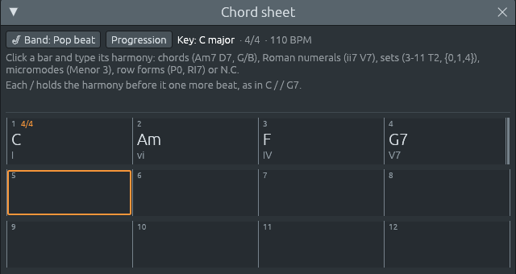

# The band plays the chord sheet

Files: [`crates/lineup-core/src/band.rs`](https://github.com/naelolaiz/ferrous-lineup/blob/main/crates/lineup-core/src/band.rs),
[`crates/lineup-core/src/library/comping.rs`](https://github.com/naelolaiz/ferrous-lineup/blob/main/crates/lineup-core/src/library/comping.rs),
[`crates/lineup-core/src/file.rs`](https://github.com/naelolaiz/ferrous-lineup/blob/main/crates/lineup-core/src/file.rs),
[`crates/lineup-app/src/chord_sheet.rs`](https://github.com/naelolaiz/ferrous-lineup/blob/main/crates/lineup-app/src/chord_sheet.rs),
[`crates/lineup-app/src/app/edit.rs`](https://github.com/naelolaiz/ferrous-lineup/blob/main/crates/lineup-app/src/app/edit.rs)
and [`crates/lineup-app/src/app/library.rs`](https://github.com/naelolaiz/ferrous-lineup/blob/main/crates/lineup-app/src/app/library.rs)

The chord sheet of the [last change](chord-sheet.md) held a song's
harmony but played nothing. This change puts a band behind it: a
piano, a bass and drums. Type `C`, Tab, `Am`, Tab, `Dm7 G7`, Tab, `C`,
press Space, and they play it.



## Trying it

**File > New** now opens an empty chord sheet with a band ready, in
song mode. (The old new song, one empty pattern and a drum kit, is
**File > New beat**.) As soon as a bar holds a harmony, three tracks
appear in the playlist, **Piano**, **Bass** and **Drums**, with
patterns called "Piano 1", "Bass 1", "Drums 1":


They are ordinary patterns. Double-click one and the piano roll shows
every note the band plays; the channel rack shows the drums step by
step. Nothing about them is hidden, which matters in a program you use
to learn: you can see how a bossa nova pianist spreads a Dm7 over the
bar, or where a walking bass puts its lead-in note.

On the sheet's top line:

- **🎷 Band** picks how the band plays. Each of the library's 81
  rhythms is a band style, sorted by genre, and four more play without
  drums: **Chorale** (each chord held, as an organ plays a hymn),
  **Alberti bass** (the chord broken low, high, middle, high, as in
  Mozart's sonatas), **Arpeggios** and **Sarabande** in 3/4. Pointing at
  one says what it is, its time signature and its usual tempo. **No
  band** sends the band home.
- **Progression** writes a well-known chord progression from the
  selected bar, in the song's key: the 145 harmony styles of the
  library, by genre, each with its chords in the tooltip ("Cmaj7 – Am7
  – Dm7 – G7. I vi ii V: the progression that ends so many standards").
  Pick another and it goes on after the first.
- **End the song here**, when you right-click a bar, says where the
  band stops. A bar with nothing written goes on with the harmony
  before it, so a song that ends on a long C is `C` in its last bar
  and "End the song here" a few bars later.


Clicking a style or a rhythm in the **Library** while there is a band
changes the band's style too, with the style's own tempo if **Use
their tempo** is ticked.

## What to play, and how to play it

In the library of [step 8](../step-8/library.md), a style is a bundle:
a chart of chords, a way to comp them, a bass pattern and a rhythm.
"Bossa nova" means Dm7 G7 Cmaj7 *and* the piano's syncopated chords
*and* the bass on 1 and the "and" of 2 *and* the rim clicks. A backing
band separates the two halves. The chords are yours (the sheet); the style
only says how to play them. So this change splits the library the same
way, without changing it:

| Half | What it is | Where it lives now |
|------|------------|--------------------|
| What to play | a progression of numerals | **Progression** menu, from each `Style`'s chart |
| How to play it | comping, bass, drums | **Band** menu, a `BandStyle` |

A `BandStyle` is a style with the chords taken out:

```rust
pub struct BandStyle {
    pub name: &'static str,
    pub genre: Genre,
    pub time: TimeSignature,
    /// The tempo it is usually played at, in BPM.
    pub tempo: f32,
    pub comping: Comping,
    pub bass: Bass,
    /// The drums, or `None` for a band without them.
    pub rhythm: Option<&'static Rhythm>,
    pub about: &'static str,
}
```

The band styles are not written out by hand. Each library rhythm
already knew how the piano and bass go with it (`apply::feel`, the
function that answers "a samba is comped like this, with this bass"),
so the list is made from the rhythms the first time it is asked for:

```rust
pub fn band_styles() -> &'static [BandStyle] {
    static STYLES: OnceLock<Vec<BandStyle>> = OnceLock::new();
    STYLES.get_or_init(|| {
        let mut styles: Vec<BandStyle> = RHYTHMS
            .iter()
            .map(|rhythm| {
                let (comping, bass) = apply::feel(rhythm);
                BandStyle { name: rhythm.name, /* … */ rhythm: Some(rhythm), /* … */ }
            })
            .chain(WITHOUT_DRUMS)
            .collect();
        // A stable sort: within a genre, the library's order stays.
        styles.sort_by_key(|style| style.genre);
        styles
    })
}
```

> **Rust: `OnceLock`.** A `static` must be built at compile time, and
> a `Vec` cannot be (it needs the heap). `std::sync::OnceLock` is a box
> that starts empty and is filled once, the first time `get_or_init`
> runs; every later call gets the same value back. Several threads can
> race to call it and only one closure runs. The return type
> `&'static [BandStyle]` says "this list lives as long as the program",
> which is what lets a `&'static BandStyle` sit in the project as the
> band's style without any lifetime to track.

`sort_by_key` is a *stable* sort: styles of the same genre keep the
order they had, so the menu lists them in the library's order.

## What each player plays

A band style knows *how*; the sheet knows *what*. Putting them
together happens in three steps.

**1. The harmonies, as notes.** `played_harmonies` walks the sheet and
turns each harmony into a `Played`: when it starts and ends, the notes
the piano holds for it (its *voicing*), and what the bass plays under
it.

```rust
pub struct Played {
    pub start: usize,
    pub end: usize,
    pub voicing: Vec<Note>,
    pub bass: BassPart,
}

pub enum BassPart {
    /// A chord: its root (or the note after the slash) and the next
    /// harmony's bass, to lead into it.
    Chord { chord: Chord, note: Note, next: PitchClass },
    /// A group of notes with no root, such as a pitch-class set: the
    /// bass keeps the rhythm of its line on this one note and its octave.
    Pedal(Note),
    /// Nothing.
    Rest,
}
```

Chords are voiced the way the library voices a chart: each from the one
before, moving every voice as little as it can (`voice_progression`),
so C Am F G7 does not jump around the keyboard. Their bass notes make a
line (`bass_line`), so a slash chord's bass is the note after the slash:
`G7/B` has B in the bass.

The other ways Ferrous Lineup names harmony are played by their notes:

- **A pitch-class set or a micromode** has no root, so there is no
  "right" bass note. The band takes the first note of its *normal form*
  (its most compact order): 3-11 T2, the notes D F A, is played D F A
  from middle C up, over a D. The choice is arbitrary but fixed, so the
  same set always sounds the same.
- **A row form** is a line of twelve notes, not a chord. The band plays
  it as four chords of three notes, in the row's order, one after
  another through the bar, each over its first note. Cutting a row into
  groups and sounding each group as a chord is a common way to
  harmonise it; Webern built the row of his Concerto Op. 24 from four
  such groups of three.
- **N.C.** plays nothing; the drums go on.

**2. The rhythm, kept to the bars.** The library's comping and bass
patterns (`Comping::play`, `Bass::play`) start again at every chord.
That is right for a chart where chords change on the bar line, but a
sheet can say `Dm7 G7` (a change on beat 3) or `C / / G7` (on beat 4).
Starting the pattern again on beat 3 would shift the groove every time
the chord changes, as if the drummer counted "one" in the middle of the
bar. A band keeps its groove and lets the chords fall into it.

So `comping.rs` gains `Comping::play_in_bars`: the rhythm's hits are
placed in every bar, from its first beat, and each hit plays *whichever
harmony is sounding when it falls*:

```rust
for bar in bars {
    let from = period_start(bar, period);
    for offset in (0..bar.end() - from).step_by(period) {
        for hit in hits {
            let at = from + offset + hit.at;
            if at < bar.start || at >= bar.end() {
                continue;
            }
            // The harmony sounding at `at`: the last one that started.
            let index = harmonies.partition_point(|harmony| harmony.start <= at);
            /* … play `pick(&harmony.voicing, hit.what)` at `at` … */
        }
    }
}
```

> **Rust: `partition_point`.** On a sorted slice, `partition_point(p)`
> returns how many elements at the start satisfy `p`, by binary search.
> The harmonies are sorted by start, so `partition_point(|h| h.start <=
> at)` counts the harmonies that have started by `at`; the sounding one
> is the one before that count. `checked_sub(1)` turns "none started
> yet" into `None` instead of an overflow.

A chord so short that no hit falls in it (a G7 on the "and" of 4, in
a pattern that only strikes on 1 and 3) would be skipped. Skipping a
chord is a wrong harmony, so such a chord is struck once where it
starts.

A pattern longer than a bar, like the bossa nova's two-bar clave,
counts from bar 1: `period_start` starts it in odd bars and goes on
in even ones, the way a player counts "one, two" across the pair.

`Bass::play_in_bars` is the same idea for the bass: the line starts
again where each harmony starts, so the root lands on the change, and
again at each bar line, so a chord held for eight bars does not turn
into one long walk. Only the last piece of a harmony leads into the
next one.

A **walking bass** plays one note per beat: the root on 1, notes of
the chord, and on the last beat a note a half step above or below the
next root, which "leads in" to it. In 4/4 over C going to F that is
C E G E. In a bar of three, root, third, lead-in would give C E E (the
third of C *is* the half step below F), so the walk in three goes
root, fifth, lead-in instead: C G E.

**3. Each part, as patterns.** The notes of a whole song do not fit in
one pattern (a pattern is at most 256 steps, 16 bars of 4/4), and one giant pattern
would be hard to read anyway. `chunks` cuts the song into stretches:
whole bars of one time signature, inside one section, as long as a
pattern may be. `write_part` cuts the notes at those lines (a note that
lasts past the end of a stretch goes on at the start of the next) and
compares each stretch's notes with the ones before. Stretches that play
exactly the same notes share **one** pattern, with two clips of it, as
a producer copies a clip instead of playing the part twice. A song of
two identical choruses gets "Piano 1" twice in the playlist.

The patterns are written *over* the ones the player already had, so
"Piano 1" stays pattern number 5 (say) while you edit the sheet: the
piano roll you have open on it shows the new notes instead of closing.

Every pattern the band writes is tagged:

```rust
pub struct Pattern {
    /* … */
    /// The band's player whose part it holds, if the band wrote it (see
    /// [`crate::band`]). The band writes these patterns again when the
    /// chord sheet changes.
    pub player: Option<Player>,
}
```

That tag is how the band finds its own work again, and how the library
knows to leave it alone: "Play the whole song in this rhythm" skips
patterns with a player, because the band's parts change when the band's
style does.

## Playing again when the sheet changes

The band plays what the sheet says *now*. Type a chord, change the
key, re-meter the song, drag a section: the parts are written again,
in the same undo step as your change, so one Ctrl+Z takes back both.

The app does it in one place. Every change to the project goes through
`LineupApp::edit` (see [Undo and redo: a history of copies](../step-5/history.md)), so
that is where the band is told:

```rust
pub(super) fn edit<R>(
    &mut self,
    label: &'static str,
    change: impl FnOnce(&mut Project) -> R,
) -> R {
    let before = self.project.clone();
    let result = change(&mut self.project);
    // The band plays what the chord sheet says now, in the same step.
    self.project.follow_chord_sheet();
    if self.project != before {
        self.sync_audio(&before);
        self.history.record(label, before);
    }
    result
}
```

> **Rust: `impl FnOnce(&mut Project) -> R`.** `edit` takes any closure
> that changes the project once and returns something of type `R`,
> which `edit` hands back. `R` is a generic type chosen by each caller:
> `self.edit("write a progression", |p| p.write_progression(style,
> from))` returns the `usize` of bars written, `self.edit("end the
> song", |p| p.end_song_at(bar))` a `bool`. `FnOnce` (rather than
> `FnMut` or `Fn`) is the most permissive bound for the caller: the
> closure may even move values out of what it captured, since it is
> only called once.

Writing every part again after every click would be wasteful: moving a
clip of the melody changes nothing the band plays from. So
`follow_chord_sheet` first takes a **fingerprint** of what the parts
are played from (the style, the chord markers, the keys, the bars, the
sections) and compares it with the one taken last time:

```rust
pub fn follow_chord_sheet(&mut self) -> bool {
    let Some(band) = &self.band else {
        return false;
    };
    if band.heard == Some(self.band_inputs()) {
        return false;
    }
    self.band_channels();
    self.write_band();
    true
}
```

A fingerprint (a *hash*) is a number computed from some data, such that
different data almost surely give different numbers. Comparing two
64-bit numbers is much cheaper than comparing two chord sheets, and the
band only has to keep the number, not a copy of the sheet.

## A part you edit stays yours

A band that writes its tracks fresh every time you press Play loses
an edit to the bass line the next time anything changes. Here,
a part you change by hand **freezes**: the band leaves it exactly as
you left it, and the sheet says so:


**Play it again** throws your version away and has the band write the
part from the sheet once more. The other players go on following the
sheet as before: in the picture the piano is frozen, but a chord typed
in bar 2 still changes the bass.

How does the band know you edited a part, whatever tool you used (the
piano roll, the channel rack, dragging a clip, the library)? It does
not watch the tools. It keeps, for each player, a fingerprint of the
part it last wrote, and compares it with a fingerprint of the part as
it is now:

```rust
pub fn is_frozen(&self, player: Player) -> bool {
    self.band.as_ref().is_some_and(|band| {
        band.written[player.index()]
            .is_some_and(|written| written != self.part_print(player))
    })
}
```

`part_print` mixes in where each of the player's clips starts, how
often it repeats, and every note of its pattern. Which track a clip is
on and which number its pattern has are left out, so moving the Piano
track down, or deleting a pattern of yours (which renumbers the ones
after it), does not freeze anything.

> **Rust: `Option::is_some_and`.** `opt.is_some_and(|x| test(x))` is
> `true` only if there is a value and it passes the test. Two of them
> nested read as one sentence: "there is a band, and it has written
> this player's part, and that is not what is there now".

### FNV-1a

The fingerprints are saved in the project file, so a part you froze
stays frozen when you open the song tomorrow. The standard library's
hasher (`DefaultHasher`) is not promised to give the same number in
the next version of Rust, so it cannot be saved. The band uses
**FNV-1a** instead, a classic hash of a few lines:

```rust
struct Fingerprint(u64);

impl Fingerprint {
    fn new() -> Self {
        Fingerprint(0xCBF2_9CE4_8422_2325)
    }

    fn bytes(&mut self, bytes: &[u8]) {
        for &byte in bytes {
            self.0 ^= u64::from(byte);
            self.0 = self.0.wrapping_mul(0x0100_0000_01B3);
        }
    }
}
```

For each byte: mix it into the number with XOR, then multiply by a
large prime, `0x100000001B3`. The starting number and the prime are
the published constants of the algorithm, so every program that
implements FNV-1a gets the same result.

> **Rust: `wrapping_mul`.** Multiplying two large `u64`s overflows. In
> a debug build plain `*` would stop the program with "attempt to
> multiply with overflow"; `wrapping_mul` says that keeping only the
> low 64 bits is what we want, as a hash does on purpose. The
> underscores in `0xCBF2_9CE4_8422_2325` are only there to make the
> digits readable.

### Moving the whole song is not an edit

**Key > D major** transposes every note of the song, the band's
included (see [Changing key](../step-8/changing-key.md)). The band's parts
no longer match their fingerprints, but you did not edit them: the
tool moved everything. Re-metering and copying a section are the same.
These tools are wrapped in `moving_the_band`, which notes which parts
were following the sheet before, runs the tool, and then takes their
new fingerprints as the band's own:

```rust
pub(crate) fn moving_the_band<R>(&mut self, change: impl FnOnce(&mut Project) -> R) -> R {
    let following: Vec<Player> = Player::ALL
        .into_iter()
        .filter(|&player| /* written by the band, and not frozen */)
        .collect();
    let result = change(self);
    /* … for each player in `following`, written = part_print(player) … */
    result
}

pub fn change_key(&mut self, scale: Scale) -> bool {
    self.moving_the_band(|project| project.move_into_key(scale))
}
```

A frozen part is moved by the tool like any other notes, and stays
frozen: your version of the piano, now in D.

## Changing the style

Picking a style writes every part that is not frozen again. Two things
can change with it:

- **The time signature.** A style in another time signature puts the
  song in it, bar for bar, as a rhythm from the library does (see
  [Re-metering](../step-8/re-metering.md)). Each bar keeps its length,
  so the tempo scales: a song in 4/4 at 110 BPM picked as a Jazz waltz
  becomes 3/4 at 82.5 BPM, and every bar lasts the same 2.18 seconds as
  before (4 × 60 / 110 = 3 × 60 / 82.5). Set the tempo you want after.
- **The tempo.** While the sheet is empty, the song takes the style's
  usual tempo. Once you have written chords, the tempo is yours and
  stays.

The piano and the bass get the General MIDI instrument that fits the
genre (an electric piano for soul and electronic styles, a double bass
for jazz and tango, a synth bass for hip hop), so they sound right
through MIDI out to an external synth.

## A band over a demo

Open a demo, say **Canon in D**, open the chord sheet and pick a band.
A demo already plays its own accompaniment, so first the band:

1. writes the chords the song plays on the sheet, if it is empty (the
   **Write the chords the song plays** of the last change), and
2. **mutes** the song's own chord and bass channels (the library calls
   them "Keys" and "Bass") and its tracks that hold only drums,

so the two do not play over each other. The melody plays on, now with
the band behind it, and the status bar says what was muted.


**No band** removes the band's patterns, its tracks and its channels
(only the ones it added, and only if nothing else plays on them), and
un-mutes what it muted. It remembers what it muted by *name*, not by
number, so the right channels come back even after you added or
removed others in between. The chords stay on the sheet.

## In the file

A project with a band is saved in format 13: the band's style by name,
where it ends, its channels, the fingerprints, and what it muted. In
RON (the file format, see [Saving and loading projects](../step-4/saving.md)):

```ron
band: Some((
    style: "Pop beat",
    end: 64,
    piano: Some(0),
    bass: Some(1),
    written: (Some(18236602816702727710), Some(945158731411533472), Some(10321456850122308024)),
    heard: Some(10198668343261403180),
    muted: (),
    since: 0,
)),
```

and each band pattern carries `player: Some(Piano)`. A file whose band
plays a style this version does not know, or on a channel that does not
exist, is refused with a message saying so rather than opened wrong.

> **Rust: `#[serde(default)]`.** Fields added later, like `since` and
> `muted`, carry `#[serde(default)]`: a file that lacks them still
> loads, with the field's default value (`0`, an empty list). Fields
> that are usually empty also carry `skip_serializing_if =
> "Vec::is_empty"`, so the file only says what is there.

## Exercises

1. Type `C | Am | F | G7` and pick **Jazz waltz**. Look at the bass in
   the piano roll: which note does it play on beat 3 of each bar, and
   which root does it lead into? Then pick **Swing** (4/4): what does
   the walk put on beat 3 now?
2. Write a bar `Dm7 G7` and a bar `C / / G7`. Open the piano part.
   Which beat does the G7 start on in each, and does the comping rhythm
   change in those bars?
3. Pick **Alberti bass** over the same chords. The pattern is "low,
   high, middle, high". Which note of the chord is low in the Am bar,
   and why might it not be the root A? (Hint: voice leading.)
4. Edit one note of the bass, then type a new chord in bar 2. Which
   parts changed? Click **Play it again**. What happened to your note?
5. Open **Canon in D**, pick **Pop ballad**, and look at the channel
   rack. Which channels are muted? Pick **No band**: is the demo back
   exactly as it was?
6. In `band.rs`, `part_print` leaves out the track a clip is on. What
   would go wrong for the user if it did not?
7. (Rust) `band_styles()` returns `&'static [BandStyle]`. Why can
   `Band` hold a `&'static BandStyle` without a lifetime parameter,
   while it could not hold a `&BandStyle` borrowed from a local `Vec`?
