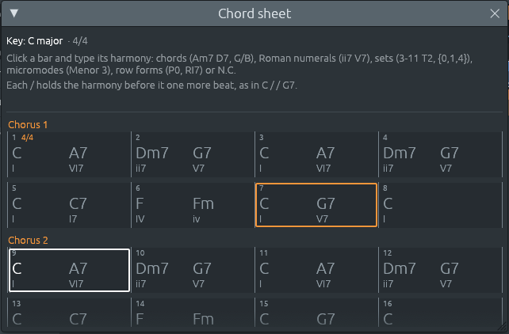
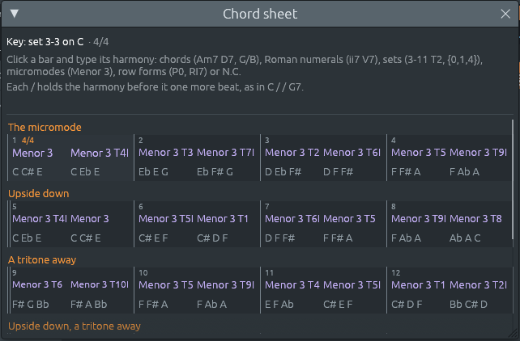

# The chord sheet: writing a song bar by bar

Files: [`crates/lineup-core/src/chord_sheet.rs`](https://github.com/naelolaiz/ferrous-lineup/blob/main/crates/lineup-core/src/chord_sheet.rs),
[`crates/lineup-core/src/project.rs`](https://github.com/naelolaiz/ferrous-lineup/blob/main/crates/lineup-core/src/project.rs),
[`crates/lineup-core/src/file.rs`](https://github.com/naelolaiz/ferrous-lineup/blob/main/crates/lineup-core/src/file.rs),
[`crates/lineup-core/src/remeter.rs`](https://github.com/naelolaiz/ferrous-lineup/blob/main/crates/lineup-core/src/remeter.rs)
and [`crates/lineup-app/src/chord_sheet.rs`](https://github.com/naelolaiz/ferrous-lineup/blob/main/crates/lineup-app/src/chord_sheet.rs)

In Band-in-a-Box the first thing you see is a grid of bars, and you
type a song into it: "C", Tab, "Am7 D7", Tab. This change gives
Ferrous Lineup that grid, the **chord sheet**. It opens with **F5**, the
**📝 Chords** button in the toolbar or **View > Chord sheet**, as a
window over the playlist, which stays as it was.


In this change the sheet is something to read and write; the next
change, [The band plays the chord sheet](band.md), puts a band behind
it. What it already does is hold the
song's harmony, name it in every way the app knows, follow the song when
it changes, and write itself from what the song plays.

## Reading the sheet

The sheet is laid out like a printed chart:

- **Four bars to a line.** Each bar shows its number in the corner, and
  the time signature where it changes (the "4/4" in bar 1).
- **Each section starts a new line**, under its name: "Chorus 1",
  "Chorus 2". A section played three times is headed "Verse ×3". A
  double bar line marks where a section starts, and the final bar line
  (thin, then thick) where the song ends.
- **Each harmony sits where its beat falls.** "C A7" in a bar of four
  beats puts C at the left edge and A7 halfway along, on beat 3.
- **Under each chord, its Roman numeral in the key**: A7 in C major is
  VI7, Fm is iv. An inversion gets the figures of figured bass: G7/B is
  V⁶₅, C/E is I⁶. Under a set or a micromode, its notes.
- **A bar with nothing written goes on with the harmony before it**,
  which is shown faintly so the bar does not look empty.
- **A key change** is written at the top right of the bar where it
  happens, "→ G major", in orange like the section names.

Pointing at a harmony says what it is, in the same words as the harmony
keys: "A7: A dominant seventh, V7/ii in C major: a secondary dominant,
the dominant of Dm. Its notes: A C# E G." Holding the mouse button down
on it plays it, with its bass note under it.

While the song plays, the bar playing gets a white frame, as the
harmony key playing does, and the chord sounding is the brightest name
on the sheet; the others turn dim. The sheet scrolls along with the
song.



## Writing in a bar

Click a bar to select it (an orange frame), and type. The first key you
press opens a text field over the bar with that letter in it; Enter
takes the text in and selects the next bar, Tab takes it in and goes
straight on typing in the next bar, Shift+Tab goes back one, and
Escape leaves the bar as it was. A double-click, Enter or F2 on a
selected bar opens it with what it holds, to change it. Delete clears
it. The arrow keys move from bar to bar, up and down by lines.

With the typing keyboard on (letters play notes), a letter cannot start
typing in a bar; double-click the bar or press Enter first.

A bar can hold any of these, separated by spaces:

| Typed | What it is | Example |
|-------|------------|---------|
| A chord symbol | any chord [Chord names](chord-names.md) reads | `Am7`, `G/B`, `F#m7b5`, `C6/9` |
| A Roman numeral | a chord of the key, in a key of seven notes | `ii7 V7` in C major is written Dm7 G7 |
| A pitch-class set | by its Forte name, moved with `Tn` or `TnI` | `3-11 T2` is D F A |
| | or by its notes, in braces | `{0,1,4}`, `{D F A}`, `{t e 0}` |
| A micromode | one of Kröpfl's twelve, moved the same way | `Menor 3`, `Menor 3 T4I` |
| A row form | a form of the key's twelve-tone row | `P0`, `I5`, `R3`, `RI7` |
| No chord | nothing plays the harmony | `N.C.` or `NC` |
| A hold | the harmony before goes on one more beat | `/` or `.` |
| The bar before | the bar goes on with the harmony before | `%`, or nothing |

What you type is written down in one way. A numeral becomes the chord
it is in the key, so "V7" typed in Bb major is written F7, and a chord
is spelled the way the harmony keys spell it: "CM7" becomes Cmaj7. A
set typed by its notes becomes its Forte name: `{D F A}` is 3-11 T2.

### Where the harmonies fall

Lead sheets have a convention for several chords in one bar, and the
sheet follows it:

| Typed in 4/4 | Beats |
|--------------|-------|
| `Am7` | Am7 on 1, for the whole bar |
| `Am7 D7` | Am7 on 1, D7 on 3: two beats each |
| `C F G` | C on 1, F on 3, G on 4: two, one and one |
| `C Am Dm G7` | one on each beat |
| `C / / G7` | C on 1, G7 on 4 |
| `/ G7` | the chord before goes on for a beat, G7 on 2 |

In 3/4, two chords take two beats and one: "C G7" puts G7 on beat 3.
The rule behind the even spreading is one line: the `k`th of `n`
harmonies in a bar of `beats` beats goes on beat
`(k × beats) / n`, rounded up.

```rust
let beat = if holds {
    place
} else {
    (harmony_count * beats.len()).div_ceil(harmonies)
};
```

`div_ceil` is integer division rounded up, so for three harmonies in
four beats the beats are 0, ⌈4/3⌉ = 2 and ⌈8/3⌉ = 3. When the bar has
any `/` in it, every word is one beat instead (`place` is the word's
position), so you can put a chord on any beat you like.

### Names of several words

"Menor 3 T2" is one harmony written in three words, and "C Am" is two
harmonies in two words. `read_bar` cannot split on spaces and read
each word alone. Instead, at each word it tries the longest run of
words first, up to four, and takes the first that reads as a harmony:

```rust
let longest = (at + 1..=words.len().min(at + MOST_WORDS))
    .rev()
    .find_map(|end| {
        HarmonyName::parse_in(&words[at..end].join(" "), key)
            .ok()
            .map(|harmony| (harmony, end))
    });
```

`(a..=b).rev()` counts down from `b` to `a`, and `find_map` stops at the
first `Some`. So "Menor 3 T2 C" reads "Menor 3 T2 C" (not a harmony),
then "Menor 3 T2" (a micromode), and goes on from "C".

### When the text cannot be read

If a word is not a harmony, or there are more harmonies than beats,
the field stays open with the cursor at the end, and the reason is
written above the sheet in red:

> Bar 3: "Hm7" is not a chord (Am7, G/B), a set (3-11 T2, {0,4,7}), a
> micromode (Menor 3), a row form (P0, RI7) or N.C.

> Bar 5: this bar has 3 beats, and 4 harmonies are written in it.

Nothing is written into the song until the whole bar reads.

## The same sheet in sets and micromodes

Ferrous Lineup is not only for songs in major and minor keys. The
micromode demos are in a key that is a pitch-class set (set 3-3 on C),
and there the sheet writes micromodes, each with its notes under it,
in the purple the harmony keys give groups of notes with no function in
a key:



Menor 3 is Kröpfl's name for the notes do, do♯, mi: C C# E, Forte's
3-3. `T4I` turns it upside down (C B Ab) and moves that up four
semitones (E Eb C), so Menor 3 T4I is C Eb E. These are the same names
the Micromodes and Sets windows use (see
[Micromodes](../step-8/micromodes.md)).

## Writing what the song plays

A song opens with its chords already on the sheet, so the sheet is
never blank for a song that plays chords. Where they come from depends
on the song:

- **A demo built from a chart** (the songs and styles in the Demos
  menu) writes its own chart on the sheet, part by part, each part in
  its own key. El Choclo's third strain, in A major, reads
  A E7 | E7 A | F#7 Bm | B7 E7: the chart's VI7 ii | II7 V7 named in
  A major. The ending's held chord is written too.
- **Any other song** (the starting song, a file you saved before the
  sheet existed, an imported MIDI file or recording) gets the chords
  the app hears in it, as described below.

Writing them when the song opens, before the app remembers the project
as saved, means a demo does not come up as changed (no `*` in the
title).

A few pieces have their accompaniment written out note by note
(Für Elise, Air on the G String, Rachmaninoff's Prelude in C-sharp
minor, Shchedryk). They have no chart, and their arpeggios hold too few
notes at once for a chord to be heard beat by beat, so their sheets
still open nearly empty.

```rust
fn write_chart(project: &mut Project, at: usize, spans: &[ChordSpan], key: Scale) {
    let Some(end) = spans.last().map(|span| at + span.start + span.length) else {
        return;
    };
    let markers: Vec<ChordMarker> = spans
        .iter()
        .map(|span| ChordMarker::new(at + span.start, HarmonyName::Chord(span.chord.symbol_in(key))))
        .collect();
    project.set_chords(at, end, &markers);
}
```

`let ... else` takes the end of the last span, or returns at once when
the chart is empty (`spans.last()` is `None`). `symbol_in(key)` is the
same function the Progression menu uses to name "V7" as A7 in D minor,
so the sheet spells a demo's chords exactly as the band would read
them.

The button **Write the chords the song plays** at the top of the sheet
writes them again from what the song plays now, in place of what the
sheet says: use it after you change the notes. It walks the song beat
by beat, asks which chord the band plays there, and writes a harmony
wherever that changes. One undo takes it all back. While a band plays
from the sheet the button is hidden, since the band's notes come from
the sheet in the first place.

Three details make the result read like a chart and not like an
analysis:

1. **The bass comes from the bass line.** The harmony keys hear the
   channels that hold chords, and a piano voicing of A minor as C E A
   would be "Am/C". A lead sheet writes the note the whole band has at
   the bottom, so the bass after the slash is the lowest note of every
   channel, the bass line included, when that note is in the chord.
   A passing note of the bass that is not in the chord is left out, and
   the chord is written over its root. "Four chords" comes out as
   C G Am F, without the piano's inversions such as G/B and Am/C.
2. **A section starts with its chord written again.** Rhythm changes
   ends its eight bars on C and starts the next eight on C. Without a
   rule, the second chorus would open on an empty bar going on from the
   first. Charts write the chord again at the top of each part, so the
   sheet does too.
3. **In a set or a row, it writes sets.** In a key that is a set or a
   twelve-tone row, a chord name such as "C#m(maj7)/B#" says nothing
   true about the music. There the notes heard together are written as
   a set by its Forte name, or as a micromode when the key is one of
   Kröpfl's trichords and three notes sound.

```rust
let harmony = if chord_sheet::names_groups(key) {
    let heard = chord_notes(parts)
        .iter()
        .map(|note| note.pitch_class())
        .collect();
    match chord_sheet::heard_group(heard, key) {
        Some(group) => group,
        None => continue,
    }
} else {
    match heard_chord(parts, key) {
        Some(symbol) => HarmonyName::Chord(symbol),
        None => continue,
    }
};
let section_starts = self.playlist.sections.iter().any(|s| s.start == step);
if section_starts || markers.last().is_none_or(|last| last.harmony != harmony) {
    markers.push(ChordMarker::new(step, harmony));
}
```

`continue` skips to the next beat of the `for` loop: a beat with no
chord, or with notes that make no chord the app knows, goes on with the
chord before. `is_none_or` is true for an empty list, so the first
harmony is always written.

## How the sheet is stored

The sheet is not a grid of bars in memory. It is a list of
**chord markers**, each saying "from this step on, the harmony is this",
like the time, tempo and key markers before it:

```rust
pub struct ChordMarker {
    /// The step it starts on, counted from the start of the song.
    pub start: usize,
    pub harmony: HarmonyName,
}

pub enum HarmonyName {
    Chord(ChordSymbol),
    NoChord,
    Set(PitchSet),
    Micromode(PitchSet),
    Row(RowLabel),
}
```

A harmony lasts until the next marker, the way a chord on a lead sheet
lasts until the next chord is written. That is why a bar with nothing
in it needs nothing stored, and why "the harmony at step 200" is a
search for the last marker at or before 200:

```rust
pub fn chord_at(&self, step: usize) -> Option<ChordMarker> {
    let markers = &self.playlist.chord_markers;
    let after = markers.partition_point(|marker| marker.start <= step);
    after.checked_sub(1).map(|index| markers[index])
}
```

`partition_point` does a binary search on the sorted list and returns
how many markers start at or before `step`; the one before that index
is the answer. `checked_sub(1)` is `None` when there is none, before the
first chord.

Keeping markers on the timeline, and not a list of bars, lets the sheet
share the code that already moves the other markers: when a tool shifts
everything after some step, the chord markers are shifted in the same
loop as the time, tempo and key markers (see "Following the song"
below). Which bar a marker falls in is worked out when it is drawn.

### In the file

The harmony is saved as the text you would type, not as numbers:

```ron
chord_markers: [
    (start: 0, harmony: "C"),
    (start: 8, harmony: "A7"),
    (start: 16, harmony: "Dm7"),
    (start: 64, harmony: "Menor 3 T2I"),
],
```

That takes two attributes on the enum:

```rust
#[derive(Serialize, Deserialize)]
#[serde(into = "String", try_from = "String")]
pub enum HarmonyName { … }
```

`into = "String"` tells serde to save a `HarmonyName` by turning it into
a `String` first (with `impl From<HarmonyName> for String`, which uses
the `Display` text), and `try_from = "String"` to load one by reading a
`String` and turning it back with `impl TryFrom<String> for HarmonyName`,
which is `HarmonyName::parse`. If the text cannot be read, the file is
refused with the reason, as for any other broken file.

The file format is now 12. A project with chords on its sheet is saved
as format 12; one without stays at the format it needed before, so it
still opens in the version before this one. The number matters because
an older version, reading the file, would skip the `chord_markers` it
does not know and lose the sheet the next time it saved. Instead it
refuses any file whose format is newer than its own, with a message
saying so (the test `files_from_the_future_are_refused`).

### Writing a bar

Every change to the sheet goes through one method, which writes the
harmonies of one stretch of the song, usually one bar:

```rust
pub fn set_chords(&mut self, start: usize, end: usize, markers: &[ChordMarker]) -> bool
```

The markers already between `start` and `end` go, and `markers` take
their place. Writing a whole bar at once, rather than adding or moving
single markers, matches what you do on the sheet: you type a bar, and
what you typed is what the bar holds. Undo needs nothing new: the
app's `edit` keeps a copy of the project from before each change, so
"write chords" is one step to undo like any other.

## Following the song

Because the markers are on the playlist's timeline, every tool that
moves things on the timeline moves them too:

- **Duplicate a section** (⧉ Duplicate in the section's menu) or
  **write out its repeats**: everything after it moves along, and each
  copy gets the section's chords, starting with the chord the section
  opens with, even when that chord was written in a bar before it.
- **Change the time signature of the whole song**
  ([Re-metering](../step-8/re-metering.md)): each marker moves with its
  bar and lands on the nearest beat of the new bar, since a chord
  changes on a beat. A chord on beat 3 of a 4/4 bar, halfway through
  it, lands halfway through the 3/4 bar, a beat and a half in, and goes
  to beat 3: on a tie, the later beat wins.
- **Change the key** ([Changing key](../step-8/changing-key.md)): the sheet
  moves the way the notes do, so it keeps naming what plays. A new root
  moves every chord, spelled by letters: G7/B in C major is A7/C# in D
  major. A new mode moves each note of a chord to the same degree of the
  new scale, as the notes in the patterns move: C major in C major
  becomes C minor in C minor, and G7 becomes Gm7 because B moves to Bb.
  Sets and micromodes keep their shape and move with the root.

Each of these has a test in `project.rs` or `remeter.rs` that writes a
sheet, does the change and checks where every marker went.

## The window

The window is in `lineup-app`, and almost all of it is drawing. A few
parts are worth a look.

### One rectangle per bar

The sheet is not made of buttons. The window takes the space all the
lines need with `ui.allocate_exact_size`, then works out a `Rect` for
every bar (a `Cell`) and asks egui about each one:

```rust
let id = ui.scope_id().with(("chord-sheet-bar", bar.number));
let response = ui.interact(rect, id, Sense::click_and_drag());
```

`ui.interact` turns any rectangle into something that can be hovered,
clicked or dragged, and returns the same `Response` a button would. The
id has to stay the same from one frame to the next, because egui
remembers by id which widget the mouse went down on; the bar number
makes it so. The names, captions and bar lines are then
painted with `painter.text`, `painter.vline` and `painter.rect_stroke`.

Each bar's names are drawn at one size, the largest at which the most
crowded name still fits, so a bar never mixes big and small names. A
name going on from an earlier bar only shrinks itself.

### A text field over a bar

Typing happens in an ordinary `TextEdit`, placed over the bar with
`ui.put(rect, field)`. Two things needed care:

- **The first letter.** You select a bar and type "A": the field opens
  in that frame, so the "A" has already been read by the sheet. The
  field is opened with "A" in it and the cursor after it, by writing the
  cursor into the field's saved state before it is drawn:

  ```rust
  let mut state = egui::text_edit::TextEditState::load(ui.ctx(), id).unwrap_or_default();
  state.cursor.set_char_range(Some(range));
  state.store(ui.ctx(), id);
  ui.memory_mut(|memory| memory.request_focus(id));
  ```

- **Tab and the arrows.** egui uses Tab to move between widgets, and a
  text field gives up the keyboard on it. On the sheet, Tab means "next
  bar", so the field takes Tab out of the input before egui sees it
  (`input.consume_key(Modifiers::NONE, Key::Tab)`), and tells egui which
  keys the sheet keeps while it has the keyboard:

  ```rust
  const KEEP_KEYS: egui::EventFilter = egui::EventFilter {
      tab: true,
      horizontal_arrows: true,
      vertical_arrows: true,
      escape: false,
  };
  ui.memory_mut(|memory| memory.set_focus_lock_filter(id, KEEP_KEYS));
  ```

One more: the Enter that closes the field is still "pressed" in that
frame, and the sheet's own keys read Enter as "open this bar". Without
a guard, Enter would close one bar and open the next at once. The sheet
remembers whether a bar was being typed in when the frame began, and
reads its own keys only if not:

```rust
let was_editing = self.editing.is_some();
self.edit_field(ui, project, &cells, &keys, sheet.id, actions);
// …
if has_keyboard && self.editing.is_none() && !was_editing {
    self.keys(ui, project, &cells, typing_keys, actions);
}
```

### Digits belong to the sheet while you type

The harmony keys play a chord when you press 1 to 7. On the chord sheet,
digits are part of what you type: "3-11 T2", "{0,1,4}", "C6/9". So while
the sheet has the keyboard, `ChordSheet::has_keyboard()` is true and the
harmony keys leave the digits alone.

### Actions, not changes

Like the channel rack and the piano roll, the sheet never changes the
project itself. It draws from `&Project` (a shared, read-only borrow)
and returns a list of what was done:

```rust
pub enum SheetAction {
    SetChords { start: usize, end: usize, markers: Vec<ChordMarker> },
    WriteHeardChords,
    Seek(usize),
    NoteOn(Vec<Note>),
    NoteOff(Vec<Note>),
}
```

`LineupApp::apply_sheet` then does each one: `SetChords` through
`edit`, so it can be undone, `Seek` by moving the playhead, and the
notes through the same path as the harmony keys. The window cannot
forget to record an undo step, because it has no way to change the
project at all; the borrow checker would refuse it.

## Exercises

1. **Copy and paste bars.** Add Ctrl+C and Ctrl+V on a selected bar:
   copy its markers (with their `start` made relative to the bar) and
   paste them into another bar with `set_chords`. What should happen
   when the bars have different time signatures? (`snap_to_beat` may
   help.)
2. **A bar's numeral, everywhere.** Add a switch that shows the Roman
   numeral in large type and the chord name small under it, the way a
   theory book writes a progression. `HarmonyName::caption` already
   gives the numeral; what should a set show?
3. **Bars per line.** Charts of songs in 3/4 often have eight bars to a
   line. Make `BARS_PER_LINE` a setting of the window, with a choice of
   2, 4 or 8. Where is it used, and do the up and down arrows still land
   in the right column?
4. **Read back what the song plays.** After "Write the chords the song
   plays", change a few notes in the piano roll. Write a method that
   compares the sheet with what is heard now, bar by bar, and returns
   the bars that differ. How would you show them on the sheet?
