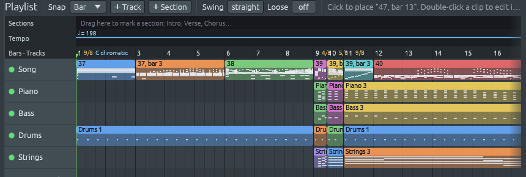

# An orchestra for music that changes meter

Files: [`crates/lineup-core/src/library/rhythm.rs`](https://github.com/naelolaiz/ferrous-lineup/blob/main/crates/lineup-core/src/library/rhythm.rs),
[`crates/lineup-core/src/library/style.rs`](https://github.com/naelolaiz/ferrous-lineup/blob/main/crates/lineup-core/src/library/style.rs),
[`crates/lineup-core/src/library/apply.rs`](https://github.com/naelolaiz/ferrous-lineup/blob/main/crates/lineup-core/src/library/apply.rs),
[`crates/lineup-core/src/band.rs`](https://github.com/naelolaiz/ferrous-lineup/blob/main/crates/lineup-core/src/band.rs),
[`crates/lineup-core/src/library/song/classical.rs`](https://github.com/naelolaiz/ferrous-lineup/blob/main/crates/lineup-core/src/library/song/classical.rs),
[`crates/lineup-core/src/project.rs`](https://github.com/naelolaiz/ferrous-lineup/blob/main/crates/lineup-core/src/project.rs)
and [`crates/lineup-app/src/library_browser.rs`](https://github.com/naelolaiz/ferrous-lineup/blob/main/crates/lineup-app/src/library_browser.rs)

Open a simple demo, say **Old MacDonald Had a Farm**, and the
**Library** lights up the style that matches it, Afropop. Click it, click **Apply**, and a band
comes in: a piano, a bass and drums playing the song's chords. The
demos of [the concert hall](concert-hall.md) had nothing lit. The Rite
of Spring, Petrushka, Boléro and the others had no matching style, and
any style you picked did more harm than good: the
**Ritual of Abduction** changes meter 32 times in 67 bars, and a style
in 4/4 turned all of it into 4/4, at the style's tempo, with the
score's own parts muted.

Now these demos have a style of their own, **Orchestra**. It plays
every bar in that bar's meter, keeps the song's time signatures and
tempo, and plays along with the score instead of muting it. It is the
matching style of the eleven concert hall demos: Promenade, the
*Pathétique* waltz in five, Boléro, La Mer, the Augurs of Spring, the
Ritual of Abduction and the five Petrushka demos.

## Trying it

1. Open **File > Demos**, type `Augurs` in the search box and press
   Enter: **The Rite of Spring, The Augurs of Spring** opens and plays.
   Stop it.
2. Click **Library** above the pattern list. **Orchestra (any meter)**
   is lit, the way a matching style always is. "Any meter" says the
   style is in no time signature of its own.

   

3. Click it. Under **Timing** there are no Time signature and Tempo
   boxes any more, only a line that says the preset keeps the song's
   time signatures and tempo.

   

4. Click **Apply**. Four tracks appear under the song: **Piano**,
   **Bass**, **Drums** and **Strings**. The Song track stays on, the
   Time box still says 2/4 and the tempo still says 112.
5. Press Play. On every bar the horns strike the chord, the timpani
   play its root, the strings hold it and the bass drum marks the bar,
   under Stravinsky's stamping strings.

Now do the same with **The Rite of Spring, Ritual of Abduction**, which
starts in 9/8 at Stravinsky's dotted quarter = 132 (the tempo box
shows 198, the same speed counted in quarter notes) and goes through 4/8, 5/8,
12/8, 6/8, 7/8, 3/4, 2/8 and more. The tracks are cut into short clips,
one for each run of bars in one meter, and each clip plays its bars the
way that meter is felt.



The orchestra plays the chords the app recognised in the score, the
ones on the chord sheet (**F5**). Where no chord was recognised, as in
the first eight bars of the Ritual, only the bass drum plays. If you
tick **Chord progression** in the popup, it plays its own chords
instead, I and ♭VII of the Mixolydian mode, the way a style's
progression always replaces the song's chords.

## The music

### Felt beats

A bar of 9/8 has nine eighth notes, but nobody counts nine. The
eighths come in three groups of three, and you feel three beats, each a
dotted quarter long. A bar of 5/8 has five eighths in two beats, a
short one of two and a long one of three. A bar of 2/4 at a fast tempo
goes by as a single beat. [Odd meters](odd-meters.md) calls these the
*felt* beats, and `TimeSignature::felt_groups` gives them for any time
signature.

A conductor beats the felt beats, not every eighth: in the Ritual, three
beats for a bar of 9/8, two for 5/8, one for 2/8. In music whose meter
changes all the time, that is what keeps an orchestra together, and it
is what the Orchestra style plays:

| Meter | Felt as | The bass drum plays on eighth (or quarter) |
|---|---|---|
| 2/8, 3/8, 2/4, 3/4 | one beat | 1 |
| 4/8 | 2 + 2 | 1 and 3 |
| 5/8 | 2 + 3 | 1 and 3 |
| 6/8 | 3 + 3 | 1 and 4 |
| 7/8 | 2 + 2 + 3 | 1, 3 and 5 |
| 9/8 | 3 + 3 + 3 | 1, 4 and 7 |
| 12/8 | 3 + 3 + 3 + 3 | 1, 4, 7 and 10 |
| 4/4 | 2 + 2 | quarters 1 and 3 |

The bass drum hits the first beat of the bar hard and the others
softly. The horns strike the chord on each of those beats and the
timpani play its root; when a chord changes between two beats, they
play the new one where it starts.

### Why horns and timpani

The style needs a part that marks the harmony on the beat and a part
that marks the bass, the jobs a piano and a bass guitar do in a band.
In an orchestra those jobs have long gone to the horns and the
timpani: in a symphony by Haydn or Beethoven, the loud chords that
close a phrase are the horns and trumpets playing the harmony while the
timpani strike the tonic or the dominant underneath. The strings hold
each chord for as long as it lasts, the way a band's string pad does
([A bigger band](bigger-band.md)).

The orchestra plays *along* with the score. In a pop demo the band
mutes the song's own chords and bass, because two pianos playing the
same chords in two different voicings sound like a mistake. In the
Rite, the song's parts *are* the piece: muting them would leave only
the band. So the Orchestra comes in on top, and every channel of the
score keeps its own mute.

## How it works

### A rhythm that follows the meter

A rhythm in the library is written in one time signature: its drum
lines are bars of steps, `X... .... o... ....` for a bar of 4/4, where
`X` is a hard hit, `o` a soft one and `.` silence. The band lays a
line out bar after bar, and in a song with time markers it writes each
run of bars in one meter as a pattern of its own.

The Orchestra rhythm has one line, that 4/4 bar for the kick, and a new
flag on `Rhythm`:

```rust
pub struct Rhythm {
    // ...
    pub follows_the_meter: bool,
}
```

The rhythms are built by a `const fn rhythm(...)`, and a builder method
sets the flag, the same way `swung` sets the swing:

```rust
const fn following_the_meter(self) -> Rhythm {
    Rhythm {
        follows_the_meter: true,
        ..self
    }
}
```

`..self` is *struct update syntax*: every field not named takes its
value from `self`. A `const fn` can do it because it only moves
values, so the whole table of rhythms is still built at compile time.

Drum notes for a bar now come from `Rhythm::notes_in(drum, time,
length)`. For an ordinary rhythm it does what it always did. For one
that follows the meter it first writes the line again for `time`:

```rust
fn in_meter(line: &str, own: TimeSignature, time: TimeSignature) -> String {
    // the hit on the first beat, and the hit on the second felt beat,
    // of the line's own bar...
    let mut bar = vec!['.'; time.steps_per_bar()];
    for (index, start) in felt_starts(time).into_iter().enumerate() {
        if let Some(step) = bar.get_mut(start) {
            *step = if index == 0 { first } else { other };
        }
    }
    bar.into_iter().collect()
}
```

`felt_starts(time)` turns the felt groups into steps: a group of three
eighths is three times `time.unit_steps()`, the steps one eighth lasts.
For 9/8 that gives steps 0, 6 and 12, and the 4/4 bar's `X` and `o`
land there: `X.....o.....o.....`.

A rhythm that follows the meter has no time signature of its own, so
`Rhythm::for_time`, which picks a rhythm for a song's new time
signature (see [Odd meters](odd-meters.md)), never picks it.

### A style that follows the song

A style knows whether it follows the song by asking its rhythm:

```rust
pub fn follows_the_song(&self) -> bool {
    super::Rhythm::named(self.rhythm).is_some_and(|rhythm| rhythm.follows_the_meter)
}
```

`Option::is_some_and` is `true` only when there is a value and the
closure says yes for it, so a style whose rhythm is missing does not
follow anything.

Applying a style used to put the song in the style's time: a function
called `remeter` laid every bar out again in the style's one meter.
Now the parts to apply, `StyleParts`, have a step that drops the time
signature and the tempo when the style follows the song:

```rust
pub fn following(mut self, follows: bool) -> Self {
    if follows {
        self.time_signature = false;
        self.tempo = false;
    }
    self
}
```

The library click and the band menu on the chord sheet both go
through it, so neither re-meters the Rite. The chord sheet's menu of
styles for a section, which only offers styles in the bar's own time
signature, now offers the Orchestra in any meter too. In the
app the same flag swaps the Timing boxes for the line you saw in the
popup, and the Library adds "(any meter)" to the style's name.

### 999 patterns

The band writes a pattern for each player and each run of bars in one
meter. Two runs can share a pattern when they play the same notes, as
the drums of two runs of 9/8 do, but the chords change from run to
run. The Ritual of Abduction has 33 runs and the band four players, on
top of the score's own patterns, and a project could hold only 99
patterns. Once the limit was reached the band quietly stopped
writing, and whole stretches of the Ritual had no drums. The limit is
now 999 (`MAX_PATTERNS` in `project.rs`). The twelve-tone window,
which says when a row would need more patterns than a project can
hold, now reads the number from `MAX_PATTERNS` instead of saying 99.

## Checking it

Two tests in `band.rs` apply the Orchestra to the Rite. One checks
that the Ritual keeps every meter change, its tempo changes and every
channel's mute, that the players are a French horn, timpani and a
string ensemble, and that the bass drum plays exactly the felt beats of
every bar, hard on the first and soft on the others. The other picks
the Orchestra for the Augurs from the band menu and then picks
**Pop beat**: the first keeps 2/4, the second puts the song in 4/4, as
before.

To hear it without listening, save the Ritual after **Apply** and read
its [playback trace](playback-trace.md):

```sh
ferrous-lineup --trace ritual.lineup --out ritual.tsv
awk -F'\t' '$11 == "Kick" { print $9, $4, $16 }' ritual.tsv | sort | uniq -c
```

Column 9 is the meter, 4 the beat and 16 the velocity:

```text
     26 9/8 1 120
     26 9/8 2 56
     26 9/8 3 56
     15 6/8 1 120
     15 6/8 2 56
      5 5/8 1 120
      5 5/8 3 56
      1 7/8 1 120
      1 7/8 3 56
      1 7/8 5 56
      ...
```

The trace counts dotted quarters as the beats of 6/8 and 9/8, and
eighths as the beats of 5/8 and 7/8, so this is the table above: three
beats in each of the 26 bars of 9/8, the first one hard, and the 5/8
bars on eighths 1 and 3. Every band note in the traces of the Ritual,
the Augurs and the Moor's Room starts exactly on a beat, and none is
late.

## Exercises

1. Apply the Orchestra to **The Rite of Spring, The Augurs of Spring**
   and mute the **Song** track. Count along with the bass drum: how
   many beats does it give each bar of 2/4? Unmute the song and listen
   for where the strings' stamping accents fall against it.
2. Open **Petrushka, The Moor's Room**, apply the Orchestra and find the
   bar of 13/16 in the ruler. On which sixteenths does the bass drum
   play there? Check your answer in the playback trace.
3. With the Orchestra playing the Ritual of Abduction, pick **Pop beat**
   from the chord sheet's band menu. What happens to the ruler, and
   why does a style in 4/4 have to do that?
4. Work out by hand the line `in_meter` writes for a bar of 7/8 from the
   Orchestra's `X... .... o... ....`, using the felt groups 2 + 2 + 3.
   Then write a test for it next to
   `a_rhythm_that_follows_the_meter_plays_each_bar_in_its_own` in
   `rhythm.rs`.
