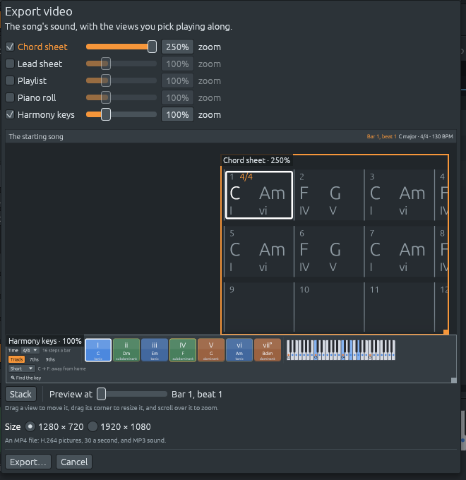
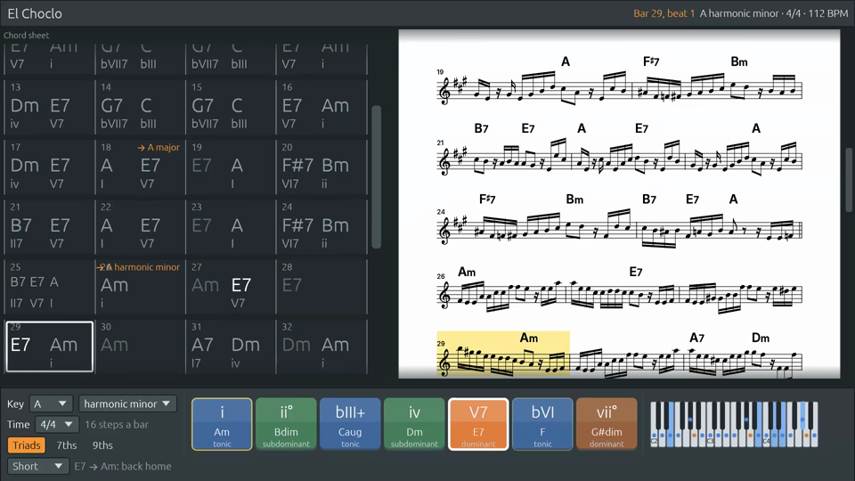

# Export video: the song with the views playing along

Files: [`crates/lineup-video/`](https://github.com/naelolaiz/ferrous-lineup/tree/main/crates/lineup-video),
[`crates/lineup-app/src/video.rs`](https://github.com/naelolaiz/ferrous-lineup/blob/main/crates/lineup-app/src/video.rs),
[`crates/lineup-app/src/app/video.rs`](https://github.com/naelolaiz/ferrous-lineup/blob/main/crates/lineup-app/src/app/video.rs)

A WAV file carries the song, but not the harmony you see while it
plays. **File › Export video…** saves an MP4 file with the sound and
the views you pick following the music: the bar playing framed in the
chord sheet, the chord lit in the harmony keys, the playhead moving
across the playlist and the piano roll, and each key change shown as
it comes.


## Using it

1. Open a song (or a demo) and choose **File › Export video…**.
2. Tick the views to show:
   - **Chord sheet**: the harmony bar by bar.
   - **Lead sheet**: the tune on a staff.
   - **Playlist**: the tracks and their clips.
   - **Piano roll**: the notes of the channel it has selected, or the tune.
   - **Harmony keys**: the chords of the key and the little piano.

   The ticked views share the picture, one above the other. A title bar
   on top names the song, the bar and beat, the key, the time and the
   tempo.
3. Arrange them on the preview, if you like (see below).
4. Pick a size: **1280×720** (HD) or **1920×1080** (Full HD). Full HD
   draws the same layout one and a half times bigger, so the text is
   sharper but nothing more fits.
5. Click **Export…** and choose where to save the `.mp4` file.

The export runs in the background, with its progress in the status bar
and a **Stop** button beside it. A stopped export leaves no file
behind. The dialog remembers your choices for next time.


## Arranging the views

The dialog shows a preview: the picture the video will have at the bar
you pick with **Preview at**. Each view on it has a frame with its name
and zoom:

- **Drag a view** to move its box.
- **Drag its corner** (the small square) to resize the box.
- **Scroll over it** to zoom in or out, from 50% to 250%. The slider
  next to each view's tick does the same.
- **Stack** puts the views back one above the other, sharing the
  picture. Ticking a view on or off stacks them too.

Boxes may overlap: the view lower in the list is drawn on top. The lead
sheet has no zoom: it always fills the width of its box, so a wider box
draws it bigger. The dialog remembers the layout for the next video.



Here the chord sheet, zoomed to 140%, sits beside the lead sheet, with
the harmony keys at 120% below:



## Nothing to install

The usual way to make a video from a program is to hand pictures to
FFmpeg. But FFmpeg is a separate program that Windows and macOS don't
have, so every user would have to install it. Instead, the app builds
two well-known encoders from their C sources along with itself, through
two crates:

| What | Format | Encoder | Crate |
|------|--------|---------|-------|
| Pictures | H.264, 30 a second | Cisco's OpenH264 (BSD licence) | `openh264` |
| Sound | MP3, 256 kbit/s stereo | LAME (LGPL) | `mp3lame-encoder` |
| Both together | MP4 | written by hand, about 500 lines | (ours) |

A crate with C inside has a `build.rs` that runs a C compiler before
Rust compiles the rest, using the [`cc`](https://docs.rs/cc) crate.
The CI matrix already builds on Linux, Windows and
both kinds of Mac, so it proves this works everywhere.

H.264 and MP3 are not the newest formats. They were picked because
every player, phone, browser and video site reads them.

## The new crate: `lineup-video`

The crate knows nothing about songs. It takes pictures and sound and
writes a file:

```rust
let mut writer = VideoWriter::create(&path, settings)?;
for each picture {
    writer.add_picture(&rgba)?;      // or writer.repeat_picture()
    writer.add_sound(&samples)?;     // what plays while it is shown
}
writer.finish()?;
```

It has four modules:

- **`canvas`** paints egui's shapes into a picture in memory (see
  below).
- **`h264`** turns each picture into H.264. The pictures arrive as RGB
  and the encoder wants YUV: brightness for every pixel, and colour for
  every square of four, because the eye sees detail in brightness much
  better than in colour. After the first picture, the encoder only
  stores what changed. A screen where only a frame moves costs almost
  nothing. Every two seconds there is a *key picture* that stands on
  its own, so a player can jump.
- **`mp3`** turns the sound into MP3 *frames* of 1152 samples each, and
  cuts them apart by reading each frame's 4-byte header.
- **`mp4`** writes the file.

`VideoWriter::create` writes to `name.mp4.tmp` and renames it at the
end, so a failed export never replaces an older video with half a new
one.

## Inside an MP4 file

An MP4 file is a tree of **boxes**. Each box is a 4-byte length, a
4-letter name, and its contents, which may be more boxes:

```text
ftyp                 "this is an MP4 file"
mdat                 all the compressed pictures and sound, one after the other
moov                 the index:
  mvhd                 how long the whole thing lasts
  trak                 the pictures:
    tkhd, mdia …         size, clock, and the tables below
      avc1 + avcC          "H.264", and the encoder's parameter sets
      stts                 how long each picture is shown
      stss                 which pictures are key pictures
      stsz, stco           how big each one is, and where it is in mdat
  trak                 the sound:
    edts/elst            where the sound really starts (see below)
    mp4a + esds          "MP3"
    stts, stsz, stco     the same tables for the MP3 frames
```

The index has to come after the data. Until the end, nobody knows how
big each picture is or where it landed. So `Mp4Writer` writes `mdat`
as it goes, keeps a list of sizes and offsets, and writes `moov` in
`finish`. Then it goes back and fills in `mdat`'s length, as 64 bits,
since a long Full HD video can pass 4 GB.

`stts` stores *runs*: "300 pictures of 1/30 s each" takes one entry,
not 300. That's what makes skipping unchanged pictures cheap (see
below). `repeat_picture` just makes the last picture last 1/30 s
longer.

### Making the sound start on time

An MP3 encoder puts 576 samples of silence before the sound, and a
decoder adds 529 more. Without a fix, the music would be 25 ms late.
That's almost one picture, and enough to see a chord light up before
you hear it. The sound track's **edit list** (`elst`) tells the player
to skip those 1105 samples:

```rust
write_full_box(out, b"elst", 0, 0, |out| {
    out.extend_from_slice(&1_u32.to_be_bytes());               // one edit
    out.extend_from_slice(&(duration_ms as u32).to_be_bytes()); // as long as the song
    out.extend_from_slice(&format.priming.to_be_bytes());       // start 1105 samples in
    …
```

For the test, a click sound was exported at 1.0, 2.5 and 4.0 s, with a
white flash on the pictures at the same moments. After decoding the
file with FFmpeg, the clicks were at exactly 1.0, 2.5 and 4.0 s, and
the flashes on pictures 30, 75 and 120.

## Drawing the app without a window

The views are ordinary egui code. The chord sheet in the video *is*
the chord sheet in the app, through small `video` functions that call
the same drawing code without the menus. egui doesn't draw pixels
itself. Each frame, it turns the UI into a list of **triangles** with
colours and texture coordinates (the texture holds the font's letters).
In the app, `egui_glow` sends those triangles to the graphics card.

The export can't count on a graphics card, and it runs on a thread of
its own. So it makes a second `egui::Context` with no window, gives it
a made-up screen of 1280×720, and paints the triangles on the CPU in
`Canvas`:

```rust
let mut output = ctx.run_ui(input, |ui| self.ui(ui, at)); // lay out the views
let primitives = ctx.tessellate(output.shapes, ppp);      // into triangles
self.canvas.paint(primitives, &mut output.textures_delta, ppp, background);
```

To paint a triangle, you visit each pixel near it and ask "is this
pixel inside?". The test is the **edge function**: for an edge from A
to B, this cross product is positive on one side and negative on the
other.

```rust
fn edge(from: (i64, i64), to: (i64, i64), p: (i64, i64)) -> i64 {
    (to.0 - from.0) * (p.1 - from.1) - (to.1 - from.1) * (p.0 - from.0)
}
```

A pixel is inside when all three edges agree. The same three numbers,
divided by their total, say how close the pixel is to each corner. That
blends the corners' colours and texture coordinates, which is how
letters get their shapes. A few details make it match the screen:

- **Integers, 1/256 of a pixel.** Two triangles that share an edge
  must not both paint the pixels on it, or a half-transparent shape
  gets a darker seam. With whole numbers, the "top-left rule" settles
  ties exactly.
- **Premultiplied colours.** egui stores colours already multiplied by
  their opacity, and blends with `new + old × (1 − alpha)`, as its
  graphics-card shader does.
- **Stepping, not multiplying.** Moving one pixel right changes each
  edge function by a constant, so the inner loop adds instead of
  multiplying. For plain one-colour triangles (most of a UI), a fast
  path skips the texture altogether.
- **Threads.** The picture is cut into bands of rows, and each band is
  painted on its own core with `std::thread::scope`, which lets the
  threads borrow the picture because they all finish before it
  returns.

### A box for each view

Each view has a **pane**: an `egui::Context` of its own and a `Canvas`
the size of its box. Zoom works the way egui's own zoom does: the pane
tells its context there are more pixels to a point (1.4 times as many
at 140%), so egui lays the view out in fewer points and draws every
letter at the bigger size. If the view were drawn small and the picture
stretched instead, the letters would come out blurred.

```rust
let ppp = self.pixels_per_point;            // the picture's, times the zoom
let size = vec2(width as f32, height as f32) / ppp;
let mut input = egui::RawInput {
    screen_rect: Some(Rect::from_min_size(Pos2::ZERO, size)),
    ..
};
input.viewports.entry(egui::ViewportId::ROOT).or_default()
    .native_pixels_per_point = Some(ppp);
```

Each pane paints its own canvas. `Canvas::copy_from` then copies the
panes into the picture, in their boxes, under the title line. Moving a
box only copies again. A box whose size or zoom changed gets a new
canvas and is drawn twice, because egui measures some things on its
first frame.

Two details keep the views on the beat:

- **No gliding.** In the window, a view scrolls smoothly to the bar
  playing, taking about half a second. In a video that's half a second
  late, so the panes turn egui's scroll animation off and jump there.
- **No frame late.** A view that scrolls only moves on the next frame,
  and egui asks for one at once (a repaint delay of zero). The pane
  draws again within the same picture, so the bar shows on its first
  beat.

### Pictures that did not change

When a song is playing, most frames look like the one before: the
chord sheet only moves when the bar changes. `Canvas::paint` keeps the
last frame's triangles. If the new ones are equal (`Vec` of meshes
compared with `==`), it doesn't paint, the encoder doesn't run, and
the last picture just lasts longer. That and the faster rasterizer took
El Choclo (101 s) from 88 s to export down to 14 s.

## Keeping the picture with the sound

The song is played by the same off-line `Renderer` as a WAV export,
1/30 s at a time: at 44 100 samples a second, exactly 1470 samples a
picture. The pictures must show *where the music is*, and with tempo
changes, ritardandos and fermatas that isn't a simple sum. So the
renderer reports it. After each block of sound, the sequencer stores
its position in steps, the same number the app's playhead reads, and
`Renderer::position` returns it:

```rust
for picture in 0..pictures {
    let position = if picture == 0 { Some(0.0) } else { renderer.position() };
    match scene.draw(time, position) {
        Some(rgba) => writer.add_picture(rgba)?,
        None => writer.repeat_picture(),     // nothing changed
    }
    renderer.render(&mut sound);             // the next 1/30 s
    writer.add_sound(&sound)?;
}
```

The position counts steps *as played*. With a repeat or a song-form
chorus, that's not the place in the playlist. `Scene::draw` maps it
back with the song's arrangement (`pass_at`), as the app does for its
playhead.

To check, El Choclo was exported and the loudness was measured every
10 ms. At 112 BPM in 4/4, bar 15 starts at 30.0 s, bar 29 at 60.0 s
and bar 43 at 90.0 s. The notes start at exactly those times, and the
pictures there show "Bar 15, beat 1", "Bar 29, beat 1" and "Bar 43,
beat 1".

## What to try

- Export a demo with only the **chord sheet** and **harmony keys**.
  It's a play-along video for practising the changes.
- Export with the **lead sheet** to watch the tune as it's sung or
  played.
- Open the file in any player and jump around. A key picture every
  two seconds means it starts drawing at once.
